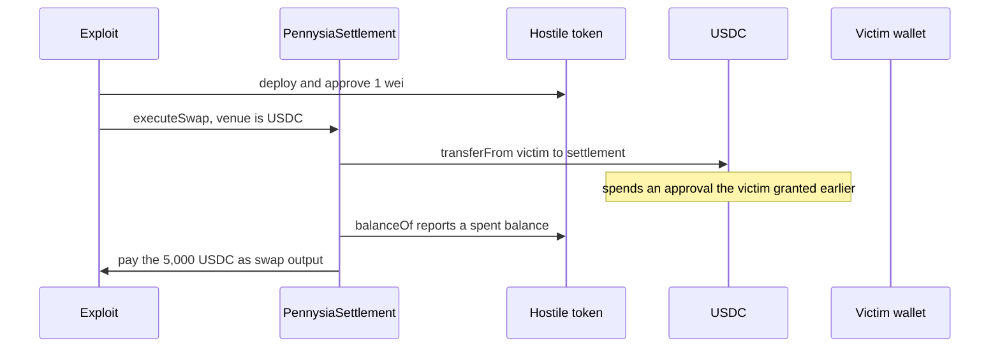

# Pennysia — `executeSyncAttempt` calls attacker calldata and pays out someone else's USDC

> **Vulnerability classes:** vuln/dependency/unsafe-external-call · vuln/access-control/missing-auth
> **Reproduction:** the PoC compiles and runs in an isolated Foundry project at [this project folder](.). Full verbose trace: [output.txt](output.txt). The trace forks Ethereum mainnet at block 26,399,313 and `[PASS] testExploit` takes 5,000 USDC. `[PASS] testControlHonestTokenDoesNotPay` reverts `AllSoftAttemptsFailed` and leaves the victim untouched.

---

## Key info

| | |
|---|---|
| **Profit** | **5,000 USDC** from one wallet that had already approved the settlement contract. The incident transaction also took 6.133489 USDC, 0.05 wstETH, and 101,000 YUNO from three other wallets. SlowMist put the combined loss near **$5.1K** |
| **Settlement** | PennysiaSettlement [`0x3aad97e5a91b8e43b7dc830aceb004307678795e`](https://etherscan.io/address/0x3aad97e5a91b8e43b7dc830aceb004307678795e), verified, solc 0.8.36 |
| **Victim in this replay** | [`0xf2ff84d45783bd64913903516fa44b419f266998`](https://etherscan.io/address/0xf2ff84d45783bd64913903516fa44b419f266998) |
| **Incident attacker** | [`0x813a5ab666adeba907548235fbac087642878300`](https://etherscan.io/address/0x813a5ab666adeba907548235fbac087642878300) |
| **Incident tx** | [`0x2716c50e450272240f68f2827bcb4a336c2ac520951e0e530154566c295b732d`](https://etherscan.io/tx/0x2716c50e450272240f68f2827bcb4a336c2ac520951e0e530154566c295b732d), block 26,399,314 |
| **Chain / block** | Ethereum mainnet / fork block **26,399,313** / 2026-11-12 |
| **Bug class** | `venue.call(callData)` plus a spend check on a caller-chosen token |

## TL;DR

PennysiaSettlement is a swap router. Users approve it once so later swaps can pull the token they are selling. `executeSwap` tries caller-supplied routes. A SYNC route names a `venue` and raw `callData`. The contract calls that venue, then checks that its balance of `spendAs` went down and its balance of `buyToken` went up. Whatever buy-token increase it measures is paid to the caller.

Nothing requires the venue to be a DEX. The attacker sets the venue to USDC and the calldata to `transferFrom(victim, settlement, 5000e6)`. The settlement contract is the caller, so the victim's old approval is spent and the USDC lands in the settlement contract. `spendAs` is a token the attacker just deployed. Its `balanceOf` returns a smaller number once that USDC arrives, so the spend check passes. The contract then transfers the 5,000 USDC to the attacker as if it were swap output.

An honest token, whose balance does not drop, makes the same route revert `AllSoftAttemptsFailed`. The victim's USDC does not move. The approval is not the bug. The bug is that the contract will call anything while it is the spender on those approvals.

## The call

Verified source, `SettlementSync.executeSyncAttempt`:

```solidity
uint256 spendBefore = TokenLib.balanceOfStrict(spendAs);
(bool ok,) = venue.call{value: venueValue}(step.callData);
if (!ok) revert SyncAttemptFailed();
```

## Diagrams



## Remediation

1. Allowlist venues. Do not accept arbitrary calldata from a contract that holds user approvals.
2. Reject `transferFrom` and other third-party pull selectors even if a venue allowlist is added later.
3. Do not treat `balanceOf` of a caller-chosen token as proof that a swap spent the input.
4. Users who approved `0x3aad97e5a91b8e43b7dc830aceb004307678795e` should revoke that approval. The team later set `swapEnabled` to false. Revocation is still what stops a later call.

## How to reproduce

Offline, from this folder:

```bash
bash ../_shared/run-poc/run_poc.sh 2026-11-Pennysia_exp -vv
```

`testExploit` asserts the victim loses 5,000 USDC and the exploit receives it. `testControlHonestTokenDoesNotPay` asserts the same route with an honest token reverts and the victim balance is unchanged.
