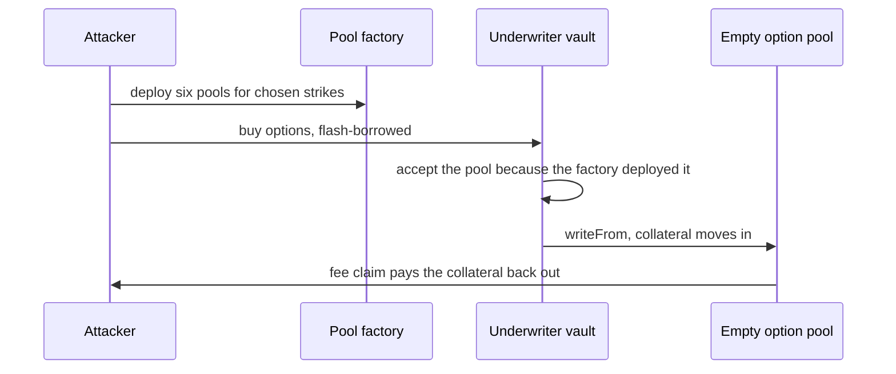

# Premia — underwriter vaults write collateral into any factory-deployed pool

<!-- non-defihacklabs -->

> **Vulnerability classes:** vuln/logic/missing-validation · vuln/defi/option-settlement
> **Reproduction:** the PoC compiles and runs in an isolated Foundry project at [this project folder](.). Full verbose trace: [output.txt](output.txt). The trace forks Arbitrum at block 520,166,284 and `[PASS] testExploit` drains six underwriter vaults. The attacker receives 191.765701446000165594 ETH.

---

## Key info

| | |
|---|---|
| **Loss** | WBTC call vault **3.64410382 WBTC**, WETH call vault **43.472545677315167985 WETH**, ARB call vault **46,215.428616328829808000 ARB**, WBTC put vault **20,215.067131 USDC.e**, WETH put vault **21,333.613826 USDC.e**, ARB put vault **6,930.677768 USDC.e** |
| **Vault implementation** | UnderwriterVault [`0xb539ff8563974d407fd6d717ff2f930e99093d21`](https://arbiscan.io/address/0xb539fF8563974D407Fd6d717ff2f930e99093d21) |
| **Attacker** | [`0xbeba8cefd0d75d747c5ad966dc17c0bb60d84dbd`](https://arbiscan.io/address/0xbeBa8CEfD0D75d747C5AD966Dc17C0Bb60D84dBd) |
| **Attack contract** | [`0x577168c8c6fa937495c3d6961f1d7d734b2d785f`](https://arbiscan.io/address/0x577168C8c6fA937495C3D6961f1d7D734b2d785f) |
| **Attack txs** | setup [`0xe3c263fcae544954367998e48e13112875cfd38a3b9a240e7818bb96313831f5`](https://arbiscan.io/tx/0xe3c263fcae544954367998e48e13112875cfd38a3b9a240e7818bb96313831f5), drain [`0x64602cbbeba5d3c7a5e2cff4f98cc118886fc6051c56fa50458abec2c90441ac`](https://arbiscan.io/tx/0x64602cbbeba5d3c7a5e2cff4f98cc118886fc6051c56fa50458abec2c90441ac), drain [`0xd7e8086df0570c5389ca27eb9bcdff290e810c094155b410a42e5bad2b3244ff`](https://arbiscan.io/tx/0xd7e8086df0570c5389ca27eb9bcdff290e810c094155b410a42e5bad2b3244ff) |
| **Chain / block / date** | Arbitrum / fork block **520,166,284** / 2026-11-01 |

## TL;DR

A Premia underwriter vault sells options and posts the collateral with `IPool.writeFrom`. The only check on the pool is that Premia's factory has deployed a contract for that strike and maturity. The factory will deploy a pool for any key. The pool does not need open interest, liquidity, or a previous trade.

The setup transaction sends 0.01 ETH and creates six empty pools through that factory. The next two transactions flash-borrow from Balancer and buy options from the WBTC, WETH, and ARB call and put vaults. Each vault writes its collateral into the attacker's pool. The pool's fee accounting then pays that collateral back to the attacker. The attacker finishes with 191.765701446000165594 ETH.

## The check

`_getPoolAddress` returns the factory address whenever `isDeployed` is true. `_getQuoteInternal` reverts only when the address is zero. The trade then calls `writeFrom` on that pool.

```solidity
(address pool, bool isDeployed) = IPoolFactory(FACTORY).getPoolAddress(_poolKey);
return isDeployed ? pool : address(0);
```

```solidity
quote.pool = _getPoolAddress(l, args.strike, args.maturity);
if (revertIfPoolNotDeployed && quote.pool == address(0)) revert Vault__OptionPoolNotListed();
```

```solidity
IPool(quote.pool).writeFrom(address(this), msg.sender, size, referrer);
```

## Diagrams



## Remediation

1. Do not treat "the factory deployed this address" as proof the pool is a market the vault should underwrite.
2. Require a vault-controlled allowlist of pool addresses, or require the pool to have been listed by the vault owner before `writeFrom`.
3. Refuse `writeFrom` into a pool whose short and long supply are both zero and whose only counterparty is the buyer.

## How to reproduce

Offline, from this folder:

```bash
bash ../_shared/run-poc/run_poc.sh 2026-11-Premia_exp -vv
```

`testExploit` replays the setup call and both drain calls at their original blocks and timestamps. It asserts each vault's token loss and that the attacker's ETH balance rises.
