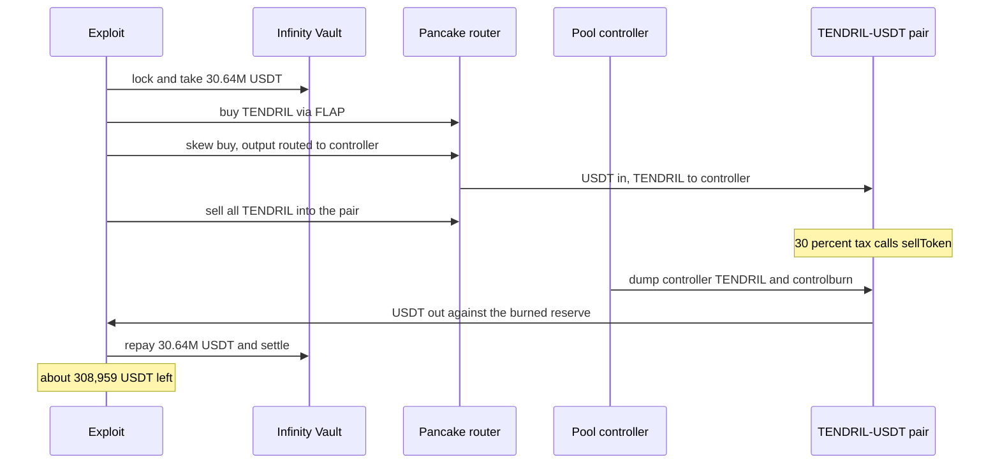

# TENDRIL — the 30% sell tax calls `sellToken`, which burns the pair before the seller's input arrives

> **Vulnerability classes:** vuln/defi/fee-manipulation · vuln/oracle/spot-price · vuln/logic/missing-check
> **Reproduction:** the PoC compiles and runs in an isolated Foundry project at [this project folder](.). Full verbose trace: [output.txt](output.txt). The trace forks BNB Chain at block 131,653,426 and `[PASS] testExploit`.

---

## Key info

| | |
|---|---|
| **Profit** | **308,959.367543173232679069 USDT** left on the exploit after repaying a 30,641,402 USDT flash take. The pair's USDT reserve ends under 1 USDT. Headline figures were about **$555K** drained from the pair |
| **TENDRIL** | [`0xb1afdfd850da168f2cc9f742e11cdda5273973d2`](https://bscscan.com/address/0xb1afdfd850da168f2cc9f742e11cdda5273973d2), verified |
| **TENDRIL/USDT pair** | [`0x5de082471f2a9f01a61e467a32837dee830d99e0`](https://bscscan.com/address/0x5de082471f2a9f01a61e467a32837dee830d99e0) |
| **Pool controller** | [`0xd00be871eb7a5cb8a69aea41e4c95affc92e54fe`](https://bscscan.com/address/0xd00be871eb7a5cb8a69aea41e4c95affc92e54fe), unverified |
| **Attacker EOA** | [`0xb81e4aafa347b27112b7f6f5de6cf7cd516021ff`](https://bscscan.com/address/0xb81e4aafa347b27112b7f6f5de6cf7cd516021ff) |
| **Attacker contract** | [`0xc8cb6a2aa825a576e1470479046056fe414ee0f8`](https://bscscan.com/address/0xc8cb6a2aa825a576e1470479046056fe414ee0f8), held the pre-bought TENDRIL |
| **Exploit tx** | [`0xfdff4fba4327821c204af07944076ecaaee163a994398fdf4063d08712e40059`](https://bscscan.com/tx/0xfdff4fba4327821c204af07944076ecaaee163a994398fdf4063d08712e40059) |
| **Flash source** | PancakeSwap Infinity Vault [`0x238a358808379702088667322f80ac48bad5e6c4`](https://bscscan.com/address/0x238a358808379702088667322f80ac48bad5e6c4) |
| **Chain / block** | BNB Chain / fork block **131,653,426** / 2026-11-04 |
| **Bug class** | A taxed transfer into the pair calls `_poolControl.sellToken(amount)`, which dumps and `controlburn`s the pair at the live spot with no reserve floor |

## TL;DR

TENDRIL taxes a non-privileged sell into its pair 30%. The tax is not only a fee. On every such transfer the token calls the pool controller's `sellToken`, and `sellToken` sells the controller's own TENDRIL into the pair and then burns about twice that amount out of the pair's TENDRIL reserve. There is no price guard. It trusts the spot reserves.

The attacker flash-takes 30.64M USDT, buys TENDRIL through the unrestricted USDT-FLAP-TENDRIL route (the main pair blocks a direct buy), and skews the main pair with a 4.10M USDT buy that the token routes to the controller. The following taxed sell makes `sellToken` burn the pair down. The untaxed 70% of that same sell swaps against the burned reserve and takes the USDT.

The pre-held TENDRIL (about 3.306e28 wei) is a real balance on the attacker's contract at the fork block, moved with `transfer`. It is not minted. The secondary pool that produced it is already empty at this block, so the test cannot re-buy it atomically.

## The hook

From the verified token, as recovered in the PoC header:

```solidity
} else if (to == _uniswapV2Pair) {
    if (from != _poolControl && from != _markControl) { tax = 30; }
}
if (tax > 0) {
    uint256 taxAmount = (amount * tax) / 100;
    _basicTransfer(from, _poolControl, taxAmount);
    IPancakeFactory(_poolControl).sellToken(amount); // auto-liquidation, no price guard
    amount -= taxAmount;
}
```

The playground marks the sell that triggers this hook:

```solidity
// @> VULN: the taxed sell calls sellToken, which dumps and burns the pair before this input arrives
ROUTER.swapExactTokensForTokensSupportingFeeOnTransferTokens(
    TENDRIL.balanceOf(address(this)), 0, p3, address(this), block.timestamp
);
```

## Diagrams



## Remediation

1. Remove the external `sellToken` call from the transfer hook, or limit it to a keeper with a deadline and a minimum output.
2. If an auto-sell stays, quote it against a reserve floor or a TWAP, and do not burn the pair below the reserves the in-flight swap still needs.
3. Do not run the hook before the pair has accounted the seller's input.

## How to reproduce

Offline, from this folder:

```bash
bash ../_shared/run-poc/run_poc.sh 2026-11-TENDRIL_exp -vv
```

`testExploit` asserts the pair's USDT reserve is under 1 USDT and the exploit's profit is within 0.1% of 308,959.367 USDT.
