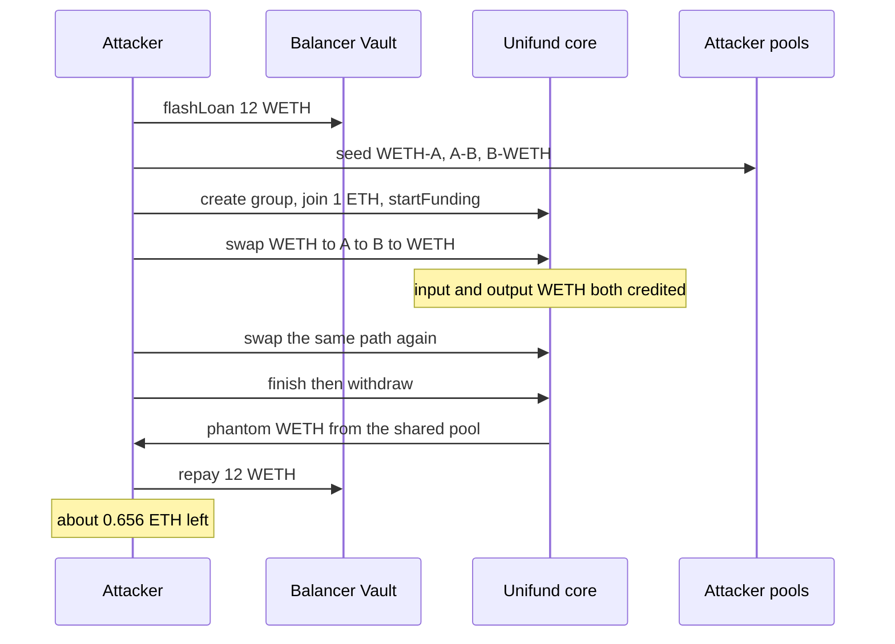

# Unifund — a cyclic swap path double-counts WETH, and `withdraw` pays the phantom from the core

> **Vulnerability classes:** vuln/logic/missing-validation · vuln/logic/state-update
> **Reproduction:** the PoC compiles and runs in an isolated Foundry project at [this project folder](.). Full verbose trace: [output.txt](output.txt). The trace forks Ethereum mainnet at block 26,388,566 and `[PASS] testExploit` plus `[PASS] testControlNonCyclic`.

---

## Key info

| | |
|---|---|
| **Profit** | **0.655850116316355546 ETH** net to the attacker after repaying a 12 WETH Balancer flash loan. The core loses **4.628136547384151187 WETH** of the **4.994488833099649474 WETH** it held |
| **Vulnerable contracts** | Unifund core [`0x152ad66bd57da8d539abaaf98d7c378621c36227`](https://etherscan.io/address/0x152ad66bd57da8d539abaaf98d7c378621c36227), unverified diamond. Swap facet [`0x489176b37cb9da4149940707ce39135adc41cec5`](https://etherscan.io/address/0x489176b37cb9da4149940707ce39135adc41cec5), unverified |
| **Attacker EOA** | [`0x6ee1702ca602ddab66f984aaebaac0451068f881`](https://etherscan.io/address/0x6ee1702ca602ddab66f984aaebaac0451068f881) |
| **Exploit tx** | [`0x5f1e276e99e63289dd4932ad18a96d7642cbdc92241652ee175271b3e63027a0`](https://etherscan.io/tx/0x5f1e276e99e63289dd4932ad18a96d7642cbdc92241652ee175271b3e63027a0) (one of five) |
| **Flash source** | Balancer V2 Vault [`0xba12222222228d8ba445958a75a0704d566bf2c8`](https://etherscan.io/address/0xba12222222228d8ba445958a75a0704d566bf2c8) |
| **Chain / block** | Ethereum mainnet / fork block **26,388,566** / 2026-11 |
| **Bug class** | `swapExactTokensForTokens` accepts `path[0] == path[last]` and books the WETH spent and the WETH received as two credits on one ledger key |

## TL;DR

Unifund lets a group swap its pooled funds along an arbitrary Uniswap V2 path. A path that starts and ends on WETH should net about zero WETH. The swap facet instead accounts the input leg and the output leg as separate deltas against the same group ledger key, so the round trip is recorded as a WETH gain. `finish()` then `withdraw()` pay that phantom balance out of the core's shared pool, which holds other groups' funds.

The whole sequence is reachable by a fresh contract. No role, no `vm.prank` of a protocol address, and no minted WETH: the 12 WETH working capital is a real Balancer flash loan, repaid in the callback. A control with the same setup and a non-cyclic path `WETH -> A -> B` does not drain the core.

The core and the swap facet are unverified, so the playground marks the cyclic `swapExactTokensForTokens` call in the exploit. The loss is measured on the core's real WETH balance.

## The call

```solidity
// test/Unifund_exp.sol — first of the two cyclic swaps
// @> VULN: a cyclic path WETH->A->B->WETH is booked as a WETH gain instead of a net of about zero
UNIFUND.swapExactTokensForTokens(groupId, 1e15, 0, path, block.timestamp);
```

`path` is `WETH, A, B, WETH`. `A` and `B` are scratch ERC20s the attacker deploys, and the three Uniswap V2 pairs are seeded so the round trip is routable. The ids on the real selectors are `uint64` and three `create` params are `uint16`. A `uint256` interface hits the wrong facet and reverts.

## Diagrams



## Remediation

1. Reject a path whose first and last token are equal, or net the two WETH deltas before crediting the group.
2. Pay `withdraw` only from that group's own balance, not from a shared core balance that other groups funded.
3. Verify and publish the diamond facets so the accounting can be checked against the interface.

## How to reproduce

Offline, from this folder, with the committed `anvil_state.json`:

```bash
bash ../_shared/run-poc/run_poc.sh 2026-11-Unifund_exp -vv
```

`testExploit` asserts the core drop is about 4.628 WETH. `testControlNonCyclic` runs the same body on `WETH -> A -> B` and asserts the core is not drained.
