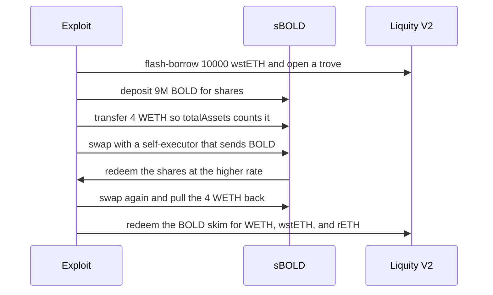

# sBOLD — swap credits BOLD that the approved collateral never paid for

> **Vulnerability classes:** vuln/defi/share-inflation · vuln/logic/swap-check
> **Reproduction:** the PoC compiles and runs in an isolated Foundry project at [this project folder](.). Full verbose trace: [output.txt](output.txt). The trace forks Ethereum mainnet at block 26,441,928 and `[PASS] testExploit` plus `[PASS] testControl_DepositRedeemNoProfit`.

---

## Key info

| | |
|---|---|
| **Loss** | **4.219135442551128639 WETH**, **5.768363658222702678 wstETH**, and **0.388632737229426117 rETH** on one representative transaction. The campaign is reported near **$3.43M** across about 34 transactions |
| **Vault** | sBOLD [`0x50bd66d59911f5e086ec87ae43c811e0d059dd11`](https://etherscan.io/address/0x50Bd66D59911F5e086Ec87aE43C811e0D059DD11) |
| **Example tx** | [`0xaa3c7f00c5e449abb4d871b3fdad91e44d6a61c7d83c36eff23faf783d4e84cf`](https://etherscan.io/tx/0xaa3c7f00c5e449abb4d871b3fdad91e44d6a61c7d83c36eff23faf783d4e84cf) |
| **Chain / block / date** | Ethereum mainnet / fork block **26,441,928** / 2026-11-18 |

## TL;DR

sBOLD is an ERC-4626 vault over Liquity V2 BOLD stability pools. `swap()` is permissionless. It approves a stability-pool token to a fixed 1inch v6 adapter and then only checks that the vault's BOLD balance rose by at least `minOut`. The adapter's generic swap lets the caller name the executor. The attacker names their own contract, which delivers BOLD from a Liquity trove. The approved collateral is not spent on the first swap, and the second swap pulls the prefunded WETH back out through the leftover approval.

Each cycle deposits 9,000,000 BOLD, transfers 4 WETH into the vault so `totalAssets` counts it, injects BOLD, redeems the shares at the higher rate, and recovers the 4 WETH. After eight cycles the skim is about 21,480 BOLD. Redeeming that BOLD through Liquity's collateral registry pays the three collateral tokens above, and the BOLD balance returns to about zero.

A deposit of 8,000,000 BOLD followed by a redeem, with no swap, returns less than was deposited.

## The call

```solidity
// The vault approves collateral, then accepts any BOLD balance increase.
SBOLD.swap(sd, address(this)); // @> VULN: the executor delivers BOLD the collateral did not pay
```

## Diagrams



## How to reproduce

Offline, from this folder:

```bash
bash ../_shared/run-poc/run_poc.sh 2026-11-sBOLD_exp -vv
```

`testExploit` asserts the three collateral nets. `testControl_DepositRedeemNoProfit` asserts a plain deposit and redeem does not profit.
