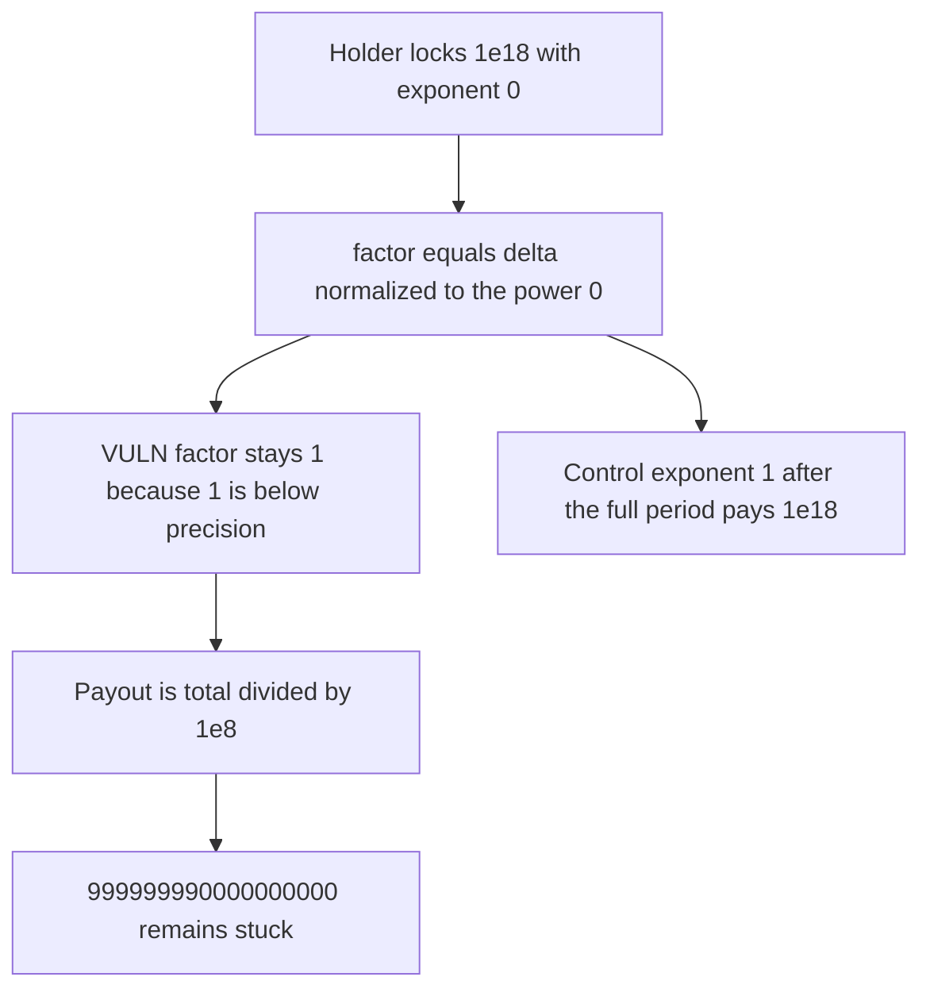

# Zerem: unlockExponent 0 leaves all but total/1e8 stuck

> **Vulnerability classes:** `vuln/dos/frozen-funds` · `vuln/logic/incorrect-state-transition`

<!-- non-defihacklabs -->
<!-- source-auditvault: https://github.com/Auditware/AuditVault/blob/main/findings/20308-h-01-the-unlockexponent-does-not-work-as-intended-when-it-is.md -->
<!-- date: 2022-11 -->

## Key info

| Field | Value |
|---|---|
| **Loss** | 999999990000000000 of a 1e18 lock stays in the vault. The holder is paid 1e10 |
| **Vulnerable contract** | `ZeremVault._getWithdrawableAmount` |
| **Attacker EOA** | `0x1111111111111111111111111111111111111111` |
| **Attack contract** | `Exploit` |
| **Attack tx** | `Exploit.run()` |
| **Chain / block / date** | Ethereum model · block 0 · 2022-11 |
| **Compiler** | solc 0.8.27, cancun, via IR |

## TL;DR

The README says `unlockExponent == 0` unlocks the full balance once `unlockDelaySec` has passed. The code sets `factor = deltaTimeNormalized ** unlockExponent`. Any value to the power 0 is 1, and 1 is below `precision` of 1e8, so `totalUnlockedAmount = totalAmount / 1e8`. A later claim computes the same number and pays 0. Waiting out the whole `unlockPeriodSec` does not help. Exponent 1 after that same period pays the full 1e18.

## The vulnerable code

```solidity
uint256 deltaTimeNormalized = (deltaTimeDelayed * precision) / unlockPeriodSec;
uint256 factor = deltaTimeNormalized ** unlockExponent;
if (factor > precision) { // @> VULN: exponent 0 leaves factor at 1, so this cap never restores a full unlock
    factor = precision;
}
totalUnlockedAmount = (totalAmount * factor) / precision;
```

Pashov recommended deleting the exponent or hardcoding the linear case. The client removed the exponent.

## Root cause

`**` is integer exponentiation. `n ** 0` is 1 for every `n`, including 0. Dividing by `precision` then keeps only one part in 1e8 of the lock. The cap only matters when the factor is too large, which is the separate early-unlock case for exponents above 1.

## Preconditions

- `unlockExponent` is 0, `precision` is 1e8, and `unlockPeriodSec` is 100000, as in the report.
- `unlockDelaySec` is 0, so the delay gate does not hide the math. The same shortfall remains after a warp of the full period in the control test.

## Attack walkthrough

1. The holder locks 1e18.
2. `claim` reads `_getWithdrawableAmount`.
3. The factor is 1. The cap does not raise it to 1e8.
4. The payout is 1e10.
5. The vault still holds 999999990000000000.
6. `claimed` equals the payout, so another claim pays nothing.

## Diagrams



## Impact

Every locker on an exponent-0 schedule can withdraw at most `total / 1e8`. The rest of the tokens cannot be claimed. That is the stuck-funds case in the report. The early-unlock case for exponent 2 is the same formula with a factor that saturates at `precision` after a small fraction of the period.

## Remediation

Remove `unlockExponent`, or treat 0 as "unlock everything after the delay" and keep exponent 1 as the only linear schedule. The control with exponent 1 and a full period returns the entire balance.

## How to reproduce

```bash
cd 20308-h-01-the-unlockexponent-does-not-work-as-intended-when-it-is_exp
forge test -vv
```

`test_exploit_exponent_zero_locks_all_but_one_over_precision` asserts the 1e10 payout and the stuck remainder. `test_control_exponent_one_unlocks_full_balance_after_the_period` warps one period and withdraws 1e18. `test_control_exponent_zero_still_stuck_after_the_full_period` shows the warp does not rescue exponent 0.

## Sources

- AuditVault finding: https://github.com/Auditware/AuditVault/blob/main/findings/20308-h-01-the-unlockexponent-does-not-work-as-intended-when-it-is.md
- Pashov report: https://github.com/solodit/solodit_content/blob/main/reports/Pashov/2022-11-01-Zerem.md
- The report quotes the factor math directly. The reduction keeps that expression.
