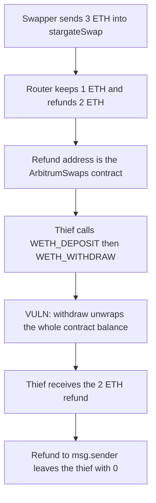

# Mugen ArbitrumSwaps — anyone unwraps the parked native refund

> **Vulnerability classes:** vuln/access-control/missing-auth · vuln/logic/wrong-condition

<!-- non-defihacklabs -->
<!-- source-auditvault: https://github.com/Auditware/AuditVault/blob/main/findings/20422-h-01-anyone-can-use-or-steal-arbitrumswaps-native-asset-bala.md -->
<!-- date: 2023-01 -->

## Key info

| | |
|---|---|
| **Protocol** | Mugen |
| **Finding** | Pashov H-01, AuditVault 20422 |
| **Vulnerable code** | `ArbitrumSwaps.arbitrumSwaps` steps `WETH_DEPOSIT` and `WETH_WITHDRAW`; `stargateSwap` refund address |
| **Harm** | A 3 ETH bridge keeps 1 ETH in flight and refunds 2 ETH to the router. The next caller takes that 2 ETH. |
| **Chain** | local synthetic |

## TL;DR

`stargateSwap` passes `address(this)` as Stargate's `_refundAddress`, so surplus native gas stays on `ArbitrumSwaps`. The contract is not supposed to hold ETH. `arbitrumSwaps` with `WETH_DEPOSIT` then `WETH_WITHDRAW` wraps the whole balance and sends it to an address the caller picks.

## The vulnerable code

```solidity
function stargateSwap() external payable {
    router.swap{value: msg.value}(payable(address(this)));
}

function arbitrumSwaps(uint8[] calldata steps, bytes[] calldata data) external payable {
    // WETH_DEPOSIT wraps address(this).balance
    // WETH_WITHDRAW:
    uint256 bal = weth.balanceOf(address(this));
    // @> VULN: unwraps the whole contract WETH balance to a caller-supplied address
    weth.withdraw(bal);
    (bool ok,) = to.call{value: address(this).balance}("");
    require(ok, "send");
}
```

The review's fix is to pass `msg.sender` as the refund address.

## Root cause

Two assumptions disagree. The swap steps treat every wei on the contract as the caller's, and the Stargate call makes the contract the refund recipient. A back-run of the refund is enough. No role is required.

## Preconditions

Some `stargateSwap` has left native ETH on `ArbitrumSwaps`. Here the swapper sends 3 ETH, the router keeps 1 ETH as the bridged amount, and 2 ETH is refunded to the contract.

## Attack walkthrough

1. The swapper calls `stargateSwap` with 3 ETH.
2. The router keeps 1 ETH and sends 2 ETH to `ArbitrumSwaps`.
3. The thief calls `arbitrumSwaps` with `WETH_DEPOSIT` and `WETH_WITHDRAW` aimed at the thief.
4. Deposit wraps 2 ETH. Withdraw unwraps 2 ETH and forwards it.
5. The thief holds 2 ETH. The router still holds the 1 ETH that was actually bridged.

The control refunds to `msg.sender`. The contract balance stays 0. The same two steps pay the thief 0.

## Diagrams



## Impact

Every native refund, and any ETH otherwise left on `ArbitrumSwaps`, is taken by the next caller of those two steps. In this reduction the loss is 2 ETH. The bridged 1 ETH is not taken.

## Remediation

Pass `msg.sender` as Stargate's refund address so the router does not accumulate a native balance.

## How to reproduce

```bash
cd 20422-h-01-anyone-can-use-or-steal-arbitrumswaps-native-asset-bala_exp
forge test -vv
```

## Sources

- AuditVault finding: https://github.com/Auditware/AuditVault/blob/main/findings/20422-h-01-anyone-can-use-or-steal-arbitrumswaps-native-asset-bala.md
- Pashov review: https://github.com/pashov/audits/blob/master/solo/md/Mugen-security-review.md
