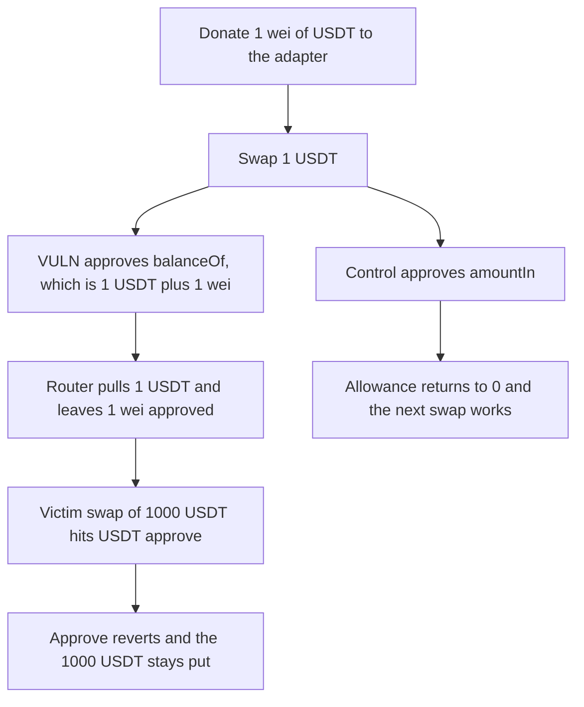

# Mugen: one wei of USDT dust makes every later USDT swap revert

> **Vulnerability classes:** `vuln/dos/griefing` · `vuln/dependency/unsafe-external-call`

<!-- non-defihacklabs -->
<!-- source-auditvault: https://github.com/Auditware/AuditVault/blob/main/findings/20423-h-02-malicious-user-can-easily-make-the-protocol-revert-on-e.md -->
<!-- date: 2023-01 -->

## Key info

| Field | Value |
|---|---|
| **Loss** | USDT swaps through the adapter revert. A 1,000 USDT swap does not move the victim's tokens |
| **Vulnerable contract** | `Adapter.swapExactInputSingle` |
| **Attacker EOA** | `0x1111111111111111111111111111111111111111` |
| **Attack contract** | `Exploit` |
| **Attack tx** | `Exploit.run()` |
| **Chain / block / date** | Ethereum model · block 0 · 2023-01 |
| **Compiler** | solc 0.8.27, cancun, via IR |
| **Bug class** | `approve(balanceOf)` leaves a non-zero USDT allowance, and USDT rejects the next approve |

## TL;DR

The adapter approves the router for `balanceOf(address(this))` instead of `amountIn`. Donating 1 wei and then swapping 1 USDT makes the balance `1e18 + 1`. The router pulls 1 USDT and leaves 1 wei of allowance. USDT reverts when `approve` changes a non-zero allowance to another non-zero value, so the next swap reverts. The victim's 1,000 USDT stays put. Approving `amountIn` returns the allowance to 0, and the second swap succeeds.

## Background

Pashov Audit Group, Mugen review, January 2023, finding H-02, in `UniswapAdapter.swapExactInputSingle` and the same pattern in `swapExactInputMultihop`. The report's attack is a 1 wei USDT donation, then `ArbitrumSwaps.arbitrumSwaps` with a 1 USDT input. This reduction keeps that sequence and a USDT mock of the non-zero-to-non-zero approve revert.

## The vulnerable code

```solidity
uint256 bal = usdt.balanceOf(address(this));
usdt.approve(address(router), bal); // @> VULN: balanceOf includes donated dust, so allowance is left non-zero
router.exactInput(amountIn);
```

The report's fix is to approve `amountIn` rather than the whole balance:

```diff
- safeApprove(token, router, IERC20(token).balanceOf(address(this)));
+ safeApprove(token, router, amountIn);
```

## Root cause

USDT's `approve` requires the current allowance to be 0 or the new amount to be 0. A balance-based approval is larger than the amount the router spends whenever the contract holds dust, so the allowance cannot return to 0 and the next approval reverts.

## Preconditions

- The token is USDT, or any token with the same approve rule.
- Anyone can transfer 1 wei to the adapter. The swap function is permissionless.
- A later user wants to swap USDT through the same adapter.

## Attack walkthrough

1. The attacker transfers 1 wei of USDT to the adapter.
2. The attacker swaps 1 USDT. The adapter balance is `1e18 + 1`.
3. `approve` writes that balance. The old allowance was 0, so USDT accepts it.
4. The router pulls 1 USDT. The allowance left is 1 wei.
5. The victim calls a 1,000 USDT swap. The adapter approves a non-zero amount while the allowance is 1, and USDT reverts.
6. The victim still holds 1,000 USDT. The control approves `amountIn`, the allowance returns to 0, and a second swap pulls the tokens.

## Diagrams



## Impact

After one dusted swap, every later USDT swap through this adapter reverts. The victim cannot move 1,000 USDT through the protocol. Other tokens are unaffected, which is why the review scored the impact as one widely used token rather than a full drain. The control processes both swaps.

## Remediation

Approve `amountIn`, not `balanceOf(address(this))`. If a balance-based approval is required, set the allowance to 0 before setting the new value, and do it with a token that allows that sequence.

## How to reproduce

```bash
cd 20423-h-02-malicious-user-can-easily-make-the-protocol-revert-on-e_exp
forge test -vv
```

`test_exploit_second_usdt_swap_reverts` asserts the second swap reverts, the allowance is 1 wei, and the victim still holds 1,000 USDT. `test_control_amount_in_approval_allows_the_second_swap` asserts the allowance is 0 after the first swap and the router receives both inputs.

## Sources

- AuditVault finding: https://github.com/Auditware/AuditVault/blob/main/findings/20423-h-02-malicious-user-can-easily-make-the-protocol-revert-on-e.md
- Pashov Mugen review: https://github.com/solodit/solodit_content/blob/main/reports/Pashov/2023-01-01-Mugen.md
- Quoted line: `UniswapAdapter` `safeApprove(..., balanceOf(address(this)))`
