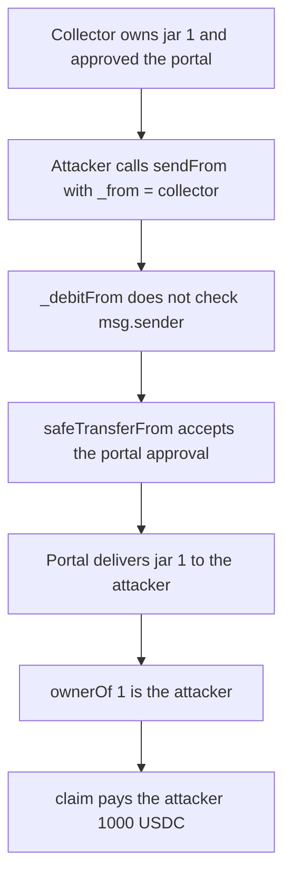

# Bearcave HoneyJarPortal — anyone can pull jars the portal is approved for

> **Vulnerability classes:** vuln/access-control/missing-owner-check · vuln/access-control/missing-auth

<!-- non-defihacklabs -->
<!-- source-auditvault: https://github.com/Auditware/AuditVault/blob/main/findings/20529-c-01-anyone-can-steal-all-honeyjar-nfts-in-honeyjarportal-an.md -->
<!-- date: 2023-03 -->

## Key info

| | |
|---|---|
| **Protocol** | Bearcave HoneyJarPortal |
| **Finding** | Pashov BearCave C-01, AuditVault 20529 |
| **Vulnerable code** | `HoneyJarPortal._debitFrom` |
| **Harm** | Attacker becomes owner of HoneyJar #1 and takes its 1000 USDC backing |
| **Chain** | local synthetic |

## TL;DR

`sendFrom` is public. `_debitFrom` transfers the jar from `_from` to the portal and does not check that `msg.sender` owns it. `safeTransferFrom` only checks that the portal is the owner or an approved operator. A collector who approved the portal loses jar #1 to any caller, who passes their own address as `_toAddress`. The attacker then `claim`s the 1,000 USDC backing that jar. The control requires `ownerOf(tokenId) == msg.sender`. The attacker's call reverts and the collector's own `sendFrom` still succeeds.

## The vulnerable code

```solidity
function _debitFrom(address _from, uint16, bytes memory, uint256 _tokenId) internal virtual {
    // @> VULN: safeTransferFrom checks the portal's approval, not that msg.sender owns the jar
    honeyJar.safeTransferFrom(_from, address(this), _tokenId);
}
```

`sendFrom` then delivers the locked jar to the address encoded in `_toAddress`. The comment on the original line says the transfer performs the owner and approval checks. Those checks are against the portal, which is `msg.sender` on the NFT, not against the account that called `sendFrom`.

The control adds the check from the recommendation before the transfer:

```solidity
require(honeyJar.ownerOf(_tokenId) == msg.sender, "not owner");
```

## Root cause

The debit trusts `_from` and the portal's allowance. It never asks whether the caller is the owner. Approving the portal for bridging therefore lets every other account spend that approval, including for jars the portal itself holds.

## Preconditions

The collector owns HoneyJar #1. The jar contract holds 1,000 USDC as that token's backing, paid by `claim` to the current owner. The collector has called `setApprovalForAll` for the portal. No other role is required.

## Attack walkthrough

1. Mint jar #1 to the collector. Backing is 1,000 USDC held by the jar contract. `ownerOf(1)` is the collector.
2. The collector approves the portal.
3. The attacker calls `sendFrom(collector, 1, attacker, 1)`.
4. `_debitFrom` pulls the jar from the collector to the portal using the operator approval. `sendFrom` then transfers it to the attacker. `ownerOf(1)` is the attacker.
5. `claim(1)` pays the attacker 1,000 USDC. The jar contract's balance is 0. See [output.txt](output.txt).

The control deploys a portal with the owner check and a fresh jar, still approved for that portal. The attacker's `sendFrom` returns false, `ownerOf` stays the collector, and the 1,000 USDC stays in the jar. The collector then calls `sendFrom` itself and the call succeeds.

## Diagrams



## Impact

The collector loses HoneyJar #1. The attacker is the new owner and withdraws the 1,000 USDC that backed it. The same call works for every other jar the portal is approved to move, and for jars the portal itself holds, because a self-transfer by the portal also passes `safeTransferFrom`. With the owner check, the attacker's call does not move the jar and does not pay the attacker. The owner can still bridge their own jar.

## Remediation

In `_debitFrom`, require `honeyJar.ownerOf(_tokenId) == msg.sender` before `safeTransferFrom`. That is the check in the report. The control above uses it: the attacker is rejected, the backing stays put, and the owner's own `sendFrom` still completes.

## How to reproduce

```bash
cd 20529-c-01-anyone-can-steal-all-honeyjar-nfts-in-honeyjarportal-an_exp
forge test -vv
```

## Sources

- AuditVault finding: https://github.com/Auditware/AuditVault/blob/main/findings/20529-c-01-anyone-can-steal-all-honeyjar-nfts-in-honeyjarportal-an.md
- Report: https://github.com/solodit/solodit_content/blob/main/reports/Pashov/2023-03-01-BearCave.md
- Synthetic: [test/20529-c-01-anyone-can-steal-all-honeyjar-nfts-in-honeyjarportal-an.sol](test/20529-c-01-anyone-can-steal-all-honeyjar-nfts-in-honeyjarportal-an.sol)
