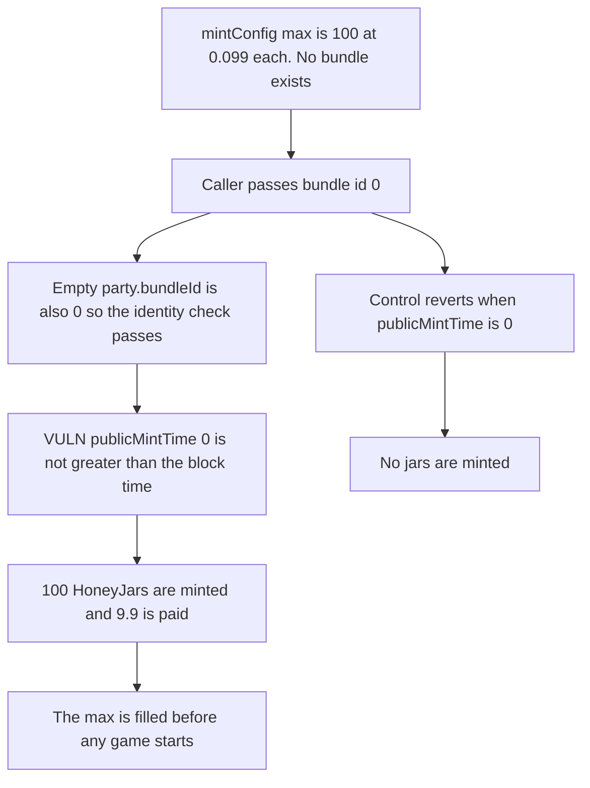

# Bearcave: bundle 0 mints the entire HoneyJar supply before any game exists

> **Vulnerability classes:** vuln/logic/missing-check · vuln/access-control/missing-auth

<!-- non-defihacklabs -->
<!-- source-auditvault: https://github.com/Auditware/AuditVault/blob/main/findings/20531-c-03-anyone-can-mint-all-nfts-through-the-public-mint-before.md -->
<!-- date: 2023-03 -->

## Key info

| Field | Value |
|---|---|
| **Loss** | Caller mints all 100 HoneyJars before any bundle exists. The next player is blocked |
| **Vulnerable contract** | `HoneyBox.mekHoneyJarWithERC20` |
| **Attacker EOA** | `0x1111111111111111111111111111111111111111` |
| **Attack contract** | `Exploit` |
| **Attack tx** | `Exploit.run()` |
| **Chain / block / date** | Ethereum model · block 0 · 2023-03 |
| **Compiler** | solc 0.8.27, cancun, via IR |
| **Bug class** | `publicMintTime > block.timestamp` treats an uncreated bundle as already open |

## TL;DR

The public mint reverts only when `publicMintTime` is still in the future. Bundle 0 was never created, so that timestamp is 0 and the comparison does not revert. The zero bundle id also matches the empty party's `bundleId`. The caller mints `mintConfig.maxHoneyJar`, which is 100, at the configured 0.099 price, for 9.9 in total. No game has been scheduled. A later mint of one more jar exceeds the max. Reverting when `publicMintTime` is 0 mints nothing.

## Background

Pashov Audit Group's Bearcave review of 1 March 2023, C-03. `mekHoneyJarWithERC20` and `mekHoneyJarWithETH` both use the `publicMintTime > block.timestamp` check, and `_canMintHoneyJar` did not reject an uninitialized party. Bundle id 0 is special because the default `bundleId` field is already 0, so the identity check passes. The review's fix is to revert when `publicMintTime == 0`.

## The vulnerable code

```solidity
_canMintHoneyJar(bundleId_, amount_);
// @> VULN: an uncreated bundle has publicMintTime 0, so 0 > block.timestamp does not revert
if (slumberParties[bundleId_].publicMintTime > block.timestamp) revert("GeneralMintNotOpen");
```

`mintConfig` is already set to a max of 100 and a price of 0.099. `bundlesAdded` is 0.

## Root cause

An unset timestamp is not in the future, and the open check only rejects future timestamps. Combined with bundle id 0 matching a zero struct, the public mint runs against a party that does not exist and consumes the global max.

## Preconditions

- `HoneyBox` is configured with `maxHoneyJar` 100 and `honeyJarPrice_ERC20` of 0.099.
- No slumber party has been added. Bundle 0's `publicMintTime` is 0.
- The caller can pay 9.9.

## Attack walkthrough

1. The caller approves 9.9. Bundle 0's open time is 0 and `bundlesAdded` is 0.
2. `mekHoneyJarWithERC20(0, 100)` passes the bundle-id check because both sides are 0.
3. `0 > block.timestamp` is false, so the mint is treated as open.
4. 9.9 is pulled and 100 HoneyJars are minted. That is the whole max.
5. One more jar would exceed the max, so a real game cannot mint.
6. The control reverts with `NotSleeping` while `publicMintTime` is 0 and mints nothing.

## Diagrams



## Impact

The caller holds all 100 HoneyJars configured for the game, and paid 9.9 for them, before any slumber party exists. The next mint is blocked because `minted[0]` is already the max. Players of the actual game cannot mint. The control reverts and the HoneyJar balance stays 0.

## Remediation

Revert in `_canMintHoneyJar` when `slumberParties[bundleId_].publicMintTime == 0`, which is the recommendation in C-03.

## How to reproduce

```bash
cd 20531-c-03-anyone-can-mint-all-nfts-through-the-public-mint-before_exp
forge test -vv
```

`test_exploit_mints_all_100_before_any_bundle` asserts 100 jars, a filled supply, zero bundles added, and a 9.9 payment. `test_control_zero_public_mint_time_reverts` asserts the call reverts and no jars are minted. Captured output is `output.txt`.

## Sources

- AuditVault finding: https://github.com/Auditware/AuditVault/blob/main/findings/20531-c-03-anyone-can-mint-all-nfts-through-the-public-mint-before.md
- Pashov Bearcave review: https://github.com/solodit/solodit_content/blob/main/reports/Pashov/2023-03-01-BearCave.md
