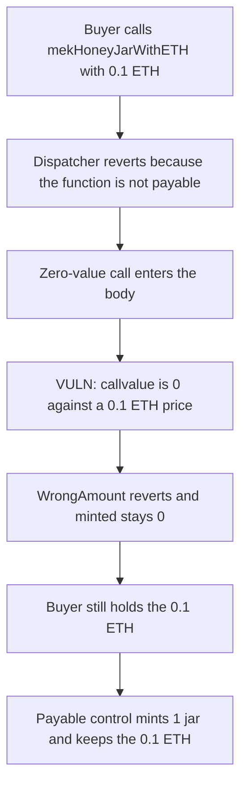

# BearCave — mekHoneyJarWithETH reverts on every paid mint

> **Vulnerability classes:** vuln/logic/missing-check · vuln/input-validation/missing

<!-- non-defihacklabs -->
<!-- source-auditvault: https://github.com/Auditware/AuditVault/blob/main/findings/20533-h-01-mint-function-mekhoneyjarwitheth-will-revert-every-time.md -->
<!-- date: 2023-03 -->

## Key info

| | |
|---|---|
| **Protocol** | BearCave / HoneyBox |
| **Finding** | Pashov H-01, AuditVault 20533 |
| **Vulnerable code** | `HoneyBox.mekHoneyJarWithETH` |
| **Harm** | A mint priced at 0.1 ETH reverts. `minted` stays 0. The buyer keeps the 0.1 ETH. The payable control mints 1 jar and holds the 0.1 ETH. |
| **Chain** | local synthetic |

## TL;DR

`mekHoneyJarWithETH` prices the mint with the ETH attached to the call, but the function is not `payable`. Every call that sends the price reverts in the dispatcher and never mints. A call with no ETH enters the body, reads call value 0, and reverts `WrongAmount_ETH`.

## The vulnerable code

The audited signature, from the review diff:

```solidity
function mekHoneyJarWithETH(uint8 bundleId_, uint256 amount_) external returns (uint256) {
    uint256 expected = PRICE * amount_;
    uint256 paid;
    assembly {
        paid := callvalue()
    }
    // @> VULN: callvalue is 0 because this function is not payable, so the price check reverts
    if (paid != expected) revert WrongAmount_ETH(expected, paid);
    minted += amount_;
    return minted;
}
```

solc 0.8.27 rejects `msg.value` in a non-payable function, so the reduction reads `callvalue()`, which is the same opcode. The review's fix is to add `payable`.

## Root cause

The price check and the Solidity mutability disagree. Non-payable functions cannot receive ETH, so the only value the check can ever observe is 0, and 0 is not the mint price.

## Preconditions

`PRICE` is 0.1 ETH. The buyer asks for 1 jar. No other role is involved.

## Attack walkthrough

1. The buyer calls `mekHoneyJarWithETH(1, 1)` with 0.1 ETH. The call reverts. `minted` is 0. The box holds 0 ETH.
2. The buyer calls the same function with no ETH, which is the only way to enter the body.
3. `callvalue()` is 0. The price check reverts. `minted` is still 0.
4. The buyer still holds 0.1 ETH.

The payable control accepts 0.1 ETH, mints 1 jar, and the box balance is 0.1 ETH.

## Diagrams



## Impact

The public ETH mint path cannot be used. Buyers who send the listed price get a revert and no jar. In this reduction that is one jar at 0.1 ETH that never mints. The ERC20 mint path is a separate function and is not what this call does.

## Remediation

Mark `mekHoneyJarWithETH` `payable`, which is the one-line diff in the review.

## How to reproduce

```bash
cd 20533-h-01-mint-function-mekhoneyjarwitheth-will-revert-every-time_exp
forge test -vv
```

## Sources

- AuditVault finding: https://github.com/Auditware/AuditVault/blob/main/findings/20533-h-01-mint-function-mekhoneyjarwitheth-will-revert-every-time.md
- Pashov report path cited by the finding: https://github.com/solodit/solodit_content/blob/main/reports/Pashov/2023-03-01-BearCave.md
