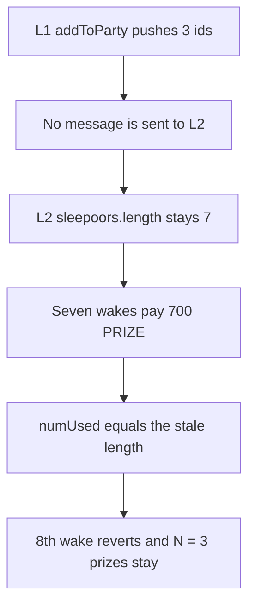

# Bearcave — L2 never learns about new sleepers, so 3 prizes stick

> **Vulnerability classes:** vuln/logic/state-update · vuln/logic/missing-check · vuln/dos/frozen-funds

> **Reproduction:** a self-contained Foundry PoC that compiles and runs offline
> with only `forge-std` — no fork and no RPC. Trace: [output.txt](output.txt).
> PoC: [test/20609-c-01-state-is-not-properly-updated-on-l2-leading-to-stuck-pr_exp.sol](test/20609-c-01-state-is-not-properly-updated-on-l2-leading-to-stuck-pr_exp.sol).

<!-- non-defihacklabs -->
<!-- source-auditvault: https://github.com/Auditware/AuditVault/blob/main/findings/20609-c-01-state-is-not-properly-updated-on-l2-leading-to-stuck-pr.md -->
<!-- date: 2023-06 -->

---

## Key info

| | |
|---|---|
| **Impact** | **HIGH** — **N = 3** prize NFTs, worth **300 PRIZE**, cannot be woken |
| **Protocol** | Bearcave `HibernationDen` |
| **Vulnerable code** | `wakeSleeper` stops at `party.sleepoors.length` |
| **Bug class** | `addToParty` updates L1 and never messages L2 |
| **Finding** | Pashov Audit Group — BearCave, 1 June 2023 · C-01 · id 20609 |
| **Report** | [2023-06-01-BearCave](https://github.com/solodit/solodit_content/blob/main/reports/Pashov/2023-06-01-BearCave.md) |
| **Source** | [AuditVault finding](https://github.com/Auditware/AuditVault/blob/main/findings/20609-c-01-state-is-not-properly-updated-on-l2-leading-to-stuck-pr.md) |
| **Status** | Reproduced on one chain as the L2 den. No second chain. |
| **Compiler** | solc 0.8.27, cancun, via IR |

---

## TL;DR

`addToParty` pushes new sleeper ids on L1 and does not send a message that would push them on L2. `wakeSleeper` on L2 reverts once `numUsed` equals the stale `sleepoors.length`.

The L2 party was synced with **7** sleepers. Three more prize NFTs are held by the den. After the 7 are paid, the 8th wake reverts `PartyAlreadyWoke`. **N = 3** NFTs stay owned by the den and **300 PRIZE** stays with them.

Mirroring the three ids onto the L2 array lets all **10** wakes succeed and pays **1,000 PRIZE**.

## The vulnerable code

```solidity
function wakeSleeper(uint256 bundleId_) external {
    Party storage party = parties[bundleId_];
    // @> VULN: L2 length was never updated, so numUsed == length bricks the rest
    if (party.numUsed == party.sleepoors.length) revert PartyAlreadyWoke(bundleId_);
    uint256 id = party.sleepoors[party.numUsed];
    party.numUsed += 1;
    // pay the prize and move the NFT
}
```

The report quotes that exact check. `addToParty` on L1 only does `sleepoors.push`.

## Root cause

The L2 length is a copy of the party. `addToParty` changes the L1 copy and does not change the L2 copy. Every later calculation that trusts `party.sleepoors.length` on L2, including the "already woke" guard, is short by the sleepers that were added after the last message.

## Preconditions

- L2 was synced when the party had 7 sleepers.
- Three more prize NFTs are in the den's custody, each with 100 PRIZE.
- `addToParty` has recorded those three ids on L1 only.

## Attack walkthrough

1. Seed L2 with ids 1 through 7.
2. Mint ids 8, 9 and 10 to the L2 den and fund 1,000 PRIZE.
3. Call `addToParty` on L1 with those three ids. L1 length becomes 3. L2 length stays 7.
4. `wakeSleeper` succeeds 7 times and pays 700 PRIZE.
5. The 8th call reverts. Ids 8, 9 and 10 are still owned by the den. 300 PRIZE is left.

Control: `mirror` pushes the same three ids onto L2. Ten wakes pay 1,000 PRIZE and the den's balance is 0.

## Diagrams



## Impact

The three late sleepers cannot be claimed. **300 PRIZE** and the three NFTs remain in the den. Every sleeper added after the last L2 sync is stuck the same way.

## Remediation

`addToParty` must send the cross-chain message that pushes the same ids into `party.sleepoors` on L2 before anyone relies on that length.

## Sources

- [AuditVault finding 20609](https://github.com/Auditware/AuditVault/blob/main/findings/20609-c-01-state-is-not-properly-updated-on-l2-leading-to-stuck-pr.md)
- [Pashov BearCave review, 1 June 2023](https://github.com/solodit/solodit_content/blob/main/reports/Pashov/2023-06-01-BearCave.md)
- Quoted check from that report. The L2 den in this file is the local model of `HibernationDen.wakeSleeper`. The Honey Jar contracts lived in `0xHoneyJar/honeyjar-contracts`.

### Taxonomy

- `vuln/logic/state-update` · `vuln/logic/missing-check` · `vuln/dos/frozen-funds`
