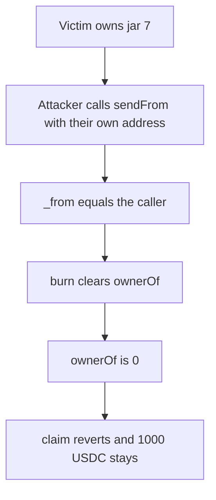

# Bearcave — anyone can burn a HoneyJar, and ownerOf becomes 0

> **Vulnerability classes:** vuln/access-control/missing-auth · vuln/logic/missing-check

> **Reproduction:** a self-contained Foundry PoC that compiles and runs offline
> with only `forge-std` — no fork and no RPC. Trace: [output.txt](output.txt).
> PoC: [test/20610-c-02-anyone-can-burn-any-nft-in-the-honeyjarportal-pashov-no_exp.sol](test/20610-c-02-anyone-can-burn-any-nft-in-the-honeyjarportal-pashov-no_exp.sol).

<!-- non-defihacklabs -->
<!-- source-auditvault: https://github.com/Auditware/AuditVault/blob/main/findings/20610-c-02-anyone-can-burn-any-nft-in-the-honeyjarportal-pashov-no.md -->
<!-- date: 2023-06 -->

---

## Key info

| | |
|---|---|
| **Impact** | **HIGH** — jar 7 is burned, **ownerOf is 0**, **1,000 USDC** cannot be claimed |
| **Protocol** | Bearcave `HoneyJarPortal` |
| **Vulnerable code** | `_debitFrom` burns after `if (_from != _msgSender())` |
| **Bug class** | The caller check does not read `ownerOf` |
| **Finding** | Pashov Audit Group — BearCave, 1 June 2023 · C-02 · id 20610 |
| **Report** | [2023-06-01-BearCave](https://github.com/solodit/solodit_content/blob/main/reports/Pashov/2023-06-01-BearCave.md) |
| **Source** | [AuditVault finding](https://github.com/Auditware/AuditVault/blob/main/findings/20610-c-02-anyone-can-burn-any-nft-in-the-honeyjarportal-pashov-no.md) |
| **Status** | A burn path. Not the March 2023 `safeTransferFrom` steal. |
| **Compiler** | solc 0.8.27, cancun, via IR |

---

## TL;DR

June 2023 `_debitFrom` does not pull the NFT the way the March finding does. It checks `_from != _msgSender()` and then burns the token id. The attacker sets `_from` to themselves and passes the victim's id.

`ownerOf(7)` goes from the victim to **address(0)**. The **1,000 USDC** backing that jar stays in the NFT contract, and `claim` reverts because nobody owns it.

The March PoC moved the jar to the attacker with `safeTransferFrom`. This one destroys it.

## The vulnerable code

```solidity
function _debitFrom(address _from, uint16, bytes memory, uint256 _tokenId) internal virtual {
    if (_from != _msgSender()) revert OwnerNotCaller();
    // @> VULN: burn ignores ownerOf; any caller who sets _from to themselves destroys the jar
    honeyJar.burn(_tokenId);
}
```

`sendFrom` is public and calls `_debitFrom` with the caller's arguments.

## Root cause

The check compares two arguments the caller controls. It never asks `ownerOf(_tokenId)`. `_from` is not used again. The burn does not care who held the jar.

## Preconditions

- Jar 7 is owned by the victim.
- The jar is backed by 1,000 USDC sitting on the NFT contract.
- The attacker is not the owner and has no approval.

## Attack walkthrough

1. Mint jar 7 to the victim and fund 1,000 USDC of backing.
2. The attacker calls `sendFrom(attacker, ..., 7)`.
3. `_from == msg.sender`, so `OwnerNotCaller` does not fire.
4. `burn` sets `ownerOf` to 0.
5. `claim` reverts. The 1,000 USDC is still on the NFT contract.

Control: the portal requires `ownerOf(tokenId) == msg.sender` before the burn. The same `sendFrom` reverts and the victim still owns jar 7.

## Diagrams



## Impact

The victim loses the NFT. **ownerOf is 0**. **1,000 USDC** of backing can no longer be claimed by anyone. Any other jar id can be burned the same way.

## Remediation

Before burning, require `honeyJar.ownerOf(_tokenId) == msg.sender`.

## Sources

- [AuditVault finding 20610](https://github.com/Auditware/AuditVault/blob/main/findings/20610-c-02-anyone-can-burn-any-nft-in-the-honeyjarportal-pashov-no.md)
- [Pashov BearCave review, 1 June 2023](https://github.com/solodit/solodit_content/blob/main/reports/Pashov/2023-06-01-BearCave.md)
- The quoted `OwnerNotCaller` check is from that report. This is not finding 20529, whose `_debitFrom` is `safeTransferFrom`.

### Taxonomy

- `vuln/access-control/missing-check` · `vuln/logic/missing-check`
