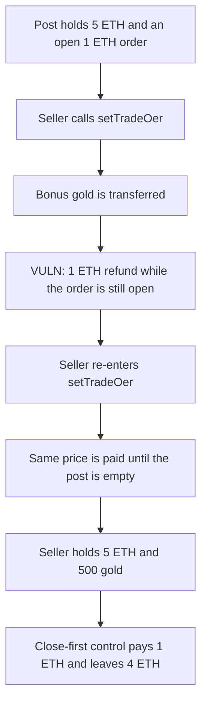

# IOTA Heroes — setTradeOer refunds before the order is closed

> **Vulnerability classes:** vuln/reentrancy/single-function · vuln/access-control/missing-modifier

<!-- non-defihacklabs -->
<!-- source-auditvault: https://github.com/Auditware/AuditVault/blob/main/findings/21013-settradeoer-and-canceltradeoer-functions-does-not-use-reentr.md -->
<!-- date: 2023-04 -->

## Key info

| | |
|---|---|
| **Protocol** | IOTA Heroes TradingPost |
| **Finding** | AuditOne, AuditVault 21013 |
| **Vulnerable code** | `TradingPost.setTradeOer` |
| **Harm** | A seller whose order price is 1 ETH re-enters and is paid 5 ETH, plus 500 gold. The post ends empty. Closing the order first pays 1 ETH and 100 gold and leaves 4 ETH. |
| **Chain** | local synthetic |

## TL;DR

`setTradeOer` and `cancelTradeOer` are the two TradingPost functions the review says transfer tokens and ETH without `ReentrancyGuard`. On `setTradeOer` the bonus token and the ETH refund both go out before the order is closed. The seller's contract re-enters and the same 1 ETH price is paid again out of other sellers' escrow.

The Crelde repo at `3e345747` is no longer published. This reduction keeps the function name and that order: external transfer, then the state write.

## The vulnerable code

```solidity
function setTradeOer(uint256 id) external payable {
    Order memory prev = orders[id];
    require(prev.seller == msg.sender && prev.open, "order");
    gold.transfer(msg.sender, BONUS);
    // @> VULN: ETH refund is sent before the order is closed, with no reentrancy guard
    (bool ok,) = msg.sender.call{value: prev.price}("");
    require(ok, "refund");
    if (msg.value > 0) orders[id].price = msg.value;
}
```

The control sets `orders[id].open = false` before either transfer.

## Root cause

The refund uses a memory copy of an order that storage still marks open. Nothing blocks the seller from entering `setTradeOer` again on that call. Each entry pays `prev.price` and `BONUS` from the contract's shared balances.

## Preconditions

The caller is the seller of an open order priced at 1 ETH. The post holds 5 ETH of other escrow and 500 gold. The seller is a contract.

## Attack walkthrough

1. Seed the seller's order at 1 ETH. Fund the post with 5 ETH and 500 gold.
2. The seller calls `setTradeOer` with no new value, so the price is not replaced.
3. Each entry transfers 100 gold, then sends 1 ETH, then re-enters while the order is open.
4. Five entries later the seller holds 5 ETH and 500 gold. The post's ETH balance is 0.

The control closes the order first. The re-entered call reverts and is caught. The seller receives 1 ETH and 100 gold. 4 ETH stays in the post.

## Diagrams



## Impact

Other sellers' ETH in the post is paid to the caller, and the gold bonus is paid once per re-entry. Here that is 5 ETH and 500 gold against a single 1 ETH order. A guard, or closing the order before the calls, pays 1 ETH and 100 gold.

## Remediation

Write `open = false` before the token transfer and the ETH call, and put `nonReentrant` on `setTradeOer` and `cancelTradeOer`.

## How to reproduce

```bash
cd 21013-settradeoer-and-canceltradeoer-functions-does-not-use-reentr_exp
forge test -vv
```

## Sources

- AuditVault finding: https://github.com/Auditware/AuditVault/blob/main/findings/21013-settradeoer-and-canceltradeoer-functions-does-not-use-reentr.md
- AuditOne report: https://github.com/solodit/solodit_content/blob/main/reports/AuditOne/2023-04-13-Lotaheros.md
- Cited source, now unpublished: https://github.com/Crelde/IOTA-Heroes-Contracts/blob/3e345747f723637c0a1ce884d1ae0e1584015e98/contracts/TradingPost.sol
