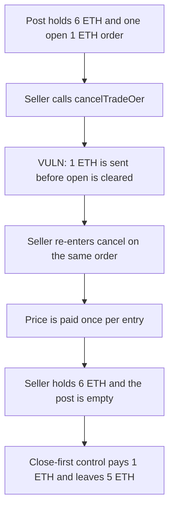

# IOTA Heroes — cancelTradeOer pays the same order until the post is empty

> **Vulnerability classes:** vuln/reentrancy/single-function · vuln/logic/incorrect-order-of-operations

<!-- non-defihacklabs -->
<!-- source-auditvault: https://github.com/Auditware/AuditVault/blob/main/findings/21014-contract-funds-can-be-drained-out-auditone-none-lotaheros-ma.md -->
<!-- date: 2023-04 -->

## Key info

| | |
|---|---|
| **Protocol** | IOTA Heroes TradingPost |
| **Finding** | AuditOne, AuditVault 21014 |
| **Vulnerable code** | `TradingPost.cancelTradeOer` |
| **Harm** | A 1 ETH order is refunded six times. The seller receives 6 ETH. The post, which also held 5 ETH for other sellers, ends at 0. Closing first refunds 1 ETH and leaves 5 ETH. |
| **Chain** | local synthetic |

## TL;DR

`cancelTradeOer` sends `o.price` to the seller and only afterwards sets `orders[id].open = false`. There is no reentrancy guard. The seller re-enters on the refund, the order is still open, and the same price is paid again until the contract's ETH is gone.

The cited `TradingPost.sol` lines at commit `3e345747` are unpublished. The reduction keeps the function name and the order the report states: the external call, then the state update.

## The vulnerable code

```solidity
function cancelTradeOer(uint256 id) external {
    Order memory o = orders[id];
    require(o.open && o.seller == msg.sender, "order");
    // @> VULN: refund call happens before orders[id] is closed
    (bool ok,) = msg.sender.call{value: o.price}("");
    require(ok, "refund");
    orders[id].open = false;
}
```

The control clears `open` before the call.

## Root cause

`o` is a memory copy. Storage still says the order is open while the ETH is in flight. The recipient is `msg.sender`, who is allowed to cancel, so the re-entered call passes the same checks and pays `o.price` from whatever ETH the post holds.

## Preconditions

The caller is the seller of an open order. The post's ETH balance is greater than that one order. Here the price is 1 ETH and the post holds 6 ETH.

## Attack walkthrough

1. Seed order 7 for the seller at 1 ETH. Fund the post with 6 ETH.
2. The seller calls `cancelTradeOer(7)`.
3. The refund of 1 ETH hits the seller. The order is still open, so `receive` calls `cancelTradeOer` again.
4. That repeats while the post holds at least 1 ETH. Six payments of 1 ETH land on the seller.
5. The post balance is 0.

The control marks the order closed before the call. The re-entered cancel reverts and is caught. The seller receives 1 ETH. 5 ETH stays in the post.

## Diagrams



## Impact

Every other seller's ETH in the post can be pulled by cancelling one order. Here 6 ETH leaves and 5 ETH of it was not this order. The fix pays exactly the 1 ETH price.

## Remediation

Set `orders[id].open = false` before the refund, and add `nonReentrant` on `cancelTradeOer`.

## How to reproduce

```bash
cd 21014-contract-funds-can-be-drained-out-auditone-none-lotaheros-ma_exp
forge test -vv
```

## Sources

- AuditVault finding: https://github.com/Auditware/AuditVault/blob/main/findings/21014-contract-funds-can-be-drained-out-auditone-none-lotaheros-ma.md
- AuditOne report: https://github.com/solodit/solodit_content/blob/main/reports/AuditOne/2023-04-13-Lotaheros.md
- Cited source, now unpublished: https://github.com/Crelde/IOTA-Heroes-Contracts/blob/3e345747f723637c0a1ce884d1ae0e1584015e98/contracts/TradingPost.sol#L154
