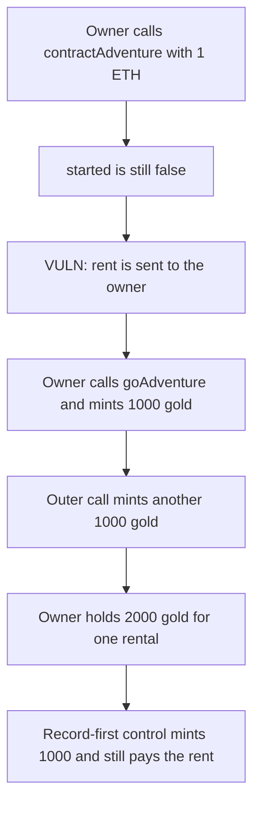

# IOTA Heroes — contractAdventure mints the reward twice

> **Vulnerability classes:** vuln/reentrancy/cross-function · vuln/logic/incorrect-order-of-operations

<!-- non-defihacklabs -->
<!-- source-auditvault: https://github.com/Auditware/AuditVault/blob/main/findings/21017-reentrancy-exploit-in-initiateadventure-function-auditone-no.md -->
<!-- date: 2023-04 -->

## Key info

| | |
|---|---|
| **Protocol** | IOTA Heroes |
| **Finding** | AuditOne, AuditVault 21017 |
| **Vulnerable code** | `Adventure.contractAdventure` then `goAdventure` |
| **Harm** | One 1 ETH rental mints 2000 gold. Recording the adventure before the payment mints 1000 gold and the owner still receives the 1 ETH. |
| **Chain** | local synthetic |

## TL;DR

`contractAdventure` takes the rent and sends it to the hero owner before `_initiateAdventure`, and before `started` is set. The owner is a contract. On the ETH call it uses `goAdventure`, which is still allowed, and that path mints 1000 gold. The outer call then mints another 1000 for the same hero.

## The vulnerable code

```solidity
function contractAdventure(uint256 heroId) external payable {
    require(msg.value == RENT, "rent");
    require(!started[heroId], "started");
    address heroOwner = ownerOf[heroId];
    // @> VULN: rent is paid before _initiateAdventure, so the owner can reenter
    (bool ok,) = heroOwner.call{value: msg.value}("");
    require(ok, "pay");
    _initiateAdventure(heroId, msg.sender);
    started[heroId] = true;
}
```

The control calls `_initiateAdventure` and sets `started` before the ETH transfer. `goAdventure` then sees `started` and does not mint.

## Root cause

The external payment is the first interaction, and the "already adventuring" bit is the last write. `goAdventure` shares `_initiateAdventure` and only checks `started`. During the payment that bit is still false.

## Preconditions

The hero owner is a contract the attacker controls, and that contract is also the renter. Rent is 1 ETH. The reward is 1000 gold. The report's unpublished adventure source is reduced to this order.

## Attack walkthrough

1. The owner calls `contractAdventure` for hero 1 with 1 ETH.
2. The rent check passes. `started` is false.
3. The 1 ETH is sent to the owner. The owner calls `goAdventure`.
4. `goAdventure` mints 1000 gold.
5. The outer call mints another 1000 and only then sets `started`.
6. The owner holds 2000 gold. The adventure contract holds 0 ETH.

The control mints 1000, sets `started`, then pays the 1 ETH. The callback does not call `goAdventure`. The owner holds 1000 gold and the 1 ETH rent.

## Diagrams



## Impact

Each rental of a hero whose owner is a contract mints the adventure reward twice. Here that is 2000 gold instead of 1000. The extra 1000 is unbacked mint.

## Remediation

Call `_initiateAdventure` and set `started` before transferring the rent, and guard both entry points with `nonReentrant`.

## How to reproduce

```bash
cd 21017-reentrancy-exploit-in-initiateadventure-function-auditone-no_exp
forge test -vv
```

## Sources

- AuditVault finding: https://github.com/Auditware/AuditVault/blob/main/findings/21017-reentrancy-exploit-in-initiateadventure-function-auditone-no.md
- AuditOne report: https://github.com/solodit/solodit_content/blob/main/reports/AuditOne/2023-04-13-Lotaheros.md
