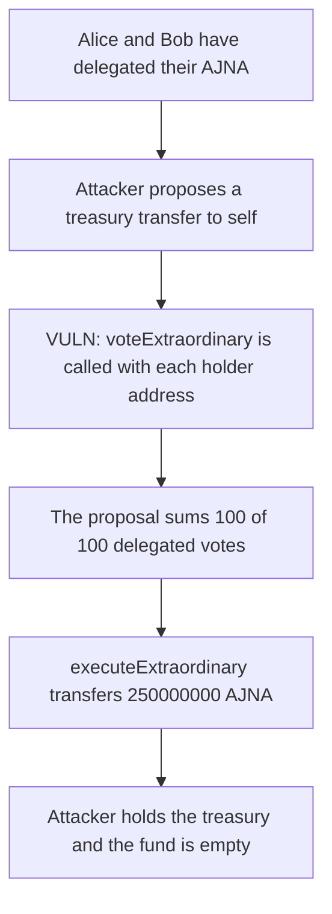

# Ajna: one caller votes every delegate and drains the grant treasury

> **Vulnerability classes:** `vuln/logic/state-update`

<!-- non-defihacklabs -->
<!-- source-auditvault: https://github.com/Auditware/AuditVault/blob/main/findings/21301-extraordinary-proposal-can-be-used-to-steal-extraordinary-am.md -->
<!-- date: 2023-04 -->

## Key info

| Field | Value |
|---|---|
| **Loss** | 250000000 AJNA moved from the grant fund to the attacker |
| **Vulnerable contract** | `GrantFund.voteExtraordinary` |
| **Attacker EOA** | `0x1111111111111111111111111111111111111111` |
| **Attack contract** | `Exploit` |
| **Attack tx** | `Exploit.run()` |
| **Chain / block / date** | Ethereum model · block 0 · 2023-04 |
| **Compiler** | solc 0.8.27, cancun, via IR |
| **Bug class** | Vote cast for an arbitrary account |

## TL;DR

`voteExtraordinary(account_, proposalId_)` never checks that `account_` is `msg.sender`. The attacker names every delegated holder, the proposal crosses the threshold, and `executeExtraordinary` transfers the treasury in the same transaction. The attacker receives 250000000 AJNA. The fund is left at 0.

## Background

Trail of Bits' April 2023 Ajna review, extraordinary funding. Holders must `delegate` before their balance counts. An extraordinary proposal can only be voted yes, only once per account, and for that account's full voting power. The report's `DrainGrantFund` passes a list of holders into `voteExtraordinary` and then calls `executeExtraordinary`. The treasury figure in the report is 250000000 AJNA. This run uses that amount. Alice has delegated 60 and Bob 40. The attacker holds none of it.

## The vulnerable code

```solidity
function voteExtraordinary(address account_, uint256 proposalId_) external returns (uint256 votesCast_) {
    votesCast_ = _extraordinaryFundingVote(account_, proposalId_); // @> VULN
}
```

`_extraordinaryFundingVote` then does `token.votes(account_)` and adds that number to the proposal.

```diff
- function voteExtraordinary(address account_, uint256 proposalId_) external returns (uint256) {
-     return _extraordinaryFundingVote(account_, proposalId_);
- }
+ function voteExtraordinary(uint256 proposalId_) external returns (uint256) {
+     return _extraordinaryFundingVote(msg.sender, proposalId_);
+ }
```

## Root cause

The account whose voting power is consumed is a function argument. Nothing ties it to the caller, so one address can submit every delegated balance.

## Preconditions

- At least one holder has called `delegate`. Here Alice and Bob have.
- The grant fund holds the tokens the proposal transfers. Here that is 250000000 AJNA.
- The execution threshold is reachable by summing those delegated balances. Here the bar is half of 100, and the two holders sum to 100.

## Attack walkthrough

1. The attacker proposes a transfer of the whole treasury to themselves.
2. `voteExtraordinary(alice)` loads Alice's 60 votes. The caller is not Alice.
3. `voteExtraordinary(bob)` adds Bob's 40. The proposal has 100 votes.
4. `executeExtraordinary` transfers 250000000 AJNA to the attacker. The fund balance is 0.

## Diagrams



## Impact

The attacker, who has no voting power, receives the entire 250000000 AJNA treasury. Alice and Bob did not vote. A caller with no delegated balance cannot vote as themselves: that call reverts with `no votes` in the control.

## Remediation

Replace the `account_` argument with `msg.sender`, so a caller can cast only their own delegated balance.

## How to reproduce

```bash
cd 21301-extraordinary-proposal-can-be-used-to-steal-extraordinary-am_exp
forge test -vv
```

`test_exploit_votes_every_holder_and_drains_treasury` asserts the attacker holds 250000000 AJNA, the fund is empty, and both holders' votes were counted. Captured output is `output.txt`.

## Sources

- AuditVault finding: https://github.com/Auditware/AuditVault/blob/main/findings/21301-extraordinary-proposal-can-be-used-to-steal-extraordinary-am.md
- Trail of Bits report: https://github.com/trailofbits/publications/blob/master/reviews/2023-04-ajnalabs-securityreview.pdf
- Blamed function: `ecosystem-coordination/src/grants/base/ExtraordinaryFunding.sol` `voteExtraordinary` lines 126-131
