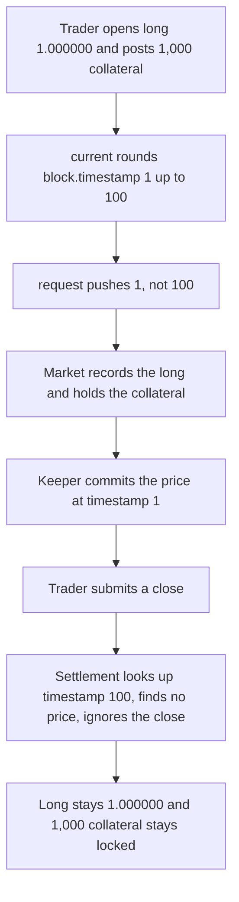

# Perennial: a mismatched oracle timestamp makes a 1.000000 long impossible to close

> **Vulnerability classes:** vuln/logic/incorrect-state-transition · vuln/dos/frozen-funds

> **Reproduction:** local synthetic, no fork. `PythOracle.request` is the audited body. The trader opens a long of 1.000000 (1,000,000 fixed-point units), posts 1,000 collateral, and the close is ignored. Trace: [output.txt](output.txt).

<!-- non-defihacklabs -->
<!-- source-auditvault: https://github.com/Auditware/AuditVault/blob/main/findings/24299-h-1-oracle-request-timestamp-and-pending-position-timestamp.md -->
<!-- date: 2023-07 -->

## Key info

| | |
|---|---|
| **Impact** | **HIGH** — the close is ignored, so a 1.000000 long stays open and 1,000 collateral stays in the market |
| **Protocol** | Perennial V2 — `PythOracle.request` / `Market` pending positions |
| **Vulnerable code** | `versionList.push(block.timestamp)` while the position timestamp is `current()` |
| **Bug class** | Timestamp mismatch → position update ignored |
| **Finding** | Sherlock 2023-07 Perennial · #24299 · WATCHPUG, panprog |
| **Report** | [sherlock-audit/2023-07-perennial-judging](https://github.com/sherlock-audit/2023-07-perennial-judging/issues/42) |

## Root cause

`PythFactory.current()` rounds `block.timestamp` **up** to the next granularity boundary (`ceilDiv`). The market stamps the new pending position with that future timestamp, then calls `oracle.request` in the same update. `request` does not store `current()`. It stores `block.timestamp`:

```solidity
function request(address) external {
    if (versionList.length == 0 || versionList[versionList.length - 1] != block.timestamp) {
        // @> VULN: request key is block.timestamp, not current(), so the price misses the position
        versionList.push(block.timestamp);
    }
}
```

`commitRequested` writes the price at `versionList[i]`. Settlement then calls `oracle.at(position.timestamp)`. Those two keys differ whenever `block.timestamp` is not already on a boundary. With granularity 100 and `block.timestamp = 1`, the position is stamped **100** and the price is stored at **1**. The version is invalid, so the close is ignored.

## Attack path



## PoC

```bash
cd 24299-h-1-oracle-request-timestamp-and-pending-position-timestamp_exp
forge test -vv
```

The exploit asserts the long is still `1_000_000`, `closeIgnored` is true, and the market still holds `1_000 ether`. The control oracle pushes `current()` instead of `block.timestamp`. The same close is accepted: the long goes to 0 and the trader receives the 1,000 collateral back.

## Remediation

Stamp the request with `current()`, which is what the pending position already uses:

```solidity
function request(address) external {
    uint256 nextTimestamp = current();
    if (versionList.length == 0 || versionList[versionList.length - 1] < nextTimestamp) {
        versionList.push(nextTimestamp);
    }
}
```

Fixed in [equilibria-xyz/perennial-v2#57](https://github.com/equilibria-xyz/perennial-v2/pull/57).

## References

- AuditVault: https://github.com/Auditware/AuditVault/blob/main/findings/24299-h-1-oracle-request-timestamp-and-pending-position-timestamp.md
- Judging issue: https://github.com/sherlock-audit/2023-07-perennial-judging/issues/42
- `PythOracle.request`: https://github.com/sherlock-audit/2023-07-perennial/blob/main/perennial-v2/packages/perennial-oracle/contracts/pyth/PythOracle.sol#L77-L81
- `PythFactory.current`: https://github.com/sherlock-audit/2023-07-perennial/blob/main/perennial-v2/packages/perennial-oracle/contracts/pyth/PythFactory.sol#L76
