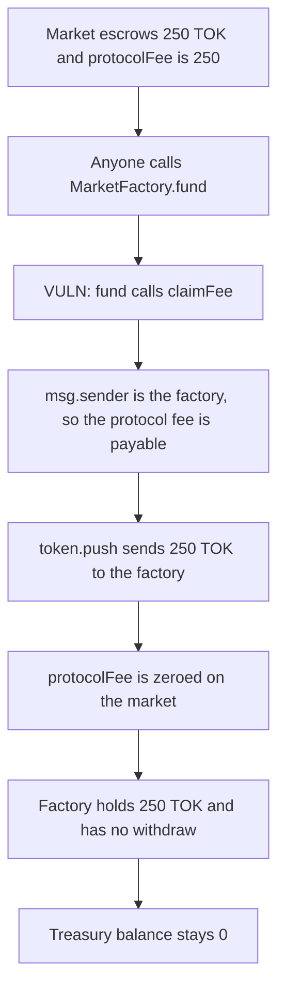

# Perennial MarketFactory — protocol fee is locked in the factory

> **Vulnerability classes:** vuln/dos/frozen-funds · vuln/logic/fee-calculation

<!-- non-defihacklabs -->
<!-- source-auditvault: https://github.com/Auditware/AuditVault/blob/main/findings/24301-h-3-protocol-fee-from-marketsol-is-locked-sherlock-none-pere.md -->
<!-- date: 2023-07 -->

## Key info

| | |
|---|---|
| **Protocol** | Perennial V2 |
| **Finding** | Sherlock 2023-07 H-3, AuditVault 24301 |
| **Vulnerable code** | `MarketFactory.fund` / `Market._claimFee` |
| **Harm** | 250 TOK protocol fee locked in MarketFactory; treasury receives 0 |
| **Chain** | local synthetic |

## TL;DR

`MarketFactory.fund` calls `Market.claimFee`. `_claimFee` pays a receiver only when `msg.sender` is that receiver, and the protocol-fee receiver is the factory. The tokens therefore move from the market into the factory, and the fee record is zeroed. The factory does not approve any spender and has no withdraw. The 250 TOK stays in the factory. The treasury balance stays 0. A second `fund` does not move it.

## The vulnerable code

```solidity
function fund(IMarket market) external {
    if (!instances(IInstance(address(market)))) revert FactoryNotInstanceError();
    // @> VULN: claimFee pays the protocol fee to this factory, which has no withdraw and no allowance out
    market.claimFee();
}

function _claimFee(address receiver, UFixed6 fee) private returns (bool) {
    if (msg.sender != receiver) return false;

    token.push(receiver, UFixed18Lib.from(fee));
    emit FeeClaimed(receiver, fee);
    return true;
}
```

`claimFee` passes `address(factory())` as the protocol-fee receiver. Oracle, risk, and donation receivers are different addresses, so those branches return false for this caller. Only the protocol fee moves, and it moves to the factory.

## Root cause

The claim path was written so the factory pulls its own fee by calling the market. Nothing on the factory can push that balance onward. There is no `withdraw`, and the factory never approves the treasury. Zeroing `protocolFee` after the push means the market will not pay the same fee again to anyone else.

## Preconditions

The market is a registered factory instance. It escrows 250 TOK and `protocolFee` is 250 TOK. Oracle, risk, and donation fees are 0. The treasury address is not the factory.

## Attack walkthrough

1. The market holds 250 TOK. `protocolFee` is 250 TOK. The factory holds 0. The treasury holds 0.
2. Anyone calls `fund` on that market. `instances` is true, so the call continues.
3. `fund` calls `claimFee`. `_claimFee` sees `msg.sender == factory` and pushes 250 TOK to the factory.
4. The market balance is 0 and `protocolFee` is 0. The factory holds 250 TOK. The treasury still holds 0.
5. A second `fund` pushes a 0 protocol fee. The factory balance stays 250 TOK.

The control is the same claim, plus `withdraw`. After `fund`, `withdraw` pushes the 250 TOK to the treasury and the factory balance is 0.

## Diagrams



## Impact

The protocol's 250 TOK fee is locked in `MarketFactory`. The treasury is not paid. The market's fee record is cleared, so the same fee cannot be claimed to a different receiver later. A factory that can `withdraw` pays the same 250 TOK to the treasury instead.

## Remediation

Add a withdraw on `MarketFactory` that pushes the token balance to the treasury, or pay the treasury directly inside `claimFee` instead of paying the factory. The audited fix added an owner claim path for these funds.

## How to reproduce

```bash
cd 24301-h-3-protocol-fee-from-marketsol-is-locked-sherlock-none-pere_exp
forge test -vv
```

## Sources

- AuditVault finding: https://github.com/Auditware/AuditVault/blob/main/findings/24301-h-3-protocol-fee-from-marketsol-is-locked-sherlock-none-pere.md
- Sherlock issue: https://github.com/sherlock-audit/2023-07-perennial-judging/issues/52
- MarketFactory.fund: https://github.com/sherlock-audit/2023-07-perennial/blob/main/perennial-v2/packages/perennial/contracts/MarketFactory.sol#L86-L89
- Market.claimFee and _claimFee: https://github.com/sherlock-audit/2023-07-perennial/blob/main/perennial-v2/packages/perennial/contracts/Market.sol#L133-L151
- Fix PR: https://github.com/equilibria-xyz/perennial-v2/pull/79
