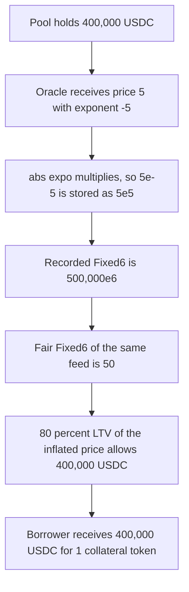

# Perennial: a negative Pyth exponent records 5e-5 as 5e5 and unlocks a 400,000 USDC borrow

> **Vulnerability classes:** vuln/arithmetic/decimal-mismatch · vuln/logic/price-calculation

> **Reproduction:** local synthetic, no fork. `_recordPrice` is the audited body. A feed of 5 with exponent -5 is stored as 5e5, and one collateral token borrows 400,000 USDC. Trace: [output.txt](output.txt).

<!-- non-defihacklabs -->
<!-- source-auditvault: https://github.com/Auditware/AuditVault/blob/main/findings/24302-h-4-pythoracleif-priceexpo-is-less-than-0-wrong-prices-will.md -->
<!-- date: 2023-07 -->

## Key info

| | |
|---|---|
| **Impact** | **HIGH** — 1 collateral token, fairly worth $0.00005, borrows 400,000 USDC |
| **Protocol** | Perennial V2 — `PythOracle._recordPrice` |
| **Vulnerable code** | multiply by `10^abs(expo)` even when `expo` is negative |
| **Bug class** | Exponent sign dropped → price inflated 10^10 |
| **Finding** | Sherlock 2023-07 Perennial · #24302 · panprog |
| **Report** | [sherlock-audit/2023-07-perennial-judging](https://github.com/sherlock-audit/2023-07-perennial-judging/issues/56) |

## Root cause

`_recordPrice` always multiplies the Pyth price by `10` raised to the absolute exponent:

```solidity
_prices[oracleVersion] = Fixed6Lib.from(price.price).mul(
    Fixed6Lib.from(SafeCast.toInt256(10 ** SafeCast.toUint256(price.expo > 0 ? price.expo : -price.expo)))
);
```

`Fixed6Lib.from` scales an integer by 1e6, and `mul` divides by 1e6, so the human value is `price * 10^|expo|`. For `price = 5` and `expo = -5` the true value is `5e-5`. The function stores `5e5`. That is a factor of `10^10`.

| | Fixed6 raw | Human price |
|---|---|---|
| Buggy record | 500,000e6 | 500,000 |
| Fair record | 50 | 0.00005 |

A lending pool that prices 1 collateral token at the recorded Fixed6, with an 80% LTV, authorizes `500,000 * 0.8 = 400,000` USDC. The fair cap is `0.00005 * 0.8 = 0.000040` USDC, which is 40 base units of a 6-decimal stablecoin.

## Attack path



## PoC

```bash
cd 24302-h-4-pythoracleif-priceexpo-is-less-than-0-wrong-prices-will_exp
forge test -vv
```

The exploit asserts the recorded raw price is `500_000e6`, the fair raw price is `50`, the ratio is `10_000_000_000`, and the attacker balance is `400_000e6` USDC. The control oracle divides when the exponent is negative. The same 400,000 USDC borrow reverts with `ltv`, and the only borrow that lands is 40 base units.

## Remediation

Keep the exponent. When it is negative, divide by `10^|expo|` instead of multiplying. The audited recommendation stores `price` and `expo` together and scales at the use site. Fixed in [equilibria-xyz/perennial-v2#53](https://github.com/equilibria-xyz/perennial-v2/pull/53).

## References

- AuditVault: https://github.com/Auditware/AuditVault/blob/main/findings/24302-h-4-pythoracleif-priceexpo-is-less-than-0-wrong-prices-will.md
- Judging issue: https://github.com/sherlock-audit/2023-07-perennial-judging/issues/56
- `_recordPrice`: https://github.com/sherlock-audit/2023-07-perennial/blob/main/perennial-v2/packages/perennial-oracle/contracts/pyth/PythOracle.sol#L202-L206
