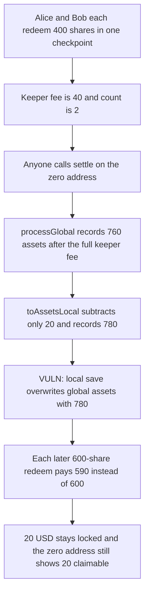

# Perennial Vault — settling the zero address inflates global assets

> **Vulnerability classes:** vuln/logic/incorrect-state-transition · vuln/logic/fee-calculation · vuln/dos/frozen-funds

<!-- non-defihacklabs -->
<!-- source-auditvault: https://github.com/Auditware/AuditVault/blob/main/findings/24303-h-5-vaultsol-settleing-the-0-address-will-disrupt-accounting.md -->
<!-- date: 2023-07 -->

## Key info

| | |
|---|---|
| **Protocol** | Perennial |
| **Finding** | Sherlock 2023-07 H-5, AuditVault 24303 |
| **Vulnerable code** | `Vault._settle` / `Checkpoint.toAssetsLocal` / `Vault._saveContext` |
| **Harm** | Global assets recorded as 780 instead of 760. Alice and Bob are paid 970 instead of 980. 20 USD stays locked. |
| **Chain** | local synthetic |

## TL;DR

The vault's global account is stored at `address(0)`. `settle` is permissionless, and it loads that account as both the global and the local account when the caller passes `address(0)`. The global loop deducts the full keeper fee. The local settlement then deducts only `keeper / count` from the same redemption, and `_saveContext` stores the local account after the global one. The smaller fee sticks. Global assets are too high, the next checkpoint underprices shares, and the difference is left in the vault.

## The vulnerable code

```solidity
function toAssetsGlobal(Checkpoint memory self, UFixed6 shares) internal pure returns (UFixed6) {
    return _withoutKeeperGlobal(self, self.shares.isZero() ? shares : _toAssets(self, shares));
}

function toAssetsLocal(Checkpoint memory self, UFixed6 shares) internal pure returns (UFixed6) {
    // @> VULN: keeper/count, not the full keeper. settle(address(0)) runs this on the global redemption.
    return _withoutKeeperLocal(self, self.shares.isZero() ? shares : _toAssets(self, shares));
}
```

`_withoutKeeperGlobal` subtracts `checkpoint.keeper`. `_withoutKeeperLocal` subtracts `checkpoint.keeper / checkpoint.count`.

```solidity
function _saveContext(Context memory context, address account) private {
    _accounts[address(0)].store(context.global);
    _accounts[account].store(context.local); // overwrites address(0) when account is address(0)
    _checkpoints[context.currentId].store(context.currentCheckpoint);
}
```

The merged fix skips the local settlement and the local store when `account == address(0)`, and writes the global account last.

## Root cause

`_loadContext` always reads `_accounts[address(0)]` into `context.global`, then reads `_accounts[account]` into `context.local`. Those are separate memory copies. For any normal user, `processGlobal` updates the global copy with `toAssetsGlobal` / `toSharesGlobal`, and `processLocal` updates that user's copy with `toAssetsLocal` / `toSharesLocal`. The per-user fee is `keeper / count` so the users split one settlement fee.

When `account` is `address(0)`, the local copy is the global account. `processLocal` therefore applies the per-user fee to the whole pending redemption (and the whole pending deposit, through `toSharesLocal`). `_saveContext` writes `context.global` and then `context.local` into the same slot, so the local numbers replace the global ones. Global assets, and global shares whenever the checkpoint has a deposit, come out higher than they should because a smaller keeper fee was deducted.

## Preconditions

The vault already has shares and a positive asset value, so conversions are not at par. At least two orders share one checkpoint, so `count > 1` and `keeper / count` is smaller than `keeper`. The underlying market has settled, so `Mapping.ready` is true and `settle` will process the checkpoint. Anyone can call `settle`.

## Attack walkthrough

1. Alice and Bob each hold 1,000 shares. The vault holds 2,000 USD. Price is 1.
2. Both queue a redemption of 400 shares in the same checkpoint. `count` is 2. The keeper fee is 40, and it is paid out to the keeper. Vault balance is 1,960.
3. The attacker calls `settle(address(0))`.
4. `processGlobal` runs `toAssetsGlobal(800)`. Par conversion is 800, then the full keeper fee of 40 is removed. Global assets in memory are 760.
5. `processLocal` runs `toAssetsLocal(800)` on the zero-address copy. The fee removed is `40 / 2 = 20`. Assets in that copy are 780.
6. `_saveContext` stores 760, then stores 780 over it. The global account's assets are 780.
7. Alice and Bob settle as themselves. Each local account is credited 380, which is the correct per-user amount (`400 - 20`). They claim 380 each. Global assets fall from 780 to 20. Nobody holds those 20. Vault balance is 1,200, and 1,200 shares remain.
8. They redeem the remaining 600 shares each. The new checkpoint snapshots `balance - global.assets = 1200 - 20 = 1180` against 1,200 shares. Each 600-share redemption pays 590.
9. Alice's balance is 970. Bob's is 970. The vault still holds 20 USD, and the global account still shows 20 claimable assets that no user can withdraw.

The control uses the patched save: `settle(address(0))` leaves global assets at 760. The same exit pays Alice and Bob 980 each, and the vault balance ends at 0. The keeper still receives 40.

## Diagrams



## Impact

Global assets are 20 too high immediately after the zero-address settle (780 instead of 760). That phantom claimable is subtracted from the next checkpoint's asset snapshot, so each depositor's remaining 600 shares pay 590 instead of 600. Together they receive 1,940 of the 1,960 left after the real keeper fee, and 20 USD is stuck in the vault. A checkpoint that also contains deposits inflates global shares through `toSharesLocal` by the same keeper gap. The attacker does not receive the tokens. Later redeemers are underpaid, and the shortfall is not withdrawable.

## Remediation

Do not run the local settlement for `address(0)`, and do not store `context.local` into that slot. Write the global account after any local store so a zero-address local copy cannot replace `processGlobal`. That is the fix in equilibria-xyz/perennial-v2#86.

## How to reproduce

```bash
cd 24303-h-5-vaultsol-settleing-the-0-address-will-disrupt-accounting_exp
forge test -vv
```

## Sources

- AuditVault finding: https://github.com/Auditware/AuditVault/blob/main/findings/24303-h-5-vaultsol-settleing-the-0-address-will-disrupt-accounting.md
- Sherlock judging issue: https://github.com/sherlock-audit/2023-07-perennial-judging/issues/62
- Audited vault: https://github.com/sherlock-audit/2023-07-perennial/blob/main/perennial-v2/packages/perennial-vault/contracts/Vault.sol
- Audited checkpoint: https://github.com/sherlock-audit/2023-07-perennial/blob/main/perennial-v2/packages/perennial-vault/contracts/types/Checkpoint.sol
- Fix: https://github.com/equilibria-xyz/perennial-v2/pull/86
