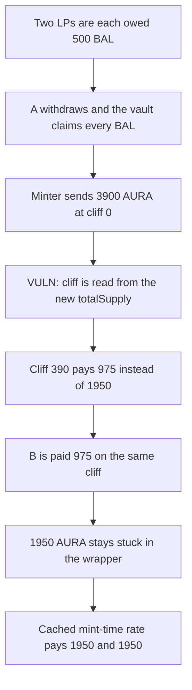

# Blueberry — AURA cliff math pays the rate after the claim

> **Vulnerability classes:** vuln/logic/reward-calculation · vuln/logic/incorrect-order-of-operations

<!-- non-defihacklabs -->
<!-- source-auditvault: https://github.com/Auditware/AuditVault/blob/main/findings/24319-h-4-cvxaura-distribution-calculation-is-incorrect-and-will-l.md -->
<!-- date: 2023-07 -->

## Key info

| | |
|---|---|
| **Protocol** | Blueberry WAuraPools |
| **Finding** | Sherlock 2023-07 H-4, AuditVault 24319 |
| **Vulnerable code** | `WAuraPools._getAuraPendingReward` |
| **Harm** | The claim mints 3900 AURA at cliff 0. Each of two LPs is then paid 975 instead of 1950. 1950 AURA stays in the wrapper. The cached-rate control pays 1950 and 1950 and leaves 0. |
| **Chain** | local synthetic |

## TL;DR

`_getAuraPendingReward` turns pending BAL into AURA with Aura's cliff formula, and the cliff is `emissionsMinted / reductionPerCliff` read from `AURA.totalSupply()`. `withdraw` claims rewards for every participant, which mints the AURA into the wrapper and moves `totalSupply`, and only then asks that function how much the user is owed. The tokens already minted are priced at the new, worse cliff.

## The vulnerable code

From `WAuraPools.sol` lines 233-248 in the Sherlock contest repo, with the constants reduced so one claim crosses 390 cliffs:

```solidity
uint256 emissionsMinted = totalSupply - initAmount - minterMinted;
// @> VULN: cliff is taken from totalSupply after this claim already minted the AURA
uint256 cliff = emissionsMinted / reductionPerCliff;
if (cliff < totalCliffs) {
    uint256 reduction = ((totalCliffs - cliff) * 5) / 2 + 700;
    mintAmount = (mintRequestAmount * reduction) / totalCliffs;
}
```

At cliff 0, `reduction` is 1950 and 1000 BAL mints 3900 AURA. After that mint, `cliff` is 390 and `reduction` is 975.

## Root cause

The formula is an estimate of AURA that has not been minted yet. The wrapper uses it after the minter has already minted that AURA into the wrapper. `withdraw` calls `IAuraRewarder.withdraw(amount, true)`, and that claim is for the whole vault balance, not the withdrawing user.

## Preconditions

Two LPs each have 500 BAL of pending rewards. `totalCliffs` is 500 and `reductionPerCliff` is 10, so minting 3900 AURA moves the cliff from 0 to 390 inside the same call. No time warp is required. The supply changes because of the mint itself.

## Attack walkthrough

1. User A withdraws. The minter quotes 1000 BAL at cliff 0 and mints 3900 AURA to the wrapper.
2. `_getAuraPendingReward(500)` now sees `totalSupply == 3900`, so `cliff` is 390.
3. A is paid `500 * 975 / 500 = 975`. Fair was 1950.
4. User B withdraws. Nothing new is minted. B is also paid 975.
5. The wrapper still holds 1950 AURA. Nobody is credited with it.

The control stores `minted * 1e18 / totalBal` at the moment of the mint. A and B each receive 1950. The wrapper balance ends at 0.

## Diagrams



## Impact

Both LPs lose half of the AURA that was minted for them: 975 each, 1950 in total, left in the wrapper with no claim. The same shape is what the Sherlock issue describes at a cliff boundary, where the later withdraw is priced at the exhausted rate and the tokens already received by the contract are not paid out.

## Remediation

When the claim mints AURA into the wrapper, snapshot aura-per-BAL from the amount actually received. Pay withdrawals from that snapshot. Only still-unminted AURA should go through the live cliff formula.

## How to reproduce

```bash
cd 24319-h-4-cvxaura-distribution-calculation-is-incorrect-and-will-l_exp
forge test -vv
```

## Sources

- AuditVault finding: https://github.com/Auditware/AuditVault/blob/main/findings/24319-h-4-cvxaura-distribution-calculation-is-incorrect-and-will-l.md
- Sherlock issue: https://github.com/sherlock-audit/2023-07-blueberry-judging/issues/109
- `WAuraPools._getAuraPendingReward`: https://github.com/sherlock-audit/2023-07-blueberry/blob/main/blueberry-core/contracts/wrapper/WAuraPools.sol#L209-L249
