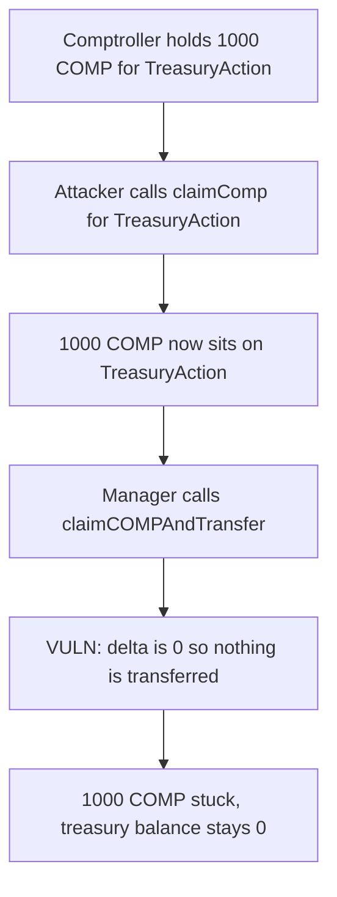

# Notional TreasuryAction — COMP harvest keeps only the balance delta

> **Vulnerability classes:** vuln/logic/incorrect-state-transition · vuln/dos/frozen-funds · vuln/dependency/unsafe-external-call

<!-- non-defihacklabs -->
<!-- source-auditvault: https://github.com/Auditware/AuditVault/blob/main/findings/24655-h-01-treasury-cannot-claim-comp-tokens-comp-tokens-are-stuck.md -->
<!-- date: 2022-01 -->

## Key info

| | |
|---|---|
| **Protocol** | Notional |
| **Finding** | Code4rena 2022-01 H-01, AuditVault 24655 |
| **Vulnerable code** | `TreasuryAction.claimCOMPAndTransfer` |
| **Harm** | 1,000 COMP stuck in TreasuryAction; treasury receives 0 |
| **Chain** | local synthetic |

## TL;DR

`claimCOMPAndTransfer` snapshots the COMP balance, calls `Comptroller.claimComp`, and forwards only the increase. `claimComp` is permissionless and pays any holder the caller names. An attacker claims for TreasuryAction first. The manager's later harvest sees a zero delta, transfers nothing, and the COMP stays in TreasuryAction.

## The vulnerable code

```solidity
uint256 balanceBefore = COMP.balanceOf(address(this));
COMPTROLLER.claimComp(address(this), cTokens);
uint256 balanceAfter = COMP.balanceOf(address(this));
// @> VULN: only the delta is forwarded. A prior permissionless claimComp makes this 0.
uint256 amountClaimed = balanceAfter - balanceBefore;
if (amountClaimed != 0) COMP.transfer(treasuryManager, amountClaimed);
```

This is the audited body. The note in the original source even says the snapshot exists so the contract does not transfer COMP it already held. That is exactly the trap: COMP claimed by someone else is COMP the harvest will not transfer.

## Root cause

Compound's `claimComp(address holder, address[] cTokens)` does not check `msg.sender`. Rewards can be pushed onto TreasuryAction at any time. Because the harvest measures a delta instead of the contract's COMP balance, those tokens are invisible to the sweep. Notional's own note says the tokens can only be recovered later by listing cCOMP and using a different reserve path, which is an upgrade, not a harvest.

## Preconditions

TreasuryAction has accrued COMP sitting in the comptroller. Anyone can call `claimComp`. The manager then calls the harvest as usual.

## Attack walkthrough

1. The comptroller holds 1,000 COMP owed to TreasuryAction.
2. The attacker calls `claimComp(TreasuryAction)`. The 1,000 COMP moves onto TreasuryAction.
3. The manager calls `claimCOMPAndTransfer`.
4. `amountClaimed` is `balanceAfter - balanceBefore` = 0. The treasury transfer is skipped.
5. TreasuryAction still holds 1,000 COMP. The treasury holds 0.

The control forwards `balanceOf(this)` instead of the delta. After the same pre-claim, the treasury receives the full 1,000 COMP.

## Diagrams



## Impact

Accrued COMP is no longer deliverable to the treasury by the harvest function. The attacker does not receive the tokens. The protocol does not either, until it upgrades or lists a cCOMP market. That is a freeze of the reward balance.

## Remediation

Transfer the contract's whole COMP balance, not the difference around `claimComp`. The original recommendation is the same.

## How to reproduce

```bash
cd 24655-h-01-treasury-cannot-claim-comp-tokens-comp-tokens-are-stuck_exp
forge test -vv
```

## Sources

- AuditVault finding: https://github.com/Auditware/AuditVault/blob/main/findings/24655-h-01-treasury-cannot-claim-comp-tokens-comp-tokens-are-stuck.md
- Code4rena report: https://code4rena.com/reports/2022-01-notional
- Compound `claimComp`: https://github.com/compound-finance/compound-protocol/blob/master/contracts/Comptroller.sol
