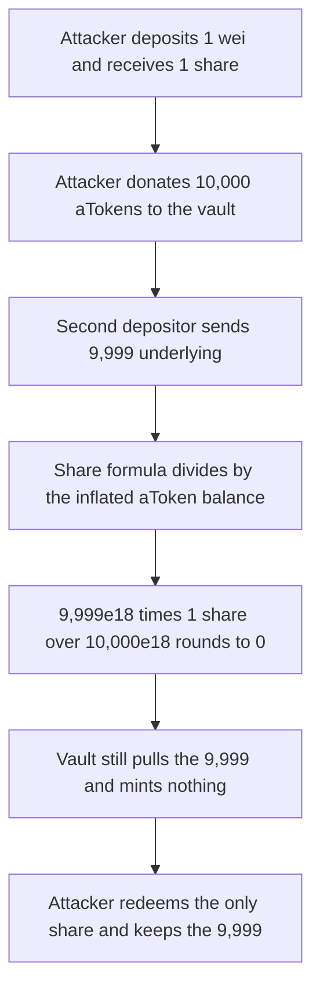

# PoolTogether: a 1-wei deposit plus an aToken donation gives the next depositor 0 shares

> **Vulnerability classes:** vuln/arithmetic/precision-loss

> **Reproduction:** local synthetic, no fork. `_tokenToShares` keeps the audited formula. The second depositor's 9,999 underlying mints 0 shares and the attacker keeps it. Trace: [output.txt](output.txt).

<!-- non-defihacklabs -->
<!-- source-auditvault: https://github.com/Auditware/AuditVault/blob/main/findings/24991-h-01-a-malicious-early-userattacker-can-manipulate-the-vault.md -->
<!-- date: 2022-04 -->

## Key info

| | |
|---|---|
| **Impact** | **HIGH** — the second depositor receives 0 shares and loses 9,999 underlying |
| **Protocol** | PoolTogether — `AaveV3YieldSource._tokenToShares` |
| **Vulnerable code** | `tokens * totalSupply / aToken.balanceOf(this)` with no virtual offset |
| **Bug class** | First-depositor inflation |
| **Finding** | Code4rena 2022-04 PoolTogether · #24991 · WatchPug, unforgiven |
| **Report** | [code4rena.com/reports/2022-04-pooltogether](https://code4rena.com/reports/2022-04-pooltogether) |

## Root cause

When `totalSupply` is not zero, shares are:

```solidity
return _tokens.mul(_supply).div(aToken.balanceOf(address(this)));
```

There is no virtual offset. The first depositor supplies 1 wei and receives 1 share. They then transfer 10,000 aTokens directly to the yield source. That donation increases `aToken.balanceOf(vault)` without minting shares, so one share now claims about 10,000 underlying.

The next depositor supplies 9,999 underlying:

```text
shares = 9_999e18 * 1 / (10_000e18 + 1) = 0
```

The vault still pulls the underlying and supplies it to Aave. The depositor's share balance stays 0. The attacker redeems the only share, receives the whole aToken balance, and keeps the 9,999.

## Attack path



## PoC

```bash
cd 24991-h-01-a-malicious-early-userattacker-can-manipulate-the-vault_exp
forge test -vv
```

The exploit asserts `victimShares == 0` and the attacker balance is `9_999 ether`. The control vault adds a virtual offset of `1_000_000` on the same formula. The same second deposit then mints a non-zero share balance (greater than 100,000).

## Remediation

Mint shares against a virtual offset so a 1-wei donation cannot dominate the rate, and reject a zero share mint:

```solidity
return _tokens.mul(_supply + OFFSET).div(aToken.balanceOf(address(this)) + OFFSET);
```

PoolTogether fixed this in [pooltogether/aave-v3-yield-source#15](https://github.com/pooltogether/aave-v3-yield-source/pull/15).

## References

- AuditVault: https://github.com/Auditware/AuditVault/blob/main/findings/24991-h-01-a-malicious-early-userattacker-can-manipulate-the-vault.md
- Report: https://code4rena.com/reports/2022-04-pooltogether
- `_tokenToShares`: https://github.com/pooltogether/aave-v3-yield-source/blob/e63d1b0e396a5bce89f093630c282ca1c6627e44/contracts/AaveV3YieldSource.sol#L352-L366
