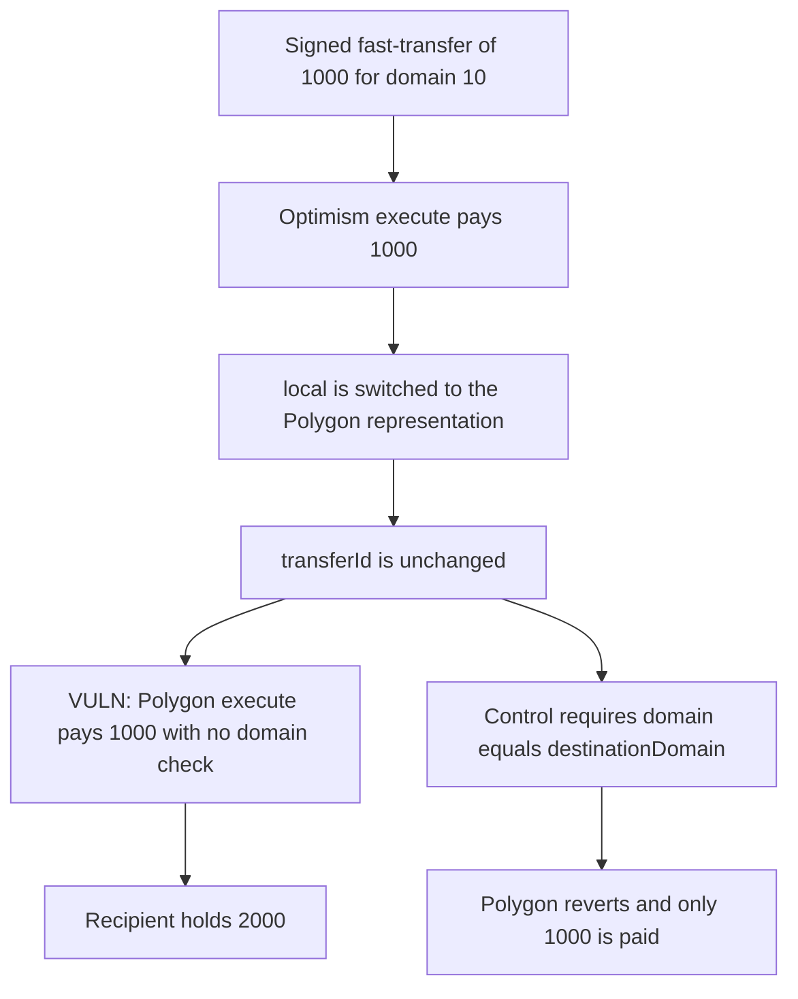

# Connext execute pays the same fast-transfer on a second domain

> **Vulnerability classes:** vuln/bridge/replay · vuln/auth/signature-replay

<!-- non-defihacklabs -->
<!-- source-auditvault: https://github.com/Auditware/AuditVault/blob/main/findings/25135-h-06-malicious-relayer-can-replay-execute-calldata-on-differ.md -->
<!-- date: 2022-06 -->

## Key info

| Field | Value |
|---|---|
| **Loss** | 2000 USDC of router liquidity paid for one 1000 transfer: 1000 on the destination domain and 1000 replayed |
| **Vulnerable contract** | `BridgeFacet.execute` |
| **Attacker EOA** | `0x1111111111111111111111111111111111111111` |
| **Attack contract** | `Exploit` |
| **Attack tx** | `Exploit.run()` |
| **Chain / block / date** | Ethereum model · block 0 · 2022-06 |
| **Compiler** | solc 0.8.27, cancun, via IR |
| **Bug class** | transferId does not bind the executing domain, so a router signature replays |

## TL;DR

`execute` rebuilds `transferId` from the canonical token id and checks the router signature against that id. It never compares `s.domain` with `CallParams.destinationDomain`. Every registered local USDC maps to the same canonical id, so changing `ExecuteArgs.local` keeps the signature valid. One signed fast-transfer of 1000 pays Optimism and then Polygon. The recipient holds 2000. A facet that requires the destination domain pays only the first 1000 and reverts the replay.

## Background

Code4rena, June 2022 Connext. `BridgeFacet.execute` and `_getTransferId`. Fast liquidity is provided by routers whose signatures cover the transfer id, not the facet that happens to receive the calldata. The sponsor confirmed the missing `s.domain` check and fixed it in `bc241f8`.

## The vulnerable code

```solidity
function _getTransferId(ExecuteArgs calldata _args) private view returns (bytes32) {
    (uint32 tokenDomain, bytes32 tokenId) = s.tokenRegistry.getTokenId(_args.local);
    return _calculateTransferId(_args.params, _args.amount, _args.nonce, tokenId, tokenDomain, _args.originSender);
}
```

`execute` then transfers `amount` of the local liquidity. `s.domain` is not read in that check.

## Root cause

`getTokenId` returns one canonical domain and id for every local representation. The executing facet's own domain is not part of the signed id, and each chain has a separate `executed` map, so the single-domain replay guard does not stop the second payment.

## Preconditions

- The same router signature is valid anywhere the canonical id matches.
- Both domains hold liquidity for a local asset registered to that canonical id.
- Anyone who can submit `execute` can replay the calldata. The function is not admin-gated.

## Attack walkthrough

1. A fast-transfer of 1000 is signed for destination domain 10. The local asset on that domain is the Optimism USDC representation.
2. Optimism `execute` resolves the local asset to the canonical id, accepts the signature, and pays 1000.
3. The same args are submitted to the Polygon facet with only `local` changed to the Polygon representation.
4. `previewTransferId` is unchanged. Polygon's domain is 137 and is not checked.
5. Polygon pays another 1000. The recipient's USDC balance is 2000.

## Diagrams



## Impact

Router liquidity on the second domain is paid out and cannot be reconciled, because only the real destination domain can claim the bridged funds back. Here that is an extra 1000 USDC, for 2000 paid on a 1000 transfer. The domain check limits the payout to 1000 and reverts the second `execute`.

## Remediation

In the sanity checks, require `args.params.destinationDomain == domain` before marking the transfer spent or sending liquidity.

## How to reproduce

```bash
cd 25135-h-06-malicious-relayer-can-replay-execute-calldata-on-differ_exp
forge test -vv
```

`test_same_transfer_pays_both_domains` asserts a 2000 USDC balance and a 1000 payout on each facet. `test_control_domain_check_pays_only_destination` asserts Polygon reverts and the recipient receives only 1000.

## Sources

- AuditVault finding: https://github.com/Auditware/AuditVault/blob/main/findings/25135-h-06-malicious-relayer-can-replay-execute-calldata-on-differ.md
- Contest: https://code4rena.com/reports/2022-06-connext
