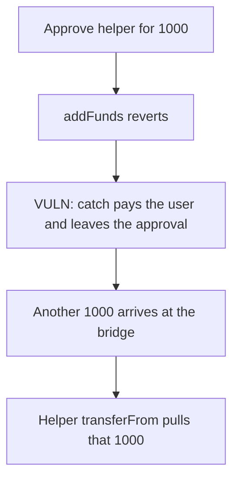

# Connext fulfill — a failed helper keeps a 1000 approval and spends the next deposit

> **Vulnerability classes:** vuln/logic/missing-check · vuln/logic/state-update · vuln/dependency/unsafe-external-call

<!-- non-defihacklabs -->
<!-- source-auditvault: https://github.com/Auditware/AuditVault/blob/main/findings/25506-h-05-approval-is-not-reset-if-the-call-to-ifulfillhelper-fai.md -->
<!-- date: 2021-07 -->

## Key info

| | |
|---|---|
| **Protocol** | Connext TransactionManager |
| **Finding** | Code4rena 2021-07 H-05, AuditVault 25506 |
| **Vulnerable code** | `TransactionManager.fulfill` catch path |
| **Harm** | The helper pulls 1000 NEXT from the next deposit with the approval the catch left behind |
| **Chain** | local synthetic |

## TL;DR

`fulfill` approves `callTo` for `toSend`, then calls `addFunds`. The helper reverts. The catch transfers the 1000 to the user and does not set the allowance back to 0. A later 1000 deposit is pulled by that leftover approval. The control approves 0 in the catch, and the same pull reverts, leaving the later deposit in the bridge.

## The vulnerable code

```solidity
require(token.approve(callTo, toSend), "fulfill: APPROVAL_FAILED");
try IFulfillHelper(callTo).addFunds(user, transactionId, address(token), toSend) {}
catch {
    // @> VULN: the fallback transfer runs and the approval of callTo is left in place
    require(token.transfer(receivingAddress, toSend), "fulfill: TRANSFER_FAILED");
}
```

The control adds `token.approve(callTo, 0)` after the fallback transfer.

## Root cause

The approval is granted before the external call and is not inside the successful path only. A revert in the helper skips every line that would have consumed the allowance, and the catch does not clear it. The allowance stays equal to `toSend`.

## Preconditions

`toSend` is 1000e18 of an ERC-20. `callTo` is a contract whose `addFunds` reverts. The bridge later receives another 1000e18. Anyone who can call the helper can then `transferFrom` the bridge.

## Attack walkthrough

1. The bridge is funded with 1000e18 and `fulfill` approves the helper.
2. `addFunds` reverts. The catch pays the user 1000e18. The allowance is still 1000e18.
3. Another 1000e18 is minted to the bridge.
4. The helper `transferFrom`s that 1000e18 to the sink. The bridge is empty.

## Diagrams



## Impact

The helper takes 1000e18 that arrived after the failed fulfill. The user already received the original 1000e18, so the second 1000e18 is an extra loss from the bridge. The control's reset makes the pull revert and the second 1000e18 stays.

## Remediation

Approve the helper only inside the successful path, or set the allowance to 0 in the catch. Connext patched this in [nxtp pull 39](https://github.com/connext/nxtp/pull/39).

## Sources

- AuditVault finding: https://github.com/Auditware/AuditVault/blob/main/findings/25506-h-05-approval-is-not-reset-if-the-call-to-ifulfillhelper-fai.md
- Code4rena report: https://code4rena.com/reports/2021-07-connext
