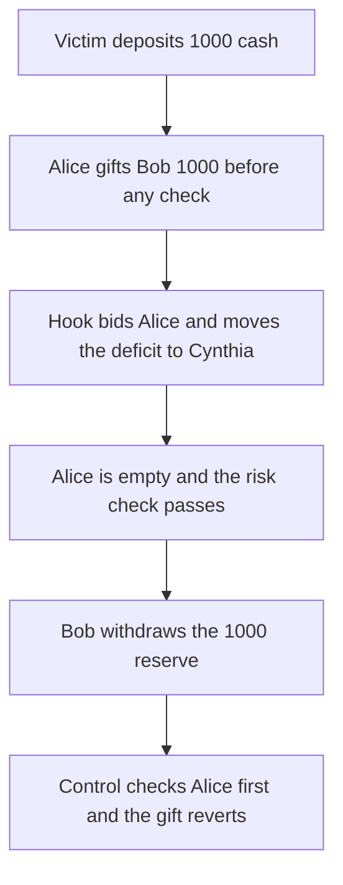

# Liquidating inside a transfer hook drains 1,000 cash the sender never deposited

> **Vulnerability classes:** vuln/reentrancy/single-function · vuln/logic/incorrect-order-of-operations
>
> **Reproduction:** self-contained synthetic Foundry reduction; see [output.txt](output.txt).

<!-- non-defihacklabs -->
<!-- source-auditvault: https://github.com/Auditware/AuditVault/blob/main/findings/26267-funds-can-be-drained-from-the-protocol-by-liquidating-an-acc.md -->
<!-- date: 2024-02 -->

## Key info

| Field | Value |
|---|---|
| **Loss** | Bob withdraws 1,000 cash. The victim who deposited it is left credited and cannot withdraw |
| **Vulnerable contract** | `LyraBook26267.submitTransfer` (reduction of Lyra `StandardManager` / `DutchAuction.bid`) |
| **Attacker EOA** | `0x1111111111111111111111111111111111111111` |
| **Attack contract** | `Exploit` |
| **Attack tx** | `Exploit.run()` |
| **Chain / block / date** | Ethereum model · block 0 · 2024-02 |
| **Compiler** | solc 0.8.27, cancun, via IR |
| **Bug class** | External managerData runs before the insolvency check, and the same-transaction bid moves the deficit with no risk check |

## TL;DR

Alice gifts Bob 1,000 cash she does not have. The book applies that gift, then calls out to `acceptData`, and only then checks that Alice is solvent. The callback bids Alice's account while she is insolvent. Because the bid is in the same transaction, the whole -1,000 moves to Cynthia and Cynthia is not risk-checked. Alice is empty, the check passes, and Bob withdraws the victim's 1,000. The same gift on a book that checks solvency first reverts, and that victim still withdraws 1,000.

## Background

Sigma Prime's review of Lyra V2 describes a transfer that leaves the sender insolvent. `submitTransfer` moves the assets before any risk check, then `_managerHook` reaches `StandardManager.handleAdjustment`, which calls `_processManagerData` before the risk check. The attacker's `acceptData` starts an insolvent auction and `dutchAuction.bid` takes 100% of the account. `stepInsolvent` is zero inside the same transaction, so the liability moves with no risk check on the bidder. The sender is then empty and passes. The recipient settles a profit nobody deposited.

## The vulnerable code

```solidity
net[alice] -= int256(gift);
net[bob] += int256(gift);
if (hookBeforeCheck) {
    // @> VULN: managerData runs before the risk check, so the callback can liquidate Alice and move her deficit away.
    IManagerHook26267(hook).acceptData(alice);
}
require(net[alice] >= 0, "insolvent");
```

`bid` then does `net[from] = 0; net[bidder] += position` with no solvency check on the bidder. That is the "stepInsolvent is zero, full liability, no risk check" step from the report.

## Root cause

Effects run before the check, and the check is on the wrong account. The hook can change who holds the deficit. The sender is tested after the deficit has been moved. The bidder who received it is never tested.

## Preconditions

- A victim has deposited the cash the recipient will withdraw. Here that deposit is 1,000.
- The caller can attach managerData that the book will call.
- The liquidation bid in the same transaction does not risk-check the bidder.

## Attack walkthrough

1. The book is funded with 1,000 ([output.txt:9](output.txt)).
2. Alice's gift to Bob is applied, then `acceptData` runs ([output.txt:8](output.txt)).
3. Cynthia's balance becomes -1,000 ([output.txt:15](output.txt)). Alice is flat and passes the check.
4. Bob withdraws 1,000 ([output.txt:11](output.txt)). The book has 0 left for the victim ([output.txt:13](output.txt)).
5. The victim's own withdrawal reverts.
6. Control: the same gift is risk-checked first and reverts. The control victim still receives 1,000 ([output.txt:17](output.txt)).
7. `[PASS]` ([output.txt:6](output.txt)).

## Diagrams



## Impact

The victim deposited 1,000 and cannot withdraw it. Bob, who deposited nothing, receives 1,000. Cynthia holds a -1,000 position that was never risk-checked. The control book rejects the gift and the depositor withdraws the full 1,000.

## Remediation

Run the external manager call only after every account that lost value has passed its risk check, and risk-check the bidder who receives a liquidated position. A system-wide reentrancy lock around the transfer is the other half of the fix the report asked for.

## How to reproduce

```bash
cd 26267-funds-can-be-drained-from-the-protocol-by-liquidating-an-acc_exp
forge test -vv
```

## Sources

- AuditVault finding: [26267-funds-can-be-drained-from-the-protocol-by-liquidating-an-acc](https://github.com/Auditware/AuditVault/blob/main/findings/26267-funds-can-be-drained-from-the-protocol-by-liquidating-an-acc.md)
- Sigma Prime, Lyra Finance review: https://github.com/sigp/public-audits/blob/master/lyra-finance/review.pdf
