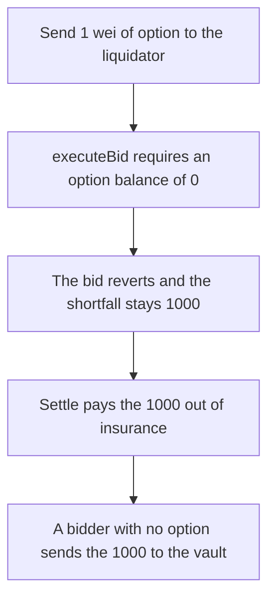

# One wei of an option blocks a liquidation and the 1,000 shortfall is paid from insurance

> **Vulnerability classes:** vuln/dos/frozen-funds · vuln/logic/missing-check
>
> **Reproduction:** self-contained synthetic Foundry reduction; see [output.txt](output.txt).

<!-- non-defihacklabs -->
<!-- source-auditvault: https://github.com/Auditware/AuditVault/blob/main/findings/26268-bids-can-be-blocked-by-sending-option-to-liquidator-sigmapri.md -->
<!-- date: 2024-02 -->

## Key info

| Field | Value |
|---|---|
| **Loss** | A 1,000 shortfall is paid out of insurance cash because the bid reverts. A clean bid sends that 1,000 to the insurance vault |
| **Vulnerable contract** | `DutchAuction26268.executeBid` (reduction of Lyra `DutchAuction`) |
| **Attacker EOA** | `0x1111111111111111111111111111111111111111` |
| **Attack contract** | `Exploit` |
| **Attack tx** | `Exploit.run()` |
| **Chain / block / date** | Ethereum model · block 0 · 2024-02 |
| **Compiler** | solc 0.8.27, cancun, via IR |
| **Bug class** | The bidder is required to hold only the cash asset, so 1 wei of any other asset reverts the bid |

## TL;DR

`executeBid` reverts unless the bidder's option balance is zero. Transferring 1 wei of option to the liquidator makes the bid revert. The 1,000 shortfall is still open, and settling it moves the 1,000 insurance cash to the borrower. The same bid from an address that holds no option succeeds, and the insurance vault receives the 1,000.

## Background

Sigma Prime LYRA-02: liquidations through `DutchAuction` require the bidder to hold only the cash asset, because a risk check during the bid was considered too expensive. Anyone can transfer a non-cash asset to the bidder. One wei is enough. The bid reverts and the insolvent account is not liquidated. The playground is a single block, so the dust transfer and the bid are in one call. The check sees the same state a frontrun would have left.

## The vulnerable code

```solidity
function executeBid(address bidder) external {
    // @> VULN: a bidder who holds any non-cash asset is rejected. One wei of option makes the liquidation revert.
    require(option.balanceOf(bidder) == 0, "non-cash");
    uint256 amt = cash.balanceOf(address(this));
    uncovered = 0;
    cash.transfer(INSURANCE, amt);
}
```

## Root cause

The liquidation's safety check is "the bidder's balances are exactly the cash asset", not "the position the bidder is about to hold is solvent". Any token the bidder did not ask for fails the check. The transfer of that token does not need the bidder's approval.

## Preconditions

- An auction is trying to cover a 1,000 shortfall, and the auction holds 1,000 insurance cash.
- The attacker can transfer 1 wei of a non-cash token to the liquidator before `executeBid`.
- If the bid does not land, the shortfall is settled from that cash.

## Attack walkthrough

1. The liquidator's option balance is 1 ([output.txt:9](output.txt)).
2. `executeBid` reverts. The shortfall is still 1,000 ([output.txt:11](output.txt)).
3. `settle` pays 1,000 out of the auction ([output.txt:13](output.txt)). The insurance vault receives 0 ([output.txt:15](output.txt)).
4. Control: a bidder with no option is accepted. The insurance vault receives 1,000 ([output.txt:17](output.txt)).
5. `[PASS]` ([output.txt:6](output.txt)).

## Diagrams



## Impact

The underwater account is not liquidated. 1,000 insurance cash is paid to the borrower instead of being posted to the insurance vault. The control bid covers the same 1,000 and leaves the borrower with nothing from that cash.

## Remediation

Do not reject a bidder for holding some other asset. Take the cash the bid requires, transfer the position, and risk-check the bidder on the resulting portfolio. That is the change the report recommends, and the later approval gate on option transfers is the patch Lyra shipped.

## How to reproduce

```bash
cd 26268-bids-can-be-blocked-by-sending-option-to-liquidator-sigmapri_exp
forge test -vv
```

## Sources

- AuditVault finding: [26268-bids-can-be-blocked-by-sending-option-to-liquidator-sigmapri](https://github.com/Auditware/AuditVault/blob/main/findings/26268-bids-can-be-blocked-by-sending-option-to-liquidator-sigmapri.md)
- Sigma Prime, Lyra Finance review, LYRA-02: https://github.com/sigp/public-audits/blob/master/lyra-finance/review.pdf
