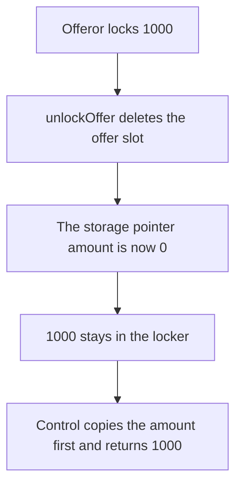

# Unlocking an offer deletes it first and returns 0 of the 1,000 deposit

> **Vulnerability classes:** vuln/dos/frozen-funds · vuln/logic/state-update
>
> **Reproduction:** self-contained synthetic Foundry reduction; see [output.txt](output.txt).

<!-- non-defihacklabs -->
<!-- source-auditvault: https://github.com/Auditware/AuditVault/blob/main/findings/26292-unlocking-offers-does-not-return-any-funds-sigmaprime-none-t.md -->
<!-- date: 2024-03 -->

## Key info

| Field | Value |
|---|---|
| **Loss** | 1,000 purchase tokens stay in the locker. The offeror is paid 0 |
| **Vulnerable contract** | `OfferLocker26292.unlockOffer` (reduction of `TermAuctionOfferLocker`) |
| **Attacker EOA** | `0x1111111111111111111111111111111111111111` |
| **Attack contract** | `Exploit` |
| **Attack tx** | `Exploit.run()` |
| **Chain / block / date** | Ethereum model · block 0 · 2024-03 |
| **Compiler** | solc 0.8.27, cancun, via IR |
| **Bug class** | A storage pointer is read after `delete`, so the returned amount is 0 |

## TL;DR

The offeror locks 1,000 purchase tokens. `unlockOffer` takes a storage pointer to the offer, deletes the offer, and then reads `offerToUnlock.amount`. That read is 0. No tokens move. The locker still holds 1,000 and the offeror holds 0. Copying the amount into a local before the delete returns all 1,000.

## Background

Sigma Prime's Term Finance review, `TermAuctionOfferLocker.sol`. The offer is a storage reference. `delete` clears the slot the reference points at. The later call to `termRepoServicer.unlockOfferAmount` is passed that cleared amount. The recommendation in the report is `uint256 amountToUnlock = offers[id].amount` before the delete. The retest of commit `e883f0e` made that change.

## The vulnerable code

```solidity
Offer storage offerToUnlock = offers[id];
delete offers[id];
uint256 cleared = offerToUnlock.amount;
// @> VULN: offerToUnlock is a storage pointer. delete already cleared it, so the amount handed to the return is 0.
this.touch(cleared);
```

## Root cause

`offerToUnlock` is not a copy. It is the slot. Deleting the slot and then reading the pointer reads the zeroed slot. The offer row is gone, so the offeror cannot unlock again, and the tokens were never sent.

## Preconditions

- An offer is locked and the locker holds the purchase tokens. Here that amount is 1,000.
- The offeror calls unlock. No other role is required.

## Attack walkthrough

1. The locker is funded with 1,000 ([output.txt:9](output.txt)).
2. Unlock pays 0 ([output.txt:11](output.txt)).
3. The locker still holds 1,000 ([output.txt:13](output.txt)).
4. Control copies the amount first and pays 1,000 ([output.txt:15](output.txt)). The control locker is empty ([output.txt:17](output.txt)).
5. `[PASS]` ([output.txt:6](output.txt)).

## Diagrams



## Impact

The offeror loses the use of 1,000 purchase tokens. The locker keeps them. The offer record is gone, so a second unlock has nothing to read. The control path returns the same 1,000 to the offeror.

## Remediation

Copy `offers[id].amount` into a local variable before `delete`, and pass that local to the token return. That is the change Term shipped in `e883f0e`.

## How to reproduce

```bash
cd 26292-unlocking-offers-does-not-return-any-funds-sigmaprime-none-t_exp
forge test -vv
```

## Sources

- AuditVault finding: [26292-unlocking-offers-does-not-return-any-funds-sigmaprime-none-t](https://github.com/Auditware/AuditVault/blob/main/findings/26292-unlocking-offers-does-not-return-any-funds-sigmaprime-none-t.md)
- Sigma Prime, Term Finance term1 review: https://github.com/sigp/public-audits/blob/master/term-finance/term1/review.pdf
