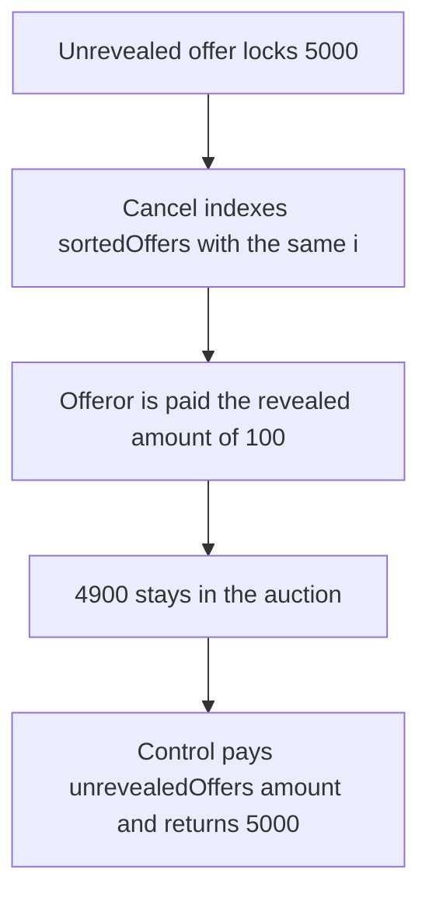

# Cancelling an auction refunds 100 of a 5,000 unrevealed offer and keeps 4,900

> **Vulnerability classes:** vuln/logic/wrong-condition · vuln/dos/frozen-funds
>
> **Reproduction:** self-contained synthetic Foundry reduction; see [output.txt](output.txt).

<!-- non-defihacklabs -->
<!-- source-auditvault: https://github.com/Auditware/AuditVault/blob/main/findings/26293-cancelling-an-auction-refunds-the-wrong-amount-for-unreveale.md -->
<!-- date: 2024-03 -->

## Key info

| Field | Value |
|---|---|
| **Loss** | The offeror locked 5,000 and is refunded 100. 4,900 stays in the auction |
| **Vulnerable contract** | `CancelAuction26293.cancel` (reduction of the Term auction cancel loop) |
| **Attacker EOA** | `0x1111111111111111111111111111111111111111` |
| **Attack contract** | `Exploit` |
| **Attack tx** | `Exploit.run()` |
| **Chain / block / date** | Ethereum model · block 0 · 2024-03 |
| **Compiler** | solc 0.8.27, cancun, via IR |
| **Bug class** | The unrevealed-offer refund reads `sortedOffers[i].amount` |

## TL;DR

Cancel walks `unrevealedOffers` and refunds `sortedOffers[i].amount`. The offeror locked 5,000. The revealed offer at index 0 is 100. Cancel pays 100 and leaves 4,900 in the contract. The index is inside `sortedOffers`, so the call does not revert. It just pays the wrong number. Refunding `unrevealedOffers[i].amount` returns all 5,000.

## Background

Sigma Prime, Term Finance term1. The cancel path returns funds for offers that were never revealed. The loop index is the unrevealed-offer index, but the amount argument is taken from `sortedOffers`. If that index is past the end of `sortedOffers` the transaction reverts and every refund in the batch fails. If it is in range, the revealed offer's amount is what the unrevealed offeror receives. The retest of commit `e883f0e` switched the argument to `unrevealedOffers[i].amount`.

This reduction shows the in-range case, which is the one with a wrong payment rather than a revert. Cancel is the admin action the report describes. The admin is not stealing. The code pays the wrong figure on an ordinary cancel.

## The vulnerable code

```solidity
for (uint256 i = 0; i < count; i++) {
    // @> VULN: sortedOffers[i].amount is refunded. The unrevealed offer's own amount is not.
    refunded = _pay(unrevealedOfferor[i], sortedAmount[i]);
}
```

The report's snippet is the same shape: `unlockOfferPartial(unrevealedOffers[i].id, unrevealedOffers[i].offeror, sortedOffers[i].amount)`.

## Root cause

Two arrays are indexed by the same `i` as if they were the same list. They are not. `sortedOffers[i]` is a different offer from `unrevealedOffers[i]`.

## Preconditions

- An unrevealed offer of 5,000 is locked in the auction.
- A revealed offer at the same index has amount 100, so the read does not run off the array.
- Someone calls cancel. In the protocol that caller is the admin. The amounts do not depend on the admin being malicious.

## Attack walkthrough

1. The auction holds 5,000 ([output.txt:9](output.txt)).
2. Cancel refunds 100 ([output.txt:11](output.txt)).
3. 4,900 remains in the auction ([output.txt:13](output.txt)).
4. Control refunds the unrevealed amount, 5,000 ([output.txt:15](output.txt)), and the control auction is empty ([output.txt:17](output.txt)).
5. `[PASS]` ([output.txt:6](output.txt)).

## Diagrams



## Impact

The offeror is short 4,900 purchase tokens. Those tokens sit in the auction with the offer already cleared. The control cancel returns the full 5,000.

## Remediation

Pass `unrevealedOffers[i].amount` to the refund. Do not index `sortedOffers` with the unrevealed-offer index.

## How to reproduce

```bash
cd 26293-cancelling-an-auction-refunds-the-wrong-amount-for-unreveale_exp
forge test -vv
```

## Sources

- AuditVault finding: [26293-cancelling-an-auction-refunds-the-wrong-amount-for-unreveale](https://github.com/Auditware/AuditVault/blob/main/findings/26293-cancelling-an-auction-refunds-the-wrong-amount-for-unreveale.md)
- Sigma Prime, Term Finance term1 review: https://github.com/sigp/public-audits/blob/master/term-finance/term1/review.pdf
