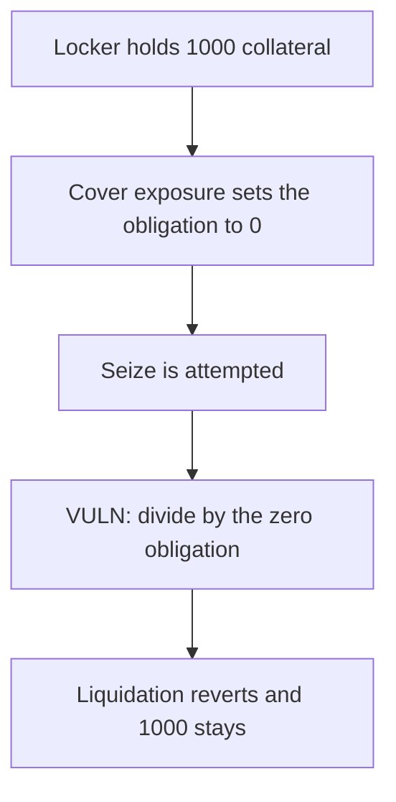

# Term Finance — a complete liquidation divides by zero and 1000 collateral stays

> **Vulnerability classes:** vuln/logic/liquidation-logic · vuln/dos/frozen-funds · vuln/logic/missing-check

<!-- non-defihacklabs -->
<!-- source-auditvault: https://github.com/Auditware/AuditVault/blob/main/findings/26294-liquidations-fail-with-division-by-zero-errors-sigmaprime-no.md -->
<!-- date: 2023-04 -->

## Key info

| | |
|---|---|
| **Protocol** | Term Finance |
| **Finding** | Sigma Prime term1, AuditVault 26294 |
| **Vulnerable code** | `BatchLiquidation._withinNetExposureCapOnLiquidation` |
| **Harm** | The liquidation reverts and 1000 COLL stays in the locker |
| **Chain** | local synthetic |

## TL;DR

A complete liquidation calls `liquidatorCoverExposure`, which sets the repurchase obligation to 0, and then divides excess equity by the USD value of that obligation. The divisor is 0, so the transaction reverts and the seize of 1000 collateral is undone. The control returns true when the obligation is already 0, and the liquidator receives the 1000.

## The vulnerable code

```solidity
uint256 getBorrowerRepurchaseObligation = servicer.getBorrowerRepurchaseObligation(who);
uint256 excessEquity = 1 ether;
uint256 denom = oracle.usdValueOfTokens(getBorrowerRepurchaseObligation);
// @> VULN: a complete liquidation leaves the repurchase obligation at 0, so this divides by zero
uint256 ratio = excessEquity / denom;
```

The control returns true before the division when the obligation is 0.

## Root cause

The cap check assumes a positive repurchase obligation. The function that runs immediately before it, on a complete liquidation, sets that obligation to 0. Solidity 0.8 reverts on division by zero, so the liquidation cannot complete.

## Preconditions

The locker holds 1000e18 collateral. The borrower has a positive obligation at the start of the call. `batchLiquidation` covers the full exposure and then reads the obligation back. No time warp is required.

## Attack walkthrough

1. 1000e18 collateral is minted into the locker.
2. `batchLiquidation` zeros the obligation and attempts the seize.
3. The cap check reads a 0 obligation and divides by it.
4. The call reverts. The locker still holds 1000e18 and the liquidator holds 0.

## Diagrams



## Impact

The 1000e18 collateral cannot be seized. A complete liquidation is impossible, so the underwater position stays open and the collateral stays in the locker. The control pays the liquidator the full 1000e18 and clears the debt.

## Remediation

Return true at the start of `_withinNetExposureCapOnLiquidation` when the repurchase obligation is 0. Sigma Prime retested this as fixed on commit `e883f0e`.

## Sources

- AuditVault finding: https://github.com/Auditware/AuditVault/blob/main/findings/26294-liquidations-fail-with-division-by-zero-errors-sigmaprime-no.md
- Sigma Prime report: https://github.com/sigp/public-audits/blob/master/reports/term-finance/term1/review.pdf
- Audited commit: term-finance `e57734f`
