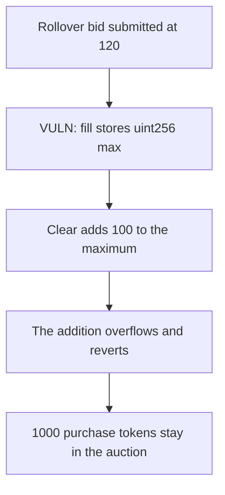

# Term Finance — a rollover bid at uint256 max sticks 1000 purchase tokens

> **Vulnerability classes:** vuln/arithmetic/overflow · vuln/logic/price-calculation · vuln/dos/frozen-funds

<!-- non-defihacklabs -->
<!-- source-auditvault: https://github.com/Auditware/AuditVault/blob/main/findings/26295-rollover-bids-are-set-to-maximum-price-causing-reverts-sigma.md -->
<!-- date: 2023-04 -->

## Key info

| | |
|---|---|
| **Protocol** | Term Finance auctions |
| **Finding** | Sigma Prime term1, AuditVault 26295 |
| **Vulnerable code** | `TermAuction._fillRevealedBidsForAuctionClearing` |
| **Harm** | Clearing reverts and 1000 PURCH stays in the auction |
| **Chain** | local synthetic |

## TL;DR

A rollover bid is submitted at 120. The fill step overwrites `bidPriceRevealed` with `type(uint256).max`. Clearing averages that price with an offer of 100. The addition overflows and the auction reverts, so the 1000 purchase tokens are not paid out. The control keeps the submitted 120, clears at 110, and pays the 1000 to the bidder.

## The vulnerable code

```solidity
if (bid.isRollover) {
    // @> VULN: the submitted rollover price is replaced with the maximum uint256
    bid.bidPriceRevealed = type(uint256).max;
}
```

The clearing line that then reverts is `(offerPrice + bidPrice) / 2`.

## Root cause

Rollover bids already carry a revealed price. Replacing it with the maximum uint256 makes any later sum with another price overflow under Solidity 0.8. The auction that contains the rollover cannot complete.

## Preconditions

The bid is marked rollover and was submitted at 120. The opposing offer is 100. The auction holds 1000e18 purchase tokens that a successful clear would transfer to the bidder.

## Attack walkthrough

1. 1000e18 is minted into the auction.
2. Fill replaces 120 with `type(uint256).max`.
3. Clear adds 100 to that maximum and reverts.
4. The auction still holds 1000e18. The bidder holds 0.

## Diagrams



## Impact

The 1000e18 purchase tokens cannot leave the auction while the rollover bid is in the clearing set. The control keeps price 120, sets the clearing price to 110, and pays the bidder the 1000e18.

## Remediation

Keep the submitted rollover price. Sigma Prime records the fix in PR 681.

## Sources

- AuditVault finding: https://github.com/Auditware/AuditVault/blob/main/findings/26295-rollover-bids-are-set-to-maximum-price-causing-reverts-sigma.md
- Sigma Prime report: https://github.com/sigp/public-audits/blob/master/reports/term-finance/term1/review.pdf
- Audited commit: term-finance `e57734f`
