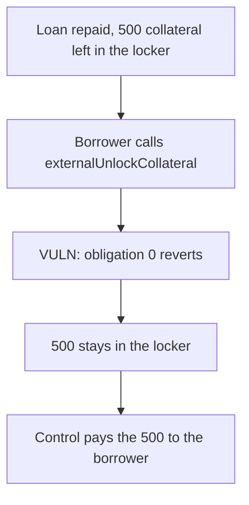

# Term Finance — 500 excess collateral stays locked after the loan is repaid

> **Vulnerability classes:** vuln/dos/frozen-funds · vuln/logic/wrong-condition · vuln/logic/liquidation-logic

<!-- non-defihacklabs -->
<!-- source-auditvault: https://github.com/Auditware/AuditVault/blob/main/findings/26296-borrowers-cannot-withdraw-excess-collateral-after-liquidatio.md -->
<!-- date: 2023-04 -->

## Key info

| | |
|---|---|
| **Protocol** | Term Finance |
| **Finding** | Sigma Prime term1, AuditVault 26296 |
| **Vulnerable code** | `TermRepoLocker.externalUnlockCollateral` |
| **Harm** | Unlock reverts and 500 COLL stays in the locker |
| **Chain** | local synthetic |

## TL;DR

After liquidation the repurchase obligation is 0 and 500 collateral is still in the locker, marked for the borrower. `externalUnlockCollateral` reverts `ZeroBorrowerRepurchaseObligation` whenever that obligation is 0, so the borrower cannot take the 500. The control skips that check and transfers the 500 to the borrower.

## The vulnerable code

```solidity
// @> VULN: a fully repaid borrower still reverts, so leftover collateral cannot move
if (servicer.getBorrowerRepurchaseObligation(borrower) == 0) {
    revert ZeroBorrowerRepurchaseObligation();
}
coll.transfer(borrower, amount);
```

The control transfers the collateral without that revert.

## Root cause

The zero check was meant to block an unlock when there is no loan, but a liquidation or default can repay the loan without taking every unit of collateral. Zero is then the state in which the excess should be withdrawable, and it is exactly the state the check rejects.

## Preconditions

The borrower's repurchase obligation is 0. The locker holds 500e18 of their collateral. The borrower calls `externalUnlockCollateral` for 500e18.

## Attack walkthrough

1. 500e18 is minted into the locker. The obligation is already 0.
2. The unlock reads the obligation and takes the revert branch.
3. The call fails. The locker still holds 500e18 and the borrower holds 0.

## Diagrams



## Impact

The borrower cannot recover 500e18 of excess collateral. It remains in the locker after the debt is gone. The control pays that 500e18 to the borrower and leaves the locker empty.

## Remediation

Allow the withdrawal when the repurchase obligation is 0 because liquidation or default already repaid it. Sigma Prime records the fix in PR 757.

## Sources

- AuditVault finding: https://github.com/Auditware/AuditVault/blob/main/findings/26296-borrowers-cannot-withdraw-excess-collateral-after-liquidatio.md
- Sigma Prime report: https://github.com/sigp/public-audits/blob/master/reports/term-finance/term1/review.pdf
- Audited commit: term-finance `e57734f`
