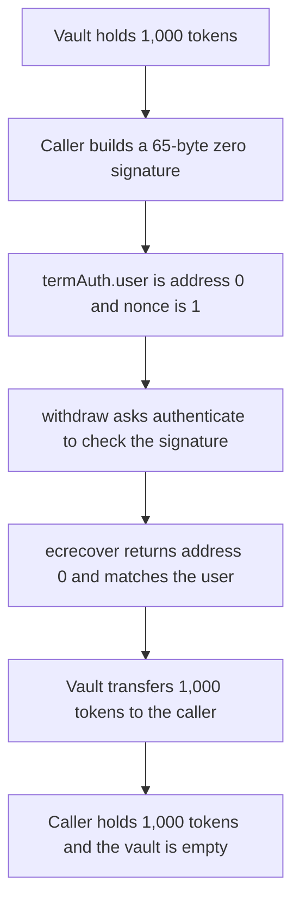

# Term Finance: a zero signature authenticates as address(0) and withdraws 1,000 tokens

> **Vulnerability classes:** vuln/auth/signature-validation

> **Reproduction:** local synthetic, no fork. `authenticate` is the audited body. A 65-byte zero signature and `user = address(0)` pass, and the vault sends 1,000 tokens. Trace: [output.txt](output.txt).

<!-- non-defihacklabs -->
<!-- source-auditvault: https://github.com/Auditware/AuditVault/blob/main/findings/26297-no-checks-for-non-zero-output-address-when-using-ecrecover-s.md -->
<!-- date: 2023-04 -->

## Key info

| | |
|---|---|
| **Impact** | **HIGH** — 1,000 tokens move with no private key |
| **Protocol** | Term Finance — `Authenticator.authenticate` |
| **Vulnerable code** | `return ecrecover(check, v, r, s) == termAuth.user` with no zero check |
| **Bug class** | `ecrecover` of an invalid signature returns `address(0)` |
| **Finding** | Sigma Prime, Term Finance contracts, April 2023 · TRM-07 |
| **Report** | [sigp/public-audits term1 review](https://github.com/sigp/public-audits/blob/master/reports/term-finance/term1/review.pdf) |

## Root cause

`ecrecover` returns `address(0)` when the signature is invalid. The audited function treats that as success whenever `termAuth.user` is also `address(0)`:

```solidity
return ecrecover(check, v, r, s) == termAuth.user;
```

A 65-byte buffer of zeros decodes to `v = 0`, `r = 0`, `s = 0`. That is not a signature from any key. `ecrecover` returns `address(0)`, the comparison is true, and the nonce is consumed so the call looks like a normal authentication. The vault then transfers 1,000 tokens to the caller.

## Attack path



## PoC

```bash
cd 26297-no-checks-for-non-zero-output-address-when-using-ecrecover-s_exp
forge test -vv
```

The exploit asserts the attacker balance is `1_000 ether` and the vault balance is 0. The control authenticator reverts with `InvalidSignature` when `ecrecover` returns `address(0)`. The same withdraw moves nothing, and the 1,000 tokens stay in the vault.

## Remediation

Reject a zero recovery address before comparing it to the claimed user:

```solidity
address recovered = ecrecover(check, v, r, s);
if (recovered == address(0)) revert InvalidSignature();
return recovered == termAuth.user;
```

Sigma Prime retested commit `e883f0e` and the function now reverts with `InvalidSignature`.

## References

- AuditVault: https://github.com/Auditware/AuditVault/blob/main/findings/26297-no-checks-for-non-zero-output-address-when-using-ecrecover-s.md
- Report: https://github.com/sigp/public-audits/blob/master/reports/term-finance/term1/review.pdf
