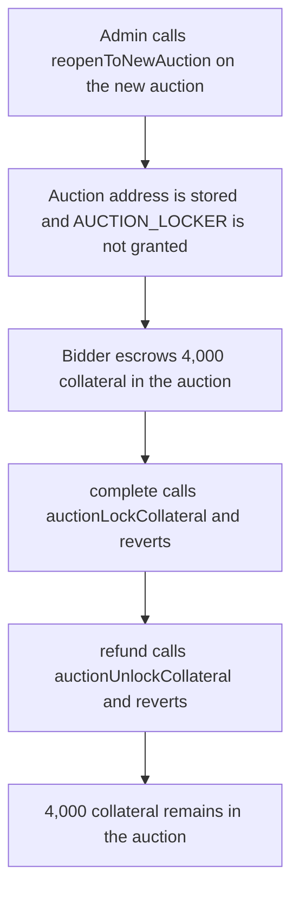

# Term Finance: a reopened auction never receives AUCTION_LOCKER, so 4,000 collateral stays locked

> **Vulnerability classes:** vuln/access-control/missing-auth · vuln/dos/frozen-funds

> **Reproduction:** local synthetic, no fork. `reopenToNewAuction` links the new auction and does not grant `AUCTION_LOCKER`. A 4,000 collateral bid cannot be settled or refunded. Trace: [output.txt](output.txt).

<!-- non-defihacklabs -->
<!-- source-auditvault: https://github.com/Auditware/AuditVault/blob/main/findings/26299-insufficient-permissions-granted-to-new-auctions-sigmaprime.md -->
<!-- date: 2023-04 -->

## Key info

| | |
|---|---|
| **Impact** | **HIGH** — 4,000 collateral is stuck in the new auction |
| **Protocol** | Term Finance — `TermRepoCollateralManager.reopenToNewAuction` |
| **Vulnerable code** | the new auction is stored and `AUCTION_LOCKER` is not granted |
| **Bug class** | Missing role on a reopened auction |
| **Finding** | Sigma Prime, Term Finance contracts, April 2023 · TRM-10 |
| **Report** | [sigp/public-audits term1 review](https://github.com/sigp/public-audits/blob/master/reports/term-finance/term1/review.pdf) |

## Root cause

`auctionLockCollateral` and `auctionUnlockCollateral` are `onlyRole(AUCTION_LOCKER)`. The initial pairing grants that role to the auction. `reopenToNewAuction` replaces the auction and, in the audited code, does not:

```solidity
function reopenToNewAuction(address auction) external onlyRole(DEFAULT_ADMIN_ROLE) {
    // @> VULN: the new auction is linked and never receives AUCTION_LOCKER
    currentAuction = auction;
}
```

A bidder can still escrow collateral in the new auction contract. Completing the auction calls `auctionLockCollateral`. Refunding calls `auctionUnlockCollateral`. Both revert with `missing role`. The 4,000 collateral has no exit.

## Attack path



## PoC

```bash
cd 26299-insufficient-permissions-granted-to-new-auctions-sigmaprime_exp
forge test -vv
```

The exploit asserts both calls reverted, `completed` is false, and the auction balance is `4_000 ether`. The control `reopenToNewAuction` grants `AUCTION_LOCKER` before returning. The same bid then completes: the auction balance goes to 0 and the collateral manager holds the 4,000.

## Remediation

Grant the role inside `reopenToNewAuction`, which is what the report recommends:

```solidity
function reopenToNewAuction(address auction) external onlyRole(DEFAULT_ADMIN_ROLE) {
    currentAuction = auction;
    hasRole[AUCTION_LOCKER][auction] = true;
}
```

Sigma Prime records the fix in PR 759.

## References

- AuditVault: https://github.com/Auditware/AuditVault/blob/main/findings/26299-insufficient-permissions-granted-to-new-auctions-sigmaprime.md
- Report: https://github.com/sigp/public-audits/blob/master/reports/term-finance/term1/review.pdf
