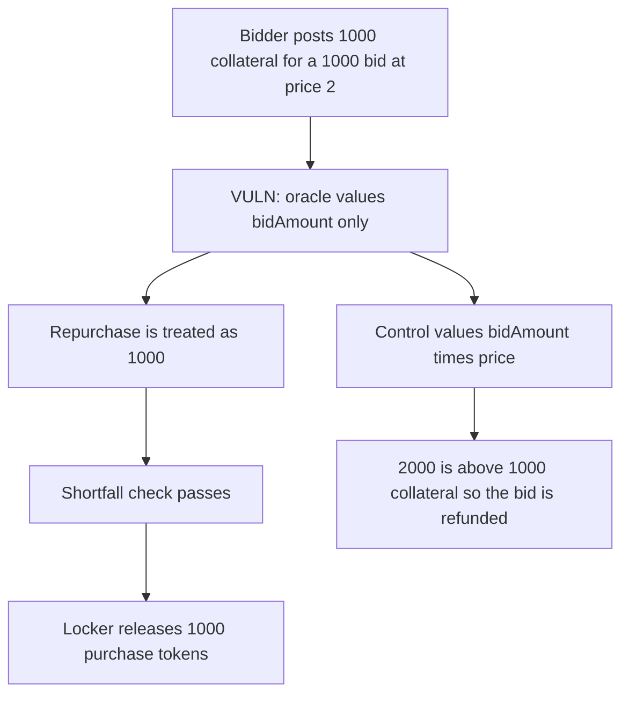

# Term Finance accepts a bid whose price the collateral cannot cover

> **Vulnerability classes:** vuln/logic/price-calculation · vuln/logic/missing-check

<!-- non-defihacklabs -->
<!-- source-auditvault: https://github.com/Auditware/AuditVault/blob/main/findings/26301-bid-price-not-accounted-for-in-isininitialcollateralshortfa.md -->
<!-- date: 1970-01 -->

## Key info

| Field | Value |
|---|---|
| **Loss** | 1000 purchase tokens released against collateral that is 1000 short of the 2000 repurchase |
| **Vulnerable contract** | `TermAuctionBidLocker._isInInitialCollateralShortFall` |
| **Attacker EOA** | `0x1111111111111111111111111111111111111111` |
| **Attack contract** | `Exploit` |
| **Attack tx** | `Exploit.run()` |
| **Chain / block / date** | Ethereum model · block 0 · 1970-01 |
| **Compiler** | solc 0.8.27, cancun, via IR |
| **Bug class** | Initial collateral check values the bid amount and ignores the bid price |

## TL;DR

`_isInInitialCollateralShortFall` asks the oracle for `usdValueOfTokens(purchaseToken, bidAmount)`. The submitted bid price is not applied. A bidder can post 1000 collateral for a 1000-token bid priced at 2, pass the check, and receive the 1000 purchase-token principal. The repurchase obligation is 2000, so the position is short 1000. Pricing the repurchase before the oracle call rejects the same bid and refunds the collateral.

## Background

Sigma Prime, Term Finance, `TermAuctionBidLocker.sol`. The report says the repurchase value on the shortfall check used only the bid amount, so a large bid could clear the auction without collateral for the interest. The fix on commit `e883f0e` includes the repurchase price.

## The vulnerable code

```solidity
Exp memory repurchasePriceUSDValue = termPriceOracle.usdValueOfTokens(
    purchaseToken,
    bidAmount
);
```

`lockBid` releases `bidAmount` of the purchase token when this check returns false.

## Root cause

The USD value passed into the comparison is the raw bid size. At a $1 oracle price that value is 1000, which is not greater than 1000 of collateral. The bid price of 2 would have made the repurchase 2000.

## Preconditions

- The locker holds purchase-token principal.
- The bidder can call `lockBid` with any price.
- Collateral is compared only with the unpriced amount.

## Attack walkthrough

1. The bidder approves 1000 collateral and calls `lockBid(1000, 2e18, 1000)`.
2. The shortfall helper calls the oracle with `bidAmount` and not `bidAmount * bidPrice / 1e18`.
3. The oracle returns 1000. Collateral is not strictly below that, so the bid is accepted.
4. The locker transfers 1000 purchase tokens to the bidder.
5. The true repurchase is 2000. The collateral gap is 1000.

## Diagrams



## Impact

The bidder receives 1000 purchase tokens while the collateral only covers half of the 2000 repurchase. Lenders are short 1000 on a position the auction should have refused. The priced control leaves the 1000 principal in the locker and returns the collateral.

## Remediation

Value `bidAmount * bidPrice / 1e18` before the shortfall comparison, which is what the retest of commit `e883f0e` describes.

## How to reproduce

```bash
cd 26301-bid-price-not-accounted-for-in-isininitialcollateralshortfa_exp
forge test -vv
```

`test_undercollateralized_bid_receives_principal` asserts 1000 purchase tokens were released and the priced gap is 1000. `test_control_priced_repurchase_rejects_bid` asserts the bid is rejected, the principal stays in the locker, and the collateral is refunded.

## Sources

- AuditVault finding: https://github.com/Auditware/AuditVault/blob/main/findings/26301-bid-price-not-accounted-for-in-isininitialcollateralshortfa.md
- Report: https://github.com/sigp/public-audits/blob/master/term-finance/term1/review.pdf
