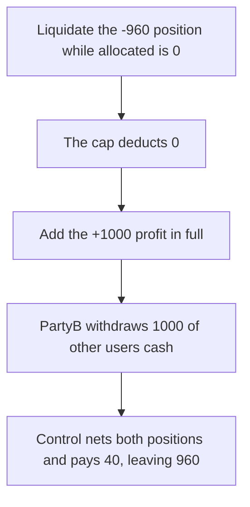

# Capping each partyB loss at the current balance turns a 40 credit into a 1,000 withdrawal

> **Vulnerability classes:** vuln/logic/state-update · vuln/logic/liquidation-logic
>
> **Reproduction:** self-contained synthetic Foundry reduction; see [output.txt](output.txt).

<!-- non-defihacklabs -->
<!-- source-auditvault: https://github.com/Auditware/AuditVault/blob/main/findings/26347-h-2-liquidatepositionspartya-limits-partyb-loss-to-partyb-al.md -->
<!-- date: 2023-08 -->

## Key info

| Field | Value |
|---|---|
| **Loss** | PartyB withdraws 1,000 of other users' cash. The fair net of the two positions is 40, so 960 is taken |
| **Vulnerable contract** | `PartyBBook26347.liquidate` (reduction of `LiquidationFacetImpl.liquidatePositionsPartyA`) |
| **Attacker EOA** | `0x1111111111111111111111111111111111111111` |
| **Attack contract** | `Exploit` |
| **Attack tx** | `Exploit.run()` |
| **Chain / block / date** | Ethereum model · block 0 · 2023-08 |
| **Compiler** | solc 0.8.27, cancun, via IR |
| **Bug class** | Each partyB loss is capped by partyB's allocated balance at that moment, so loss-then-profit drops the loss |

## TL;DR

PartyB has a -960 position and a +1,000 position, and an allocated balance of 0. Liquidating the loss first deducts `min(960, 0) = 0`. Liquidating the profit then adds 1,000. PartyB withdraws 1,000. Netting both positions before applying them leaves 40, and 960 of the 1,000 reserve stays in the book. The numbers are the ones in the Sherlock report.

## Background

Sherlock 2023-08 SYMMIO, `LiquidationFacetImpl.sol` around lines 163-166. `amountToDeduct` is the minimum of the position loss and partyB's current allocated balance, and that minimum is what gets subtracted. The order of the positions changes the result. Profit first would credit the balance and the later loss would be fully deductible. Loss first forgives the loss and then books the profit in full. PartyB can already have deallocated down to 0 because the net uPnL is small. The report's worked example is upnl -960 and +1,000, allocated 0, final balance 1,000 instead of less than 60.

## The vulnerable code

```solidity
uint256 amountToDeduct = amount < bal ? amount : bal;
allocated -= int256(amountToDeduct);
// @> VULN: the loss is capped by partyB's current allocated balance, so a loss that lands before a profit is dropped.
lastDeducted = amountToDeduct;
```

## Root cause

The cap is applied per position against a balance the same liquidation is about to change. A loss that arrives while the balance is 0 disappears. A later profit does not look back at it.

## Preconditions

- PartyB has one position at -960 and another at +1,000, and allocated balance 0.
- PartyA's liquidation processes the loss first.
- The book holds 1,000 of other users' cash, which is what the inflated balance can withdraw.

## Attack walkthrough

1. The loss deducts 0 ([output.txt:9](output.txt)).
2. After the profit, partyB's balance is 1,000 ([output.txt:11](output.txt)).
3. PartyB withdraws 1,000 ([output.txt:13](output.txt)).
4. Control nets the two positions. The fair balance is 40 ([output.txt:15](output.txt)).
5. The control book keeps 960 ([output.txt:17](output.txt)). The extra taken on the vulnerable path is 960 ([output.txt:19](output.txt)).
6. `[PASS]` ([output.txt:6](output.txt)).

## Diagrams



## Impact

Other users' cash backs a credit the protocol did not receive funds for. PartyB is paid 1,000 instead of 40. The 960 difference is the insolvency the report describes: the book owes more than it holds, and the last withdrawers are the ones who cannot leave.

## Remediation

Sum the signed PnL of every position for a partyB, then apply that one net to the allocated balance. Do not cap each loss against the balance left by the previous position in the same liquidation.

## How to reproduce

```bash
cd 26347-h-2-liquidatepositionspartya-limits-partyb-loss-to-partyb-al_exp
forge test -vv
```

## Sources

- AuditVault finding: [26347-h-2-liquidatepositionspartya-limits-partyb-loss-to-partyb-al](https://github.com/Auditware/AuditVault/blob/main/findings/26347-h-2-liquidatepositionspartya-limits-partyb-loss-to-partyb-al.md)
- Sherlock, SYMMIO symmetrical update, August 2023, issue 6. `LiquidationFacetImpl.sol` lines 163-166.
