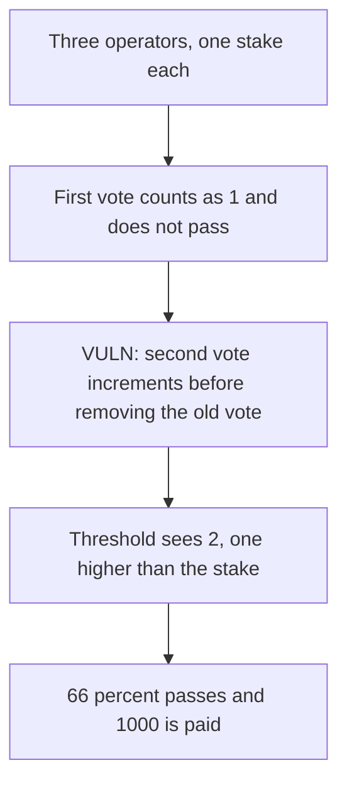

# Smoothly — one operator's second vote counts as 2 and pays 1000

> **Vulnerability classes:** vuln/governance/proposal-manipulation · vuln/logic/incorrect-state-transition · vuln/logic/wrong-condition

<!-- non-defihacklabs -->
<!-- source-auditvault: https://github.com/Auditware/AuditVault/blob/main/findings/26460-c-01-operators-can-cast-an-extra-vote-to-get-voting-majority.md -->
<!-- date: 2023-08 -->

## Key info

| | |
|---|---|
| **Protocol** | Smoothly PoolGovernance |
| **Finding** | Pashov C-01, AuditVault 26460 |
| **Vulnerable code** | `PoolGovernance.proposeEpoch` |
| **Harm** | A count of 2, one higher than the stake of 1, passes a 3-operator vote and pays 1000 POOL |
| **Chain** | local synthetic |

## TL;DR

Three operators need 66 percent. One operator votes twice for the same choice. `proposeEpoch` increments `voteCounter` before it removes the previous vote, so the second call sees a count of 2. That is one higher than the operator's stake of 1. `2 * 100 / 3` is 66, so the proposal executes and pays 1000. The stored counter is then decremented back to 1. The control removes the old vote first, the second count stays 1, and nothing is paid.

## The vulnerable code

```solidity
bytes32 prevVote = votes[epochNumber][msg.sender];
// @> VULN: the new vote is counted before the previous vote is removed
uint256 count = ++voteCounter[epochNumber][vote];
votes[epochNumber][msg.sender] = vote;
if (prevVote != bytes32(0)) --voteCounter[epochNumber][prevVote];
```

The control increments only after the previous vote is removed. The threshold uses that later `count`.

## Root cause

The value compared with the 66 percent bar is the pre-decrement count. A repeat of the same vote increments and then decrements the same slot, so the stored total returns to 1, but the decision already used 2.

## Preconditions

`operators.length` is 3. The caller is one operator. The choice is the same bytes32 both times. The treasury holds 1000e18. No time warp is required.

## Attack walkthrough

1. Three operators are registered.
2. The first vote sets the count to 1. 33 percent does not execute.
3. The second vote increments to 2, passes 66 percent, and transfers 1000e18.
4. The late decrement leaves the stored counter at 1. `lastCount` is still 2.

## Diagrams



## Impact

A single operator of three moves 1000e18 out of the treasury. The proposal flips from not executed to executed. The control counts the repeat as 1, leaves `executed` false, and keeps the 1000e18.

## Remediation

Increment `voteCounter` only after the previous vote has been removed, which is the diff in the report.

## Sources

- AuditVault finding: https://github.com/Auditware/AuditVault/blob/main/findings/26460-c-01-operators-can-cast-an-extra-vote-to-get-voting-majority.md
- Pashov report: https://github.com/solodit/solodit_content/blob/main/reports/Pashov/2023-08-01-Smoothly.md
