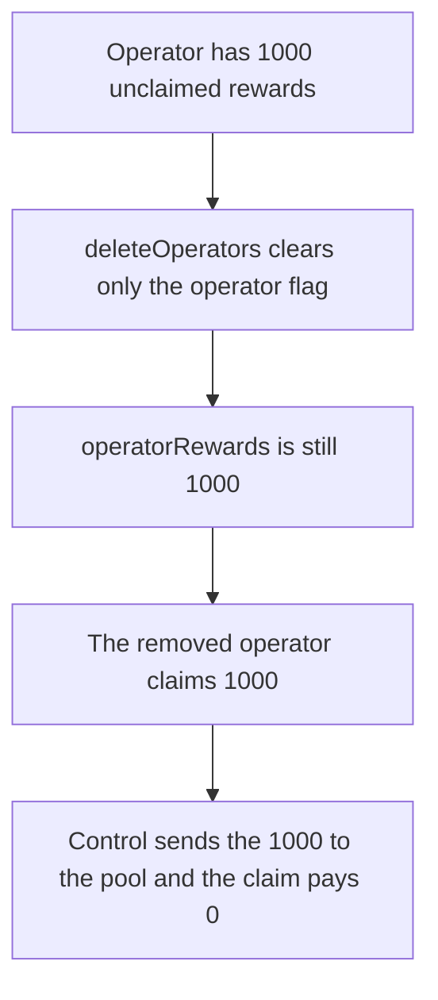

# A removed operator still claims 1,000 rewards because removal does not touch the balance

> **Vulnerability classes:** vuln/logic/reward-calculation · vuln/access-control/broken-logic
>
> **Reproduction:** self-contained synthetic Foundry reduction; see [output.txt](output.txt).

<!-- non-defihacklabs -->
<!-- source-auditvault: https://github.com/Auditware/AuditVault/blob/main/findings/26461-c-02-operator-can-still-claim-rewards-after-being-removed-fr.md -->
<!-- date: 2023-08 -->

## Key info

| Field | Value |
|---|---|
| **Loss** | The removed operator claims 1,000 rewards. Seizing on removal sends that 1,000 to the pool and the later claim pays 0 |
| **Vulnerable contract** | `PoolGovernance26461.deleteOperators` (reduction of Smoothly `PoolGovernance`) |
| **Attacker EOA** | `0x1111111111111111111111111111111111111111` |
| **Attack contract** | `Exploit` |
| **Attack tx** | `Exploit.run()` |
| **Chain / block / date** | Ethereum model · block 0 · 2023-08 |
| **Compiler** | solc 0.8.27, cancun, via IR |
| **Bug class** | `deleteOperators` clears `isOperator` and leaves `operatorRewards` unchanged |

## TL;DR

The operator has 1,000 unclaimed rewards. Governance removes them. `isOperator` becomes false and `operatorRewards` is still 1,000. `claim` transfers the 1,000. The control removal zeroes the balance, sends the 1,000 to the pool, and the same claim pays 0.

## Background

Pashov, Smoothly, C-02, 1 August 2023. `deleteOperators` is the path used when an operator is slashed or has gone inactive. It removes the account from `PoolGovernance` and does not move `operatorRewards`. A malicious operator who was removed can still claim. An inactive operator's balance stays in the contract with no one to sweep it. The report's fix is to transfer the rewards to a chosen account, for example `SmoothlyPool`, as part of removal.

## The vulnerable code

```solidity
function deleteOperators(address op) external {
    // @> VULN: the operator is removed from governance but operatorRewards[op] is left intact, so the removed operator can still claim.
    isOperator[op] = false;
}
```

`claim` then pays `operatorRewards[op]` and zeroes it. Removal never reaches that mapping.

## Root cause

The operator flag and the reward balance are separate, and only the flag is updated. Claim does not check `isOperator`. Whoever is still in the mapping gets paid.

## Preconditions

- The operator has a non-zero `operatorRewards` balance. Here it is 1,000, and the governance contract holds the tokens.
- Governance calls `deleteOperators`. That is the intended slash path, not a malicious admin. The harm is the removed operator calling `claim` afterwards.

## Attack walkthrough

1. Accrued rewards are 1,000 ([output.txt:9](output.txt)).
2. After removal the balance on the books is still 1,000 ([output.txt:11](output.txt)).
3. The removed operator claims 1,000 ([output.txt:13](output.txt)).
4. Control seizes 1,000 to the pool ([output.txt:15](output.txt)). The later claim pays 0 ([output.txt:17](output.txt)).
5. `[PASS]` ([output.txt:6](output.txt)).

## Diagrams



## Impact

Rewards that were supposed to be slashed are paid to the removed operator. The pool is short 1,000. On the control path the pool receives the 1,000 and the operator receives 0.

## Remediation

On removal, read `operatorRewards[op]`, set it to zero, and transfer that amount to the pool before the operator can claim.

## How to reproduce

```bash
cd 26461-c-02-operator-can-still-claim-rewards-after-being-removed-fr_exp
forge test -vv
```

## Sources

- AuditVault finding: [26461-c-02-operator-can-still-claim-rewards-after-being-removed-fr](https://github.com/Auditware/AuditVault/blob/main/findings/26461-c-02-operator-can-still-claim-rewards-after-being-removed-fr.md)
- Pashov Audit Group, Smoothly, 1 August 2023: https://github.com/solodit/solodit_content/blob/main/reports/Pashov/2023-08-01-Smoothly.md
