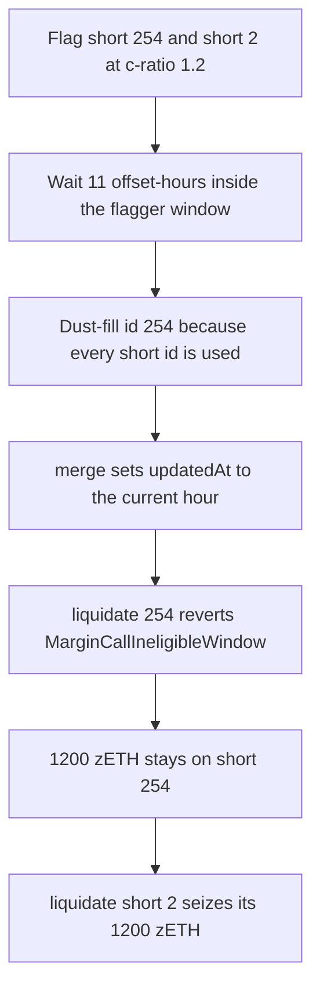

# DittoETH — last short record refreshes `updatedAt` and dodges primary liquidation

> **Vulnerability classes:** vuln/logic/liquidation-logic · vuln/logic/state-update · vuln/logic/incorrect-state-transition

<!-- non-defihacklabs -->
<!-- source-auditvault: https://github.com/Auditware/AuditVault/blob/main/findings/27450-users-can-avoid-liquidation-while-being-under-the-primary-li.md -->
<!-- date: 2023-09 -->

> **Reproduction:** Cheatcode-free synthetic. `LibShortRecord.merge` is copied with the blamed `short.updatedAt = creationTime` assignment verbatim. A flagged short on id 254 stays 1,200 zETH undercollateralized; the same window liquidates a short that was not merged.

## Key info

| | |
|---|---|
| **Loss** | 1,200 zETH of underwater collateral stays on short record 254 (`output.txt:24`). The control short is seized for the same 1,200 zETH (`output.txt:20`, `output.txt:25`). |
| **Vulnerable contract** | `LibShortRecord.merge` in DittoETH (reduced here as `ShortBook.merge`) |
| **Attacker** | The shorter, who dust-fills the last short record after it has been flagged |
| **Attack contract** | `Exploit.run` |
| **Attack tx** | Local synthetic, one block. No `vm.warp` inside `run()`. |
| **Chain · date** | CodeHawks DittoETH contest, Sep 2023 (repo `Cyfrin/2023-09-ditto` @ `a93b427`) |
| **Compiler** | solc 0.8.27, cancun, via_ir |
| **Bug class** | Liquidation window reset on the overflow short record |

## TL;DR

DittoETH allows 254 short records. The next fill does not open record 255. `createShortRecord` calls `fillShortRecord`, which calls `merge`, and `merge` always sets `updatedAt` to the current offset hour. Primary liquidation of a flagged short above `minimumCR` is allowed only while `getOffsetTimeHours() - updatedAt` sits in `(10, 16]` hours, and only the flagger may liquidate in `(10, 12]`. Refreshing `updatedAt` makes that difference 0, so `liquidate` reverts `MarginCallIneligibleWindow`. The short is still under `primaryLiquidationCR` (1.5). Its collateral stays.

## Background

A short under the primary collateral ratio can be flagged. The flag starts a clock stored in `updatedAt`. After 10 offset-hours the flagger may liquidate; after 12 hours anyone may; after 16 hours the flag resets. `minimumCR` (1.1) bypasses the clock. The bug is the band in between: under 1.5, above 1.1, flagged, and then merged.

`getOffsetTimeHours` is `(block.timestamp - STARTING_TIME) / 1 hours` with `STARTING_TIME = 1660353637`. The Playground uses one timestamp, `1660425637`, which is offset hour 20. The 11-hour flag age is written into `updatedAt` as hour 9. `run()` never warps.

## The vulnerable code

From `contracts/libraries/LibShortRecord.sol` at the audited commit (the synthetic keeps this body):

```solidity
// Assign updatedAt
// @> VULN: merging into the last short record sets updatedAt to now, so a flagged underwater short leaves the liquidation window
// FIX: if the short is flagged and the post-merge c-ratio is still under primaryLiquidationCR, revert instead of refreshing updatedAt
short.updatedAt = creationTime;
```

`creationTime` is `LibOrders.getOffsetTimeHours()` passed by `fillShortRecord`. The recommended fix, matching `combineShorts`, is to revert when the short is flagged and the post-merge c-ratio is still below `primaryLiquidationCR`.

## Root cause

The overflow path and the liquidation clock share one field. Merging a fill is an economic update of debt and collateral. It is also, unconditionally, a write to the flag timestamp. On every id below 254 a new record gets its own `updatedAt`. Id 254 is reused, so the existing flag clock is overwritten.

## Preconditions

- The shorter already holds short id 254 (every id is used, so `nextShortId == 255`).
- That short is flagged, its c-ratio is 1.2 (1,200 zETH collateral / 1,000 zETH debt), and `updatedAt` is 11 offset-hours old.
- 11 is inside `(firstLiquidationTime = 10, secondLiquidationTime = 12]`, so the flagger may liquidate.
- A second short, id 2, has the same collateral, debt, flagger, and age, and is not merged.

## Attack walkthrough

1. `run()` approves 2,400 zETH and opens both flagged shorts. Each locks 1,200 zETH.
2. `hoursNow() - updatedAt == 11`. Short 254 is eligible.
3. `createShortRecord` sees id 255 and calls `fillShortRecord` → `merge` with 0 new collateral and 1 wei of debt.
4. `short.updatedAt = creationTime` stores hour 20 (`output.txt:27`). The c-ratio becomes `1199999999999999999` (`output.txt:26`), still under 1.5e18 and above 1.1e18.
5. The flagger's `liquidate(254)` reverts `MarginCallIneligibleWindow`. `collateralOf(254)` is still `1200000000000000000000` (`output.txt:24`).
6. `liquidate(2)` succeeds. The flagger receives 1,200 zETH (`output.txt:25`). The book's zETH balance is the 1,200 that stayed.
7. Control, separate deployment, no merge: `liquidate(254)` seizes the same 1,200 zETH and the book is left empty (`output.txt:20`).

## Diagrams



## Impact

The shorter keeps a position the protocol should liquidate. In this reduction that is exactly 1,200 zETH of collateral. The debt is not repaid. The same numbers on an unmerged short are seized in full, so the stayed balance is caused by the `updatedAt` write and not by the c-ratio or the clock.

## Remediation

Do not refresh `updatedAt` on a flagged last record unless the post-merge c-ratio is at least `primaryLiquidationCR`. If it is still short, revert, as the report's `combineShorts`-style patch does. A separate `flaggedAt` that `merge` cannot write also closes the window reset.

## How to reproduce

```bash
cd 27450-users-can-avoid-liquidation-while-being-under-the-primary-li_exp
forge test -vv
```

`test_last_short_keeps_1200_zeth` is the attack. `test_control_liquidates_the_same_window_without_merge` liquidates the same window when `merge` is not called. Both warp to offset hour 20 before `run()` / `runControl()`. `run()` itself does not warp.

## Sources

- AuditVault finding: https://github.com/Auditware/AuditVault/blob/main/findings/27450-users-can-avoid-liquidation-while-being-under-the-primary-li.md
- CodeHawks report: https://codehawks.cyfrin.io/c/2023-09-ditto/s/270
- Vulnerable source: https://github.com/Cyfrin/2023-09-ditto/blob/a93b4276420a092913f43169a353a6198d3c21b9/contracts/libraries/LibShortRecord.sol#L153
- Liquidation window: https://github.com/Cyfrin/2023-09-ditto/blob/a93b4276420a092913f43169a353a6198d3c21b9/contracts/facets/MarginCallPrimaryFacet.sol#L351
