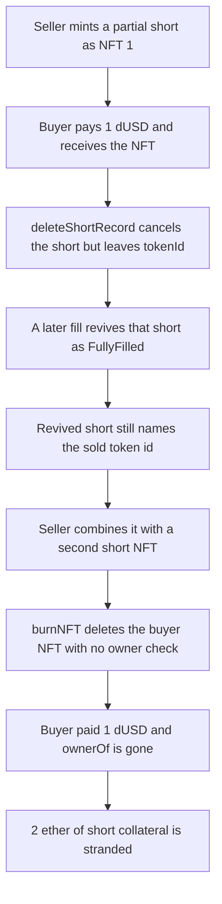

# DittoETH — previous NFT owner burns the NFT the buyer just paid for

> **Vulnerability classes:** vuln/access-control/missing-auth · vuln/logic/missing-check · vuln/logic/incorrect-state-transition

> **Reproduction:** cheatcode-free local synthetic. `combineShorts` burns `currentShort.tokenId` with no owner check, after `deleteShortRecord` left that id set. Full trace: [output.txt](output.txt). PoC: [test/27455-previous-nft-owner-can-burn-nft-from-the-new-owner-codehawks_exp.sol](test/27455-previous-nft-owner-can-burn-nft-from-the-new-owner-codehawks_exp.sol).

<!-- non-defihacklabs -->
<!-- source-auditvault: https://github.com/Auditware/AuditVault/blob/main/findings/27455-previous-nft-owner-can-burn-nft-from-the-new-owner-codehawks.md -->
<!-- date: 2023-09 -->

**AuditVault taxonomy:** `lang/solidity` · `sector/lending` · `sector/nft` · `sector/nft-lending` · `platform/codehawks` · `has/github` · `severity/high` · `impact/loss-of-funds/direct-drain` · genome: `missing-modifier` · `direct-drain` · `access-roles` · `liquidation-underwater` · `oracle-freshness`

## Key info

| | |
|---|---|
| **Protocol** | DittoETH |
| **Finding** | CodeHawks 2023-09-ditto, reporter hash, AuditVault 27455 |
| **Vulnerable code** | `LibShortRecord.deleteShortRecord`, `ShortRecordFacet.combineShorts`, `LibShortRecord.burnNFT` |
| **Harm** | Buyer pays 1 dUSD for NFT 1. Previous owner burns it. `ownerOf(1)` reverts. 2 ether of short collateral stays on the buyer's record and the escrow cannot claim it |
| **Chain** | local synthetic |

## TL;DR

Transferring a short-record NFT deletes the sender's short and mints a new one for the receiver, but `deleteShortRecord` never clears `tokenId`. A partially filled short is not unlinked, so a later fill sets `SR.Cancelled` back to `SR.FullyFilled` while `tokenId` is still the sold NFT. `combineShorts` burns any non-zero `tokenId` on the caller's short. `burnNFT` deletes `nftMapping[tokenId]` and does not check that `msg.sender` is the current owner. The buyer paid 1 dUSD, `ownerOf` is gone, and 2 ether of collateral is stranded.

## The vulnerable code

Audited `ShortRecordFacet.combineShorts` (`Cyfrin/2023-09-ditto` @ `a93b4276420a092913f43169a353a6198d3c21b9`):

```solidity
if (currentShort.tokenId != 0) {
    //@dev First short needs to have NFT so there isn't a need to burn and re-mint
    if (firstShort.tokenId == 0) {
        revert Errors.FirstShortMustBeNFT();
    }

    // @> VULN: stale tokenId burns the new owner's NFT — no check that msg.sender owns it
    LibShortRecord.burnNFT(currentShort.tokenId);
}
```

`burnNFT` then destroys whatever that id currently points at:

```solidity
NFT storage nft = s.nftMapping[tokenId];
if (nft.owner == address(0)) revert Errors.NotMinted();
address asset = s.assetMapping[nft.assetId];
ShortRecord storage short = s.shortRecords[asset][nft.owner][nft.shortRecordId];
delete s.nftMapping[tokenId];
delete s.getApproved[tokenId];
delete short.tokenId;
```

The id is stale because `deleteShortRecord` only flips status. On a `PartialFill` it also skips the unlink, which is why a later fill can revive the same record:

```solidity
if (shortRecord.status != SR.PartialFill && id < SHORT_MAX_ID) {
    // unlink omitted for a partial — this branch is not taken on the transfer
}
// FIX: shortRecord.tokenId = 0;
shortRecord.status = SR.Cancelled;
```

`fillShortRecord` revives that record and never writes `tokenId`:

```solidity
if (short.status == SR.Cancelled) {
    short.ercDebt = short.collateral = 0;
}
short.status = status;
```

## Root cause

`deleteShortRecord` treats `tokenId` as leftover data. The NFT mapping is updated to the new owner, and a new short is created for them with the same id, but the cancelled short keeps its copy. Reviving a partial fill makes that copy combinable again. The burn path trusts `currentShort.tokenId != 0` and never asks whether `nft.owner` is still `msg.sender`.

## Preconditions

The short was only partially filled before it was tokenized, so `deleteShortRecord` does not recycle the id. The previous owner can still complete that short, open a second fully filled short, mint an NFT on the second short (so `firstShort.tokenId != 0`), and call `combineShorts`. The buyer is an escrow whose only exit is `ownerOf`.

## Attack walkthrough

1. The seller opens a partially filled short. Collateral on the record is 2 ether. Debt is 1 ether. They mint it as NFT 1. `ownerOf(1)` is the seller.
2. The escrow pays 1 dUSD to the seller and the seller calls `transferFrom`. `deleteShortRecord` sets the seller's short to `Cancelled` and leaves `tokenId == 1`. The buyer's new short receives the 2 ether of collateral. `ownerOf(1)` is the escrow.
3. The leftover size fills the seller's old id. `fillShortRecord` zeros the cancelled balances, sets `FullyFilled`, and does not touch `tokenId`. The seller's short still stores 1.
4. The seller opens a second short and mints NFT 2 on it, then `combineShorts(second, stale)`. The stale short's `tokenId` is 1, so `burnNFT(1)` runs.
5. `burnNFT` reads `nft.owner`, which is the escrow, deletes `nftMapping[1]`, and clears the token id on the buyer's short. Collateral on that short is still 2 ether.
6. `ownerOf(1)` reverts with `ERC721NonexistentToken`. The seller's dUSD balance is 1 ether. The escrow's `canClaim()` is false and `claim()` reverts. NFT 2, the seller's other token, is untouched.

The control resets `tokenId` at the end of `deleteShortRecord`. After the same transfer, the seller's short stores 0, so `burnShortNft` reverts with `NotMinted`. The later fill does not restore the id. `combineShorts` does not burn. `ownerOf(1)` stays the escrow, and `claim()` returns the 2 ether of collateral.

## Diagrams



## Impact

The new owner loses the NFT after paying for it. In this run the escrow pays 1 dUSD, `ownerOf(1)` changes from the escrow to a revert, and 2 ether of collateral booked on the buyer's short can no longer be released. An escrow that cannot re-mint is stuck with the position. The seller keeps the 1 dUSD. Their own second NFT is not burned.

## Remediation

Set `tokenId = 0` on the deleted short inside `LibShortRecord.deleteShortRecord`, before or when status becomes `Cancelled`. `combineShorts` then sees `tokenId == 0` and does not call `burnNFT`. A direct burn from the previous owner reverts.

## How to reproduce

```bash
cd 27455-previous-nft-owner-can-burn-nft-from-the-new-owner-codehawks_exp
forge test -vv
```

## Sources

- AuditVault finding: https://github.com/Auditware/AuditVault/blob/main/findings/27455-previous-nft-owner-can-burn-nft-from-the-new-owner-codehawks.md
- Contest: https://codehawks.cyfrin.io/c/2023-09-ditto
- Audited code: https://github.com/Cyfrin/2023-09-ditto/blob/a93b4276420a092913f43169a353a6198d3c21b9/contracts/libraries/LibShortRecord.sol#L132
- `deleteShortRecord`: https://github.com/Cyfrin/2023-09-ditto/blob/a93b4276420a092913f43169a353a6198d3c21b9/contracts/libraries/LibShortRecord.sol#L184
- `burnNFT`: https://github.com/Cyfrin/2023-09-ditto/blob/a93b4276420a092913f43169a353a6198d3c21b9/contracts/libraries/LibShortRecord.sol#L363
- `combineShorts` burn: https://github.com/Cyfrin/2023-09-ditto/blob/a93b4276420a092913f43169a353a6198d3c21b9/contracts/facets/ShortRecordFacet.sol#L168
