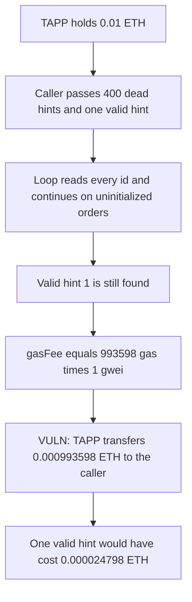

# DittoETH — a long shortHintArray bills the TAPP for the gas

> **Vulnerability classes:** vuln/logic/liquidation-logic · vuln/dos/gas-limit · vuln/logic/missing-check

<!-- non-defihacklabs -->
<!-- source-auditvault: https://github.com/Auditware/AuditVault/blob/main/findings/27473-margin-callers-can-drain-the-tapp-during-liquidation-by-will.md -->
<!-- date: 2023-09 -->

## Key info

| | |
|---|---|
| **Protocol** | DittoETH |
| **Finding** | Codehawks 2023-09, AuditVault 27473 |
| **Vulnerable code** | `MarginCallPrimary.liquidate` hint walk and TAPP gas reimbursement |
| **Harm** | 993,598,000,000,000 wei (0.000993598 ETH) paid from a 0.01 ETH TAPP in the replay; about 40x a one-hint liquidation |
| **Chain** | local synthetic |

## TL;DR

Primary liquidation walks `shortHintArray` with no length check. Dead ids are `continue`d, not rejected. The TAPP then pays the caller `gasUsed * basefee`. At a 1 gwei price, 400 distinct uninitialized ids plus one valid hint burn 993,598 gas in the replay (forge measured 995,598 gas on the same bytecode). The pool pays 0.000993598 ETH to the margin caller. The same liquidation with one valid hint pays 0.000024798 ETH. A length cap of 4 reverts the 401-hint call and leaves the 0.01 ETH pool untouched.

## The vulnerable code

```solidity
function _updateOracleAndStartingShort(uint16[] memory shortHintArray) private {
    uint16 shortHintId;
    for (uint256 i = 0; i < shortHintArray.length;) {
        shortHintId = shortHintArray[i];
        unchecked {
            ++i;
        }
        {
            O shortOrderType = shorts[shortHintId].orderType;
            if (shortOrderType == O.Cancelled || shortOrderType == O.Matched || shortOrderType == O.Uninitialized) {
                continue;
            }
        }
        if (shorts[shortHintId].price >= ORACLE_PRICE) {
            startingShortId = shortHintId;
        }
    }
}

gasFee = uint88(gasUsed * block.basefee);
// @> VULN: TAPP pays gasUsed * basefee with no cap on shortHintArray.length
token.transfer(msg.sender, callerFee);
```

The audited comment says basing the fee on `basefee` rather than the caller's priority tip stops a drain. That only stops a tip. It does not stop the caller from choosing an array long enough that `gasUsed * basefee` is the drain. The in-browser block reports a 7 wei basefee, so the synthetic bills `max(block.basefee, 1 gwei)`. 1 gwei is the initial EIP-1559 base fee and the value the forge test sets with `vm.fee`. The gas count is the real walk.

## Root cause

Hints are an optional gas saving, not a bound. The loop charges a storage read per entry and skips cancelled, matched, and uninitialized orders. The fee handler adds that gas, priced at `block.basefee`, to the caller's reimbursement and subtracts it from the TAPP whenever the pool can cover it. A longer array is a larger bill, paid by the pool, and the liquidation still succeeds if one hint is the real short.

## Preconditions

The TAPP escrows 0.01 ETH. Basefee is 1 gwei, the value in the local block. The short at id 1 is a limit order priced above the oracle. Ids 2 through 401 are uninitialized. The caller is not the shorter. Collateral and the flag window are already satisfied in this reduction, so the only variable is the hint array.

## Attack walkthrough

1. The pool holds 0.01 ETH. The caller allocates 401 hints. The first 400 are distinct dead ids. The last is id 1.
2. `liquidate` starts the gas clock and walks the array. Each dead id hits `continue`.
3. Id 1 is a limit order above the oracle, so `startingShortId` becomes 1. The liquidation completes.
4. Gas used inside that window is 993,598 in the replay. At 1 gwei the fee is 993,598,000,000,000 wei. Forge measured 995,598 gas, which is 995,598,000,000,000 wei.
5. The TAPP transfers the replay amount to the caller. The pool is left with 0.009006402 ETH.

A one-hint call on the capped contract uses enough gas to cost 24,798,000,000,000 wei, about 1/40 of the padded call. The 401-hint call on that contract reverts with `HintArrayTooLong` before any transfer. The pool stays at 0.01 ETH.

## Diagrams



## Impact

The margin caller is paid 0.000993598 ETH out of the TAPP for a liquidation that a single correct hint would have reimbursed at 0.000024798 ETH. The extra 0.0009688 ETH is the cost of the dead ids. Nothing in the walk stops a longer array. At this 1 gwei basefee the whole 0.01 ETH pool is several such calls away; a higher basefee, which is the congestion case the reimbursement is priced on, scales the same gas linearly.

## Remediation

Reject `shortHintArray` above a small bound, on the order of one starting-id probe. Reimburse at most the gas of a capped walk. Do not treat `basefee` pricing as a substitute for that bound.

## How to reproduce

```bash
cd 27473-margin-callers-can-drain-the-tapp-during-liquidation-by-will_exp
forge test -vv
```

The forge test sets `vm.fee(1 gwei)` before `run()` so `block.basefee` matches the local block. `run()` itself does not warp or change the fee.

## Sources

- AuditVault finding: https://github.com/Auditware/AuditVault/blob/main/findings/27473-margin-callers-can-drain-the-tapp-during-liquidation-by-will.md
- liquidate: https://github.com/Cyfrin/2023-09-ditto/blob/a93b4276420a092913f43169a353a6198d3c21b9/contracts/facets/MarginCallPrimaryFacet.sol#L93
- forced bid and gas fee: https://github.com/Cyfrin/2023-09-ditto/blob/a93b4276420a092913f43169a353a6198d3c21b9/contracts/facets/MarginCallPrimaryFacet.sol#L239-L267
- hint loop: https://github.com/Cyfrin/2023-09-ditto/blob/a93b4276420a092913f43169a353a6198d3c21b9/contracts/libraries/LibOrders.sol#L827-L841
- TAPP fee handler: https://github.com/Cyfrin/2023-09-ditto/blob/a93b4276420a092913f43169a353a6198d3c21b9/contracts/facets/MarginCallPrimaryFacet.sol#L270-L290
