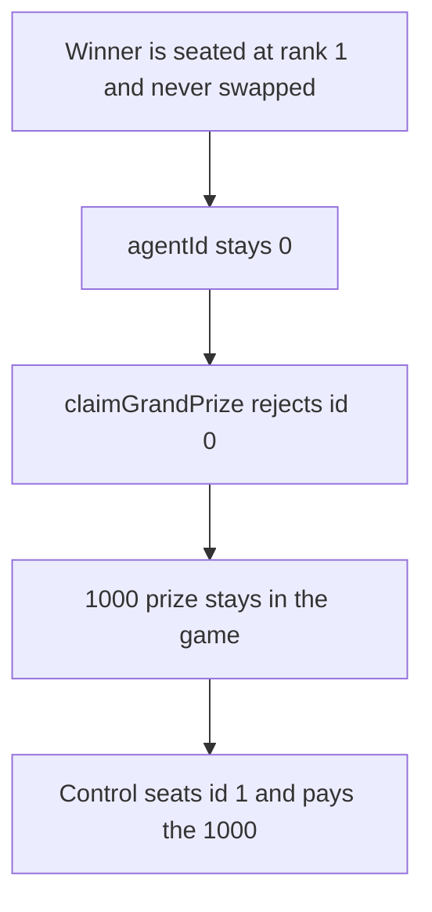

# The winning agent's id stays 0, so the 1,000 grand prize cannot be claimed

> **Vulnerability classes:** vuln/data/uninitialized · vuln/dos/frozen-funds
>
> **Reproduction:** self-contained synthetic Foundry reduction; see [output.txt](output.txt).

<!-- non-defihacklabs -->
<!-- source-auditvault: https://github.com/Auditware/AuditVault/blob/main/findings/27587-h-2-winning-agent-id-may-be-uninitialized-when-game-is-over.md -->
<!-- date: 2023-10 -->

## Key info

| Field | Value |
|---|---|
| **Loss** | 1,000 prize tokens stay in the game. The winner's claim reverts |
| **Vulnerable contract** | `Infiltration27587.claimGrandPrize` (reduction of LooksRare `Infiltration`) |
| **Attacker EOA** | `0x1111111111111111111111111111111111111111` |
| **Attack contract** | `Exploit` |
| **Attack tx** | `Exploit.run()` |
| **Chain / block / date** | Ethereum model · block 0 · 2023-10 |
| **Compiler** | solc 0.8.27, cancun, via IR |
| **Bug class** | `agents[1].agentId` is written only on a swap, so an unswapped winner has id 0 and the ownership check reverts |

## TL;DR

Rank 1 is the winner, and that record's `agentId` is set only when two agents are swapped. If the winner was never swapped, the id stays 0. `claimGrandPrize` uses that id to check ownership. Id 0 has no owner, the claim reverts, and the 1,000 prize stays in the contract. Seating the same winner with id 1 pays the 1,000 out.

## Background

Sherlock 2023-10 LooksRare Infiltration, issue 31. `agents` is a rank-indexed mapping. A kill or an escape writes `agentId` on the slot that moves. The agent who is already at rank 1 and is never moved keeps the zero default. `claimGrandPrize` reads `agents[1].agentId` and calls `_assertAgentOwnership`. Zero is not a valid agent id, so the check reverts. The fix accepted in pull requests 153 and 178 is to treat a zero id as 1.

## The vulnerable code

```solidity
uint256 agentId = agents[1].agentId;
// @> VULN: rank 1 was never swapped, so agentId is still 0. There is no owner for id 0 and the prize claim reverts.
require(agentId != 0 && ownerOf[agentId] == caller, "not winner");
```

## Root cause

The id is lazy, and the claim treats zero as "not the winner" rather than "this slot was never swapped, so the id is the rank". The owner was stored. The id was not.

## Preconditions

- The game is over and rank 1 is the winner.
- That rank was never swapped, so `agentId` is still 0.
- The prize pool is non-zero. Here it is 1,000.

## Attack walkthrough

1. The game holds 1,000 ([output.txt:9](output.txt)).
2. The stored winner id is 0 ([output.txt:11](output.txt)).
3. The claim reverts and the game still holds 1,000 ([output.txt:13](output.txt)).
4. Control seats the winner as id 1 ([output.txt:15](output.txt)) and pays 1,000 ([output.txt:17](output.txt)).
5. `[PASS]` ([output.txt:6](output.txt)).

## Diagrams



## Impact

The winner cannot take the grand prize. 1,000 stays in the contract. The control claim pays that 1,000 to the same winner.

## Remediation

If `agents[1].agentId` is 0, use 1. That is the default the LooksRare fix applies inside `claimGrandPrize` before the ownership check.

## How to reproduce

```bash
cd 27587-h-2-winning-agent-id-may-be-uninitialized-when-game-is-over_exp
forge test -vv
```

## Sources

- AuditVault finding: [27587-h-2-winning-agent-id-may-be-uninitialized-when-game-is-over](https://github.com/Auditware/AuditVault/blob/main/findings/27587-h-2-winning-agent-id-may-be-uninitialized-when-game-is-over.md)
- Sherlock, LooksRare Infiltration, October 2023, issue 31. `Infiltration.sol` `claimGrandPrize`.
