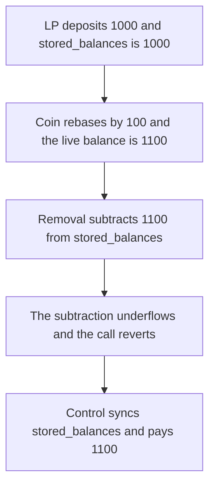

# A 100 rebase makes removal underflow, and 1,100 stays in the pool

> **Vulnerability classes:** vuln/dos/frozen-funds · vuln/logic/state-update
>
> **Reproduction:** self-contained synthetic Foundry reduction; see [output.txt](output.txt).

<!-- non-defihacklabs -->
<!-- source-auditvault: https://github.com/Auditware/AuditVault/blob/main/findings/27687-rebasing-rewards-will-get-stuck-on-the-contract-mixbytes-non.md -->
<!-- date: 2023-12 -->

## Key info

| Field | Value |
|---|---|
| **Loss** | 1,100 of the rebasing coin stays in the pool. The LP receives 0 |
| **Vulnerable contract** | `StablePool27687.removeLiquidity` (reduction of Curve `CurveStableSwapNG._transfer_out`) |
| **Attacker EOA** | `0x1111111111111111111111111111111111111111` |
| **Attack contract** | `Exploit` |
| **Attack tx** | `Exploit.run()` |
| **Chain / block / date** | Ethereum model · block 0 · 2023-12 |
| **Compiler** | solc 0.8.27, cancun, via IR |
| **Bug class** | `stored_balances` is not increased when the coin rebases, so subtracting the live withdrawal underflows |

## TL;DR

The LP deposits 1,000. The coin rebases by 100. `stored_balances` is still 1,000 and the live balance is 1,100. Removal pays the live amount and then does `stored_balances -= 1100`. That underflows, the call reverts, and the LP receives nothing. The pool still holds 1,100. Syncing `stored_balances` up to the live balance before the subtraction pays the LP 1,100 and leaves the pool empty.

## Background

MixBytes, Curve StableSwap-NG. `stored_balances` is updated by the amount transferred in and the amount transferred out (`CurveStableSwapNG.vy` `_transfer_out`, the subtraction at the line the report points at). A positive rebase increases `balanceOf` and does not increase `stored_balances`. Withdrawal amounts are taken from the live balance. The stored balance is then reduced by that larger number and underflows. The pool is not upgradeable, so the tokens stay there. The report's ask is to account for the rebase when touching `stored_balances`.

## The vulnerable code

```solidity
value = live * burn / lpSupply;
coin.transfer(lp, value);
// @> VULN: stored_balances ignores the rebase. Subtracting the live withdrawal underflows, so the whole removal reverts.
storedBalances -= value;
```

## Root cause

Two balances are supposed to track the same coins. Only one of them sees the rebase. The subtraction assumes the stored figure is at least the live figure. After a positive rebase it is not.

## Preconditions

- The pool holds a rebasing coin and `stored_balances` was set from deposits only.
- The coin balance then increases without a transfer the pool recorded. Here the increase is 100 on a 1,000 deposit.
- An LP removes liquidity for their whole share.

## Attack walkthrough

1. Stored balance is 1,000 ([output.txt:9](output.txt)). Live balance is 1,100 ([output.txt:11](output.txt)).
2. Removal reverts. The pool still holds 1,100 ([output.txt:13](output.txt)). The LP received 0 ([output.txt:15](output.txt)).
3. Control syncs `stored_balances` to the live balance and pays 1,100 ([output.txt:17](output.txt)).
4. `[PASS]` ([output.txt:6](output.txt)).

## Diagrams



## Impact

The LP cannot withdraw. 1,100, principal plus rewards, stays in a pool that cannot be upgraded. The control withdrawal pays the same 1,100 to the LP.

## Remediation

Before subtracting a live withdrawal from `stored_balances`, raise `stored_balances` to the live balance when the coin has rebated up. The stored figure has to include rewards or the subtraction cannot succeed.

## How to reproduce

```bash
cd 27687-rebasing-rewards-will-get-stuck-on-the-contract-mixbytes-non_exp
forge test -vv
```

## Sources

- AuditVault finding: [27687-rebasing-rewards-will-get-stuck-on-the-contract-mixbytes-non](https://github.com/Auditware/AuditVault/blob/main/findings/27687-rebasing-rewards-will-get-stuck-on-the-contract-mixbytes-non.md)
- MixBytes, Curve StableSwap-NG: https://github.com/mixbytes/audits_public/blob/master/Curve%20Finance/StableSwapNG/README.md
- `CurveStableSwapNG.vy` `_transfer_out`, `stored_balances[i] -= _amount`, commit `8c78731`.
