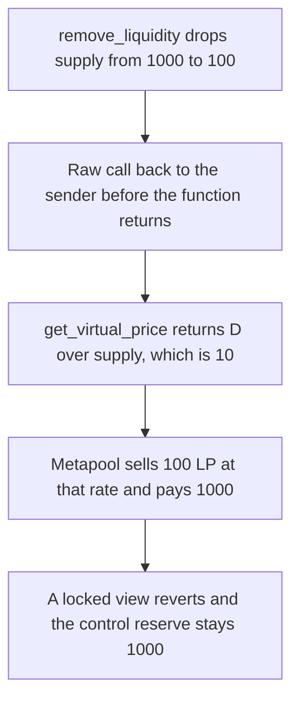

# An unlocked virtual price reads 10 during removal and the metapool pays out 1,000

> **Vulnerability classes:** vuln/reentrancy/read-only · vuln/oracle/price-manipulation
>
> **Reproduction:** self-contained synthetic Foundry reduction; see [output.txt](output.txt).

<!-- non-defihacklabs -->
<!-- source-auditvault: https://github.com/Auditware/AuditVault/blob/main/findings/27689-read-only-reentrancy-in-meta-pool-with-an-old-base-pool-mixb.md -->
<!-- date: 2023-12 -->

## Key info

| Field | Value |
|---|---|
| **Loss** | The metapool's 1,000 coin reserve is paid out at a virtual price of 10. A fair price of 1 would have paid 100 |
| **Vulnerable contract** | `OldBase27689.get_virtual_price` (reduction of an old Curve ETH base pool, read by `CurveStableSwapMetaNG`) |
| **Attacker EOA** | `0x1111111111111111111111111111111111111111` |
| **Attack contract** | `Exploit` |
| **Attack tx** | `Exploit.run()` |
| **Chain / block / date** | Ethereum model · block 0 · 2023-12 |
| **Compiler** | solc 0.8.27, cancun, via IR |
| **Bug class** | `get_virtual_price` does not check the reentrancy lock, so D/supply is inflated while `remove_liquidity` is still in its callback |

## TL;DR

The base pool's D is 1,000 and its supply is 1,000, so the virtual price is 1. `remove_liquidity` of 900 drops the supply to 100 and raw-calls the sender before it returns. D is unchanged. `get_virtual_price` does not look at the lock, so it returns 10. The metapool sells the caller's remaining 100 LP at that rate and transfers its whole 1,000 coin reserve. The same removal against a base pool that reverts the view while locked pays nothing, and that reserve stays 1,000.

## Background

MixBytes, Curve StableSwap-NG. A metapool prices the base-pool LP with `get_virtual_price` (`CurveStableSwapMetaNG.vy` around the line the report cites). New base pools take the reentrancy lock inside that view. Old base pools that pay ETH do not. `remove_liquidity` updates supply, then sends ETH with a raw call, and the view is readable from the callback. Virtual price is D over supply. Supply has moved, D has not, and the rate is wrong for the duration of the call. The report rates this critical because a swap in the metapool during that window trades at the manipulated rate. The recommended fix is to refuse base pools paired with ETH when they are added to the factory.

## The vulnerable code

```solidity
if (guardView) {
    require(!locked, "locked");
}
// @> VULN: old ETH base pools do not check the reentrancy lock here. D/supply is read while supply is already reduced.
return D * 1e18 / supply;
```

The raw call is the empty call at the end of `remove_liquidity`, which is the reduction of the ETH transfer. No value is attached. The harm is the price read, not the ether.

## Root cause

The view is part of the price the metapool trusts, and it is not covered by the lock that the state-changing removal already holds. Callers can reenter the price before the removal has finished.

## Preconditions

- The base pool is an old pool: `get_virtual_price` does not revert while `locked` is true.
- Removal reduces supply before the external call, and D stays put.
- The metapool holds a coin reserve it will pay against that price. Here the reserve is 1,000, and the caller sells 100 LP.

## Attack walkthrough

1. The metapool reserve is 1,000 ([output.txt:9](output.txt)).
2. During the callback the price is 10 ([output.txt:11](output.txt)).
3. The caller receives 1,000 ([output.txt:13](output.txt)). The metapool is empty ([output.txt:15](output.txt)).
4. Control: the guarded view reverts, the swap pays 0 ([output.txt:17](output.txt)), and the control reserve is still 1,000 ([output.txt:19](output.txt)).
5. `[PASS]` ([output.txt:6](output.txt)).

## Diagrams



## Impact

The metapool pays 1,000 for 100 LP. At the price from before the callback, 100 LP is worth 100. The extra 900 comes out of the other LPs' coin. The control path pays 0 during the callback and keeps the 1,000.

## Remediation

`get_virtual_price` has to take the same reentrancy lock as `remove_liquidity`. Do not register a base pool whose view is readable in the middle of an ETH transfer.

## How to reproduce

```bash
cd 27689-read-only-reentrancy-in-meta-pool-with-an-old-base-pool-mixb_exp
forge test -vv
```

## Sources

- AuditVault finding: [27689-read-only-reentrancy-in-meta-pool-with-an-old-base-pool-mixb](https://github.com/Auditware/AuditVault/blob/main/findings/27689-read-only-reentrancy-in-meta-pool-with-an-old-base-pool-mixb.md)
- MixBytes, Curve StableSwap-NG: https://github.com/mixbytes/audits_public/blob/master/Curve%20Finance/StableSwapNG/README.md
- `CurveStableSwapMetaNG.vy` virtual-price read, commit `8c78731`.
