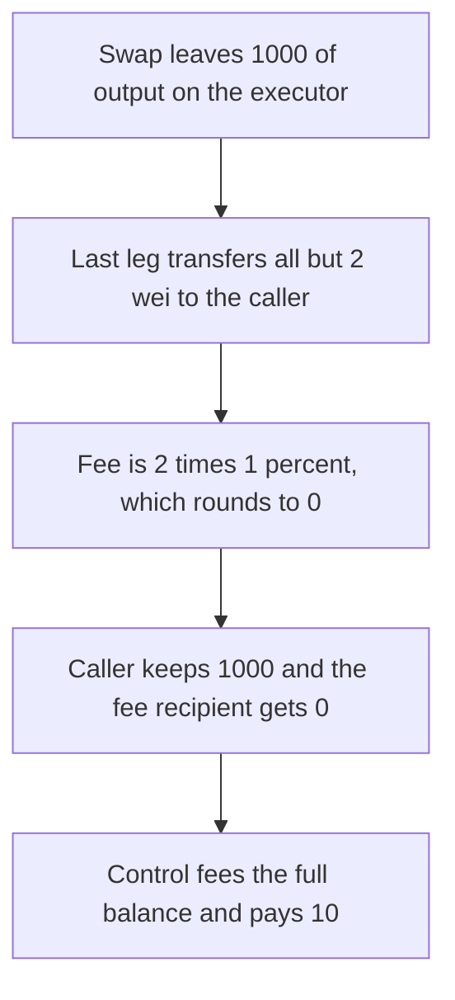

# Leaving 2 wei on the executor rounds a 10 fee down to 0 and the caller keeps 1,000

> **Vulnerability classes:** vuln/logic/fee-calculation · vuln/defi/fee-manipulation
>
> **Reproduction:** self-contained synthetic Foundry reduction; see [output.txt](output.txt).

<!-- non-defihacklabs -->
<!-- source-auditvault: https://github.com/Auditware/AuditVault/blob/main/findings/27744-bypassing-payment-fees-through-various-methods-mixbytes-none.md -->
<!-- date: 2023-09 -->

## Key info

| Field | Value |
|---|---|
| **Loss** | The fee recipient is paid 0 instead of 10. The caller keeps the full 1,000 output |
| **Vulnerable contract** | `SwapExecutor27744.execute` (reduction of Barter `SwapExecutor`) |
| **Attacker EOA** | `0x1111111111111111111111111111111111111111` |
| **Attack contract** | `Exploit` |
| **Attack tx** | `Exploit.run()` |
| **Chain / block / date** | Ethereum model · block 0 · 2023-09 |
| **Compiler** | solc 0.8.27, cancun, via IR |
| **Bug class** | The fee is a percentage of whatever output is still on the executor, so a final transfer that leaves 2 wei makes the fee 0 |

## TL;DR

The executor holds 1,000 of output. The fee is 1% of the balance still on the contract after the swap path. The last leg transfers 1,000 minus 2 wei to the caller first. The fee base is 2, and `2 * 100 / 10000` is 0. The caller ends with all 1,000. The fee recipient gets 0. Leaving the same 1,000 on the contract charges a fee of 10, and the caller keeps 990.

## Background

MixBytes, Barter DAO. `SwapExecutor` takes its fee from `tokenToTransfer`'s balance after the swaps (`SwapExecutor.sol` around line 146). The path is caller-supplied. The last step can be a transfer of the output to the caller, leaving a dust balance. The fee math then runs on that dust. Two wei is enough for a 1% fee to round to zero. The report also describes a worthless fee token and a copied executor with the fee deleted. This reduction is the dust path, which is the one that needs no second token and no cloned contract.

## The vulnerable code

```solidity
uint256 amount = token.balanceOf(address(this));
// @> VULN: the fee is a percentage of the tokenToTransfer still on this contract. Leaving 2 wei rounds that fee to 0.
feeBase = amount;
fee = amount * FEE_BPS / BPS;
```

`FEE_BPS` is 100 and `BPS` is 10,000. On a 1,000 balance that is 10. On a balance of 2 it is 0.

## Root cause

The fee base is "what happens to be left here", and the caller chooses the path that decides what is left. The fee is not taken on the output the path produced.

## Preconditions

- A swap produces 1,000 of output on the executor.
- The caller can add a final transfer of that output to themselves, leaving 2 wei.
- The fee is `balance * 100 / 10000`, which is 0 for a balance under 100.

## Attack walkthrough

1. The executor starts with 1,000 ([output.txt:9](output.txt)).
2. The fee base after the dust transfer is 2 ([output.txt:11](output.txt)). The fee paid is 0 ([output.txt:13](output.txt)).
3. The caller holds 1,000 ([output.txt:15](output.txt)).
4. Control, with the output left on the executor, charges 10 ([output.txt:17](output.txt)). The caller keeps 990 ([output.txt:19](output.txt)).
5. `[PASS]` ([output.txt:6](output.txt)).

## Diagrams



## Impact

The fee recipient is owed 10 and is paid 0. The caller keeps 10 more than the control path pays them. On a larger output the same 2 wei still rounds a 1% fee to 0, so the unpaid fee scales with the output. The control charge on this 1,000 is 10.

## Remediation

Take the fee on the output amount before the path can move it, in a token the caller does not choose. The report's suggestion is a fixed fee in a fixed token, taken in the facade rather than from whatever balance the executor happens to hold.

## How to reproduce

```bash
cd 27744-bypassing-payment-fees-through-various-methods-mixbytes-none_exp
forge test -vv
```

## Sources

- AuditVault finding: [27744-bypassing-payment-fees-through-various-methods-mixbytes-none](https://github.com/Auditware/AuditVault/blob/main/findings/27744-bypassing-payment-fees-through-various-methods-mixbytes-none.md)
- MixBytes, Barter DAO: https://github.com/mixbytes/audits_public/blob/master/Barter%20DAO/Barter%20DAO%20(diff)/README.md
- `SwapExecutor.sol` fee on the remaining balance, commit `22239aac`.
