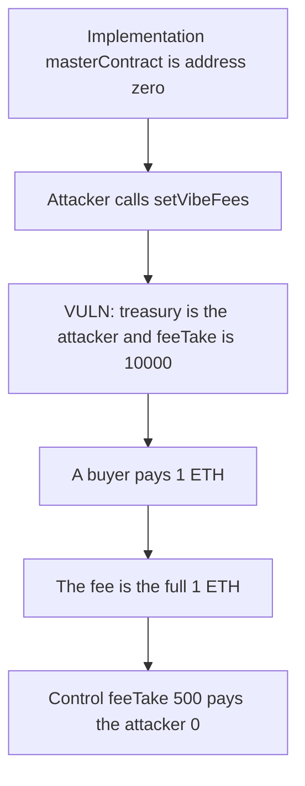

# Vibe — setVibeFees is open on the implementation

> **Vulnerability classes:** vuln/access-control/missing-modifier · vuln/defi/fee-manipulation

<!-- non-defihacklabs -->
<!-- source-auditvault: https://github.com/Auditware/AuditVault/blob/main/findings/27818-unrestricted-access-to-the-setvibefees-function-in-mintsaleb.md -->
<!-- date: 2023-06 -->

## Key info

| | |
|---|---|
| **Protocol** | Vibe |
| **Finding** | MixBytes, June 2023, AuditVault 27818 |
| **Vulnerable code** | `onlyMasterContractOwner` skips the check when `masterContract` is zero |
| **Harm** | A 1 ETH buy pays 1 ETH to the attacker. The owner fee of 500 bps pays the attacker 0. |
| **Chain** | local synthetic (audited Ethereum contracts) |

## TL;DR

`setVibeFees` is guarded by `onlyMasterContractOwner`. That modifier checks the master contract's owner only when `masterContract` is set. The implementation itself has no master. Anyone can set `vibeTreasury` to themselves and `feeTake` to 10000, the whole BPS range from the same report. A later 1 ETH purchase then forwards the entire payment as the fee.

## The vulnerable code

The audited fix, proposed at `MintSaleBase.sol` L69, is `require(msg.sender == owner())` for the no-master case. `feeTake` is a fraction of `BPS` (the medium finding requires `feeTake <= BPS`).

```solidity
modifier onlyMasterContractOwner() {
    if (masterContract != address(0)) {
        require(msg.sender == MintSaleBase(masterContract).owner(), "not owner");
    }
    _;
}

function setVibeFees(address vibeTreasury_, uint256 feeTake_) external onlyMasterContractOwner {
    // @> VULN: masterContract is 0, so this write is not limited to owner().
    vibeTreasury = vibeTreasury_;
    feeTake = feeTake_;
}
```

The buy splits the payment with that stored rate:

```solidity
uint256 fee = msg.value * feeTake / BPS;
```

## Root cause

The implementation is a real contract with its own storage, and the modifier treats "no master" as "no caller check". Fees are read from that storage on the purchase path. Whoever writes them first collects the fee until the owner overwrites the fields.

## Preconditions

The sale being configured is the implementation: `masterContract == address(0)`. The owner has not yet set the fee. No second transaction is required. The buyer pays 1 ETH after the write.

## Attack walkthrough

1. `masterContract` reads as address zero.
2. The attacker calls `setVibeFees(attacker, 10000)`.
3. The assignment stores that treasury and that rate. There is no `owner()` check.
4. `feeTake` is 10000.
5. A buyer calls `buy` with 1 ETH.
6. The fee is `1 ETH * 10000 / 10000`. The whole 1 ETH is sent to the attacker. Seller proceeds are 0.

Control: the fixed modifier reverts the attacker's call. The owner sets `feeTake` to 500. The same 1 ETH buy pays the protocol treasury 0.05 ETH and the seller 0.95 ETH. The attacker receives 0.

## Diagrams



## Impact

The buyer pays 1 ETH and the attacker treasury receives 1 ETH. The seller receives 0. At the owner's 500 bps rate the protocol would have received 0.05 ETH and the seller 0.95 ETH.

## Remediation

In `onlyMasterContractOwner`, when `masterContract` is zero, require `msg.sender == owner()`. Also reject `feeTake` above `BPS` and a zero treasury, which is the check MixBytes asked for on the setter.

## How to reproduce

```bash
cd 27818-unrestricted-access-to-the-setvibefees-function-in-mintsaleb_exp
forge test -vv
```

## Sources

- AuditVault finding: https://github.com/Auditware/AuditVault/blob/main/findings/27818-unrestricted-access-to-the-setvibefees-function-in-mintsaleb.md
- MixBytes report: https://github.com/mixbytes/audits_public/blob/master/Vibe/README.md
- Audited file: `contracts/mint/MintSaleBase.sol` at `d08057edbaf83b00d94dcaca2a05e3c44a45e4d9`
