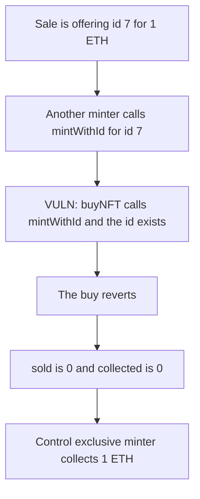

# Vibe — another minter can occupy an id the sale is selling

> **Vulnerability classes:** vuln/dos/frozen-funds · vuln/logic/missing-check

<!-- non-defihacklabs -->
<!-- source-auditvault: https://github.com/Auditware/AuditVault/blob/main/findings/27820-nftmintsalemultiple-wont-work-if-other-minter-mints-tokens-w.md -->
<!-- date: 2023-06 -->

## Key info

| | |
|---|---|
| **Protocol** | Vibe |
| **Finding** | MixBytes, June 2023, AuditVault 27820 |
| **Vulnerable code** | `buyNFT` calls `nft.mintWithId(recipient, id)` |
| **Harm** | Id 7 is taken, so the 1 ETH sale collects 0. The exclusive-minter control collects 1 ETH. |
| **Chain** | local synthetic (audited Ethereum contracts) |

## TL;DR

`NFTMintSaleMultiple.buyNFT` mints one predetermined id with `mintWithId`. The ERC721 is shared. Any other minter can create that id first. The sale's call then reverts because the id exists, and that 1 ETH listing cannot complete.

## The vulnerable code

The report points at `NFTMintSaleMultiple.sol` L77.

```solidity
function buyNFT(address recipient) external payable {
    require(msg.value == price, "price");
    uint256 tokenId = id;
    // @> VULN: mintWithId reverts when another minter already took this id.
    nft.mintWithId(recipient, tokenId);
    sold += 1;
    collected += msg.value;
}
```

## Root cause

The sale does not own the id space. `mintWithId` is a global write on the NFT. The sale assumes the id is still free at purchase time. Nothing in the sale stops a second minter from using the same id.

## Preconditions

The NFT allows a minter other than this sale. The sale is offering id 7 at 1 ETH. The external minter gets there first. One transaction is enough for the occupying mint. The buy is attempted in the same transaction here and reverts.

## Attack walkthrough

1. The external minter calls `mintWithId` for id 7.
2. `ownerOf(7)` is that minter.
3. A buyer sends 1 ETH into `buyNFT`.
4. `nft.mintWithId(recipient, id)` reverts because id 7 exists.
5. The sale records the unsold amount as 1 ETH.
6. `sold` stays 0 and `collected` stays 0. The 1 ETH is refunded to the buyer.

Control: `mintWithId` is restricted to the sale. The external mint reverts. `buyNFT` collects 1 ETH and the buyer owns id 7.

## Diagrams



## Impact

The buyer cannot purchase id 7. The sale collects 0 of the 1 ETH price. With minting limited to the sale, that same purchase collects 1 ETH and the buyer receives the NFT.

## Remediation

Use only `mint` or only `mintWithId` on a given `VibeERC721`, which is the MixBytes recommendation. The sale should be the only account allowed to mint ids inside its range.

## How to reproduce

```bash
cd 27820-nftmintsalemultiple-wont-work-if-other-minter-mints-tokens-w_exp
forge test -vv
```

## Sources

- AuditVault finding: https://github.com/Auditware/AuditVault/blob/main/findings/27820-nftmintsalemultiple-wont-work-if-other-minter-mints-tokens-w.md
- MixBytes report: https://github.com/mixbytes/audits_public/blob/master/Vibe/README.md
- Audited file: `contracts/mint/NFTMintSaleMultiple.sol` at `d08057edbaf83b00d94dcaca2a05e3c44a45e4d9` L77
