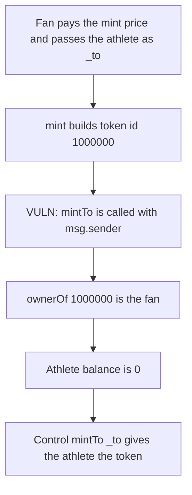

# Fantium — mint delivers the NFT to the caller, not _to

> **Vulnerability classes:** vuln/access-control/missing-owner-check

<!-- non-defihacklabs -->
<!-- source-auditvault: https://github.com/Auditware/AuditVault/blob/main/findings/28050-undefined-behavior-for-mint-mixbytes-none-fantium-markdown.md -->
<!-- date: 2023-01 -->

## Key info

| | |
|---|---|
| **Protocol** | Fantium |
| **Finding** | MixBytes, January 2023, AuditVault 28050 |
| **Vulnerable code** | `FantiumMinterV1.mint` mints to `msg.sender` |
| **Harm** | Token 1000000 is owned by the fan. The athlete passed as `_to` owns 0. |
| **Chain** | local synthetic (audited Ethereum contracts) |

## TL;DR

`mint(address _to, ...)` is documented as minting to `_to`. The final mint uses `msg.sender`. MixBytes paid `100000000000000` wei from the fan, passed the athlete, and `ownerOf(1000000)` printed the fan. The fix is `fantiumNFTContract.mintTo(_to, thisTokenId)`.

## The vulnerable code

`FantiumMinterV1.sol` L269. Token id is `collectionId * 1_000_000`, so collection 1 is token 1000000.

```solidity
function mint(address _to, uint256 collectionId) external payable {
    require(msg.value == PRICE, "price");
    require(_to != address(0), "to");
    uint256 thisTokenId = collectionId * 1_000_000;
    // @> VULN: the final mint is for msg.sender, not _to.
    fantiumNFTContract.mintTo(msg.sender, thisTokenId);
}
```

## Root cause

`_to` is checked only for the zero address. It is not the recipient of `mintTo`. Anyone who calls `mint` in order to give the token to another address keeps it.

## Preconditions

The caller pays the mint price, `100000000000000` wei. They pass a non-zero `_to` that is not themselves. Collection 1 has not minted token 1000000 yet.

## Attack walkthrough

1. The fan pays `100000000000000` wei.
2. `mint` is called with the athlete as `_to` and collection 1.
3. `mintTo` is called with `msg.sender` and token id 1000000.
4. The price is forwarded to the proceeds address.
5. `ownerOf(1000000)` is the fan.
6. The athlete's balance is 0.
7. The fan's balance is 1.

Control calls `mintTo(_to, thisTokenId)`. The athlete owns token 1000000. The caller owns 0.

## Diagrams



## Impact

The address named as the owner receives 0 tokens. The caller receives token 1000000 after paying `100000000000000` wei. A mint that was addressed to the athlete does not arrive. The fixed call gives that token to the athlete and leaves the caller at 0.

## Remediation

Replace the recipient with `_to`: `fantiumNFTContract.mintTo(_to, thisTokenId)`.

## How to reproduce

```bash
cd 28050-undefined-behavior-for-mint-mixbytes-none-fantium-markdown_exp
forge test -vv
```

## Sources

- AuditVault finding: https://github.com/Auditware/AuditVault/blob/main/findings/28050-undefined-behavior-for-mint-mixbytes-none-fantium-markdown.md
- MixBytes report: https://github.com/mixbytes/audits_public/blob/master/Fantium/Fantium/README.md
- Audited file: `contracts/FantiumMinterV1.sol` at `cb2d97bc30c40321991fe5ab8fc798babba1610f` L269
