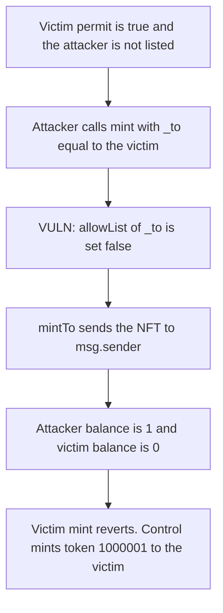

# Fantium — mint can clear another user's allow-list permit

> **Vulnerability classes:** vuln/access-control/missing-auth · vuln/dos/griefing

<!-- non-defihacklabs -->
<!-- source-auditvault: https://github.com/Auditware/AuditVault/blob/main/findings/28051-an-intruder-can-block-any-users-mixbytes-none-fantium-markdo.md -->
<!-- date: 2023-01 -->

## Key info

| | |
|---|---|
| **Protocol** | Fantium |
| **Finding** | MixBytes, January 2023, AuditVault 28051 |
| **Vulnerable code** | `FantiumMinterV1.mint` writes the allow list at `_to` |
| **Harm** | The victim's permit goes from 1 to 0. The attacker mints 1 NFT. The victim's mint reverts. |
| **Chain** | local synthetic (audited Ethereum contracts) |

## TL;DR

While a collection is paused, a single allow-list permit can mint, and `mint` then sets that permit to false. The permit it reads and writes is `_to`, and `_to` is not required to be the caller. An intruder who is not on the list passes the victim, takes the paused mint, and the victim can no longer mint. Changing that permit normally needs `onlyPlatformManager`.

## The vulnerable code

The report points at the permit update after `FantiumMinterV1.sol` L266. L-12 describes the same path: the allow list is checked in `mint`, and a true entry allows one mint before it is set false.

```solidity
require(!paused || allowList[collectionId][_to], "not on allow list");
uint256 thisTokenId = collectionId * 1_000_000 + 1;
allowList[collectionId][_to] = false;
// @> VULN: _to was not checked, so this mint follows a cleared permit of someone else.
fantiumNFTContract.mintTo(msg.sender, thisTokenId);
```

## Root cause

The allow-list key is an argument, not `msg.sender`. The caller chooses whose one-mint permit is consumed. The NFT is then minted to the caller.

## Preconditions

The collection is paused. The victim's permit is true. The attacker's permit is false. The attacker pays the mint price, `100000000000000` wei.

## Attack walkthrough

1. `allowList[1][victim]` is true.
2. `allowList[1][attacker]` is false.
3. The attacker calls `mint(victim, 1)`.
4. The permit of `_to` is set to false, and `mintTo` runs for `msg.sender`.
5. The attacker holds 1 NFT.
6. The victim's balance is 0. Their own `mint` reverts because the permit is gone.

Control requires `_to == msg.sender`. The intruder's call reverts. The victim mints token 1000001 and owns it. The intruder's balance stays 0.

## Diagrams



## Impact

The victim loses their only paused-collection mint. The permit goes from 1 to 0. The attacker, who was not allowed, holds 1 NFT. The victim's later mint reverts and their balance stays 0. With the sender check, the victim is the one who mints, and the intruder holds 0.

## Remediation

Do not let `mint` rewrite `allowList[_to]` unless `_to` is `msg.sender`, and do not treat an arbitrary `_to` as the allow-list subject. Permit changes that are not part of the caller's own mint should stay behind `onlyPlatformManager`.

## How to reproduce

```bash
cd 28051-an-intruder-can-block-any-users-mixbytes-none-fantium-markdo_exp
forge test -vv
```

## Sources

- AuditVault finding: https://github.com/Auditware/AuditVault/blob/main/findings/28051-an-intruder-can-block-any-users-mixbytes-none-fantium-markdo.md
- MixBytes report: https://github.com/mixbytes/audits_public/blob/master/Fantium/Fantium/README.md
- Audited file: `contracts/FantiumMinterV1.sol` at `cb2d97bc30c40321991fe5ab8fc798babba1610f` L266
